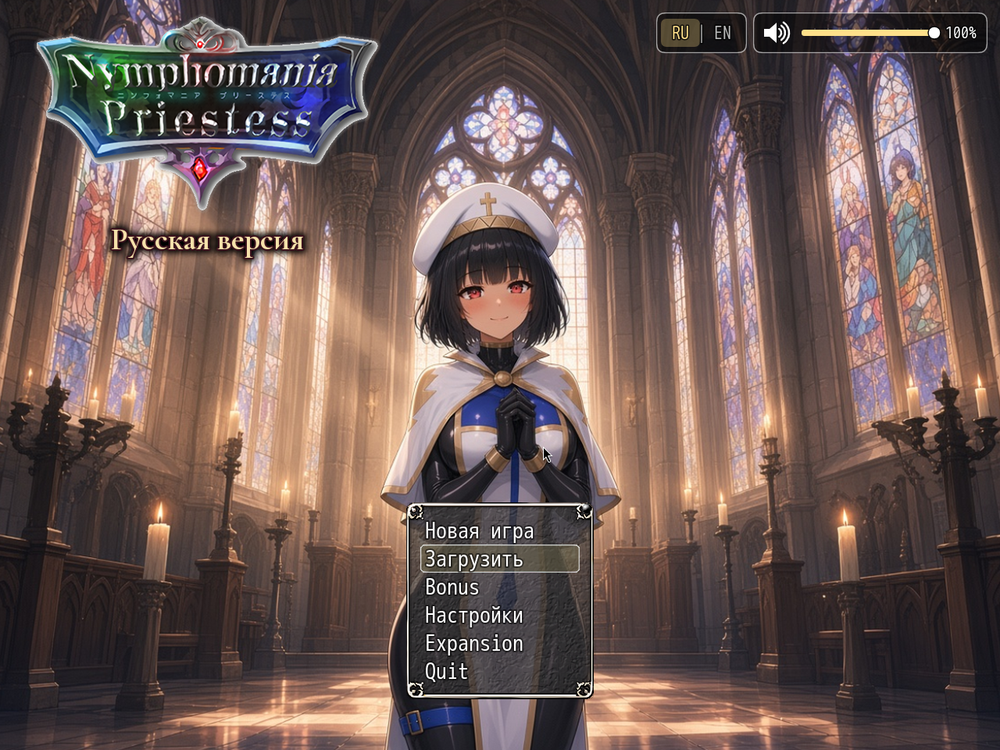

# NymPri plugins (RU mod)


Personal plugin pack for the Russian mod of **Nymphomania Priestess** (adult RPG Maker MV). Not affiliated with the original publisher.

Companion russifier (translation + language switch only): [nympri-ru](https://github.com/posolware1/nympri-ru)



## Requirements

- Game **Alpha 0.80j** with a working `www` folder (English original or the RU patch).
- These scripts hook MEO / KNS / YEP Item Core / DreamX — keep the rest of the mod data in place.

## Install (Windows)

1. Download this repo as a ZIP (**Code → Download ZIP**) and unpack it.
2. Double-click `install.bat` **or** run:
   ```bat
   install.bat "C:\path\to\game\www"
   ```
   (Python 3 required. The script copies `.js` files, optional `assets/`, and patches `plugins.js`.)
3. Start the game.

Manual fallback (no Python): copy every `plugins/NP_*/NP_*.js` into `www/js/plugins/`, copy each `plugins/*/assets/` into `www/` (keep `img/`, `movies/`, …), then run `python install.py "www"` on a machine that has Python — or edit `plugins.js` using `install/plugins_order.txt` (`NP_Language` right after `MEO_Util_Node`, other NP_* at the end, `NP_OptionsCategories` last).

## Plugins by category

Categories are for browsing only. **Load order is separate** — see `install/plugins_order.txt`.

### Language

- [NP_Language](plugins/NP_Language/) — Title + Options switch Russian/English, then reload.
- [NP_OptionsCategories](plugins/NP_OptionsCategories/) — Options grouped: Sound, Battle, Mechanics, Interface, Language, Other.

### UI

- [NP_TitleVolume](plugins/NP_TitleVolume/) — Speaker + 0–100 music slider on the title screen.
- [NP_TitleProgress](plugins/NP_TitleProgress/) — Title art/music advance with furthest Yarizo bond.
- [NP_MenuLayout](plugins/NP_MenuLayout/) — Pause screen: party cards, quest panel, commands under More.
- [NP_LogToggle](plugins/NP_LogToggle/) — Map log fades during messages; L/D collapses it.
- [NP_UIColors](plugins/NP_UIColors/) — Option recolours quests, items, shop, logs.
- [NP_SaveThumb](plugins/NP_SaveThumb/) — Save slots show map thumb, chapter, quest, priestess stage.
- [NP_ShopCompare](plugins/NP_ShopCompare/) — Buy screen: current → new stats in green/red.
- [NP_LevelAllocation](plugins/NP_LevelAllocation/) — After level-up, spend every new point on one screen.
- [NP_BattleHUD](plugins/NP_BattleHUD/) — Party cards: face, HP/MP, fatigue, super, stress, icons.
- [NP_BattleCmd](plugins/NP_BattleCmd/) — Two-column icon+label battle commands; gold when super ready.
- [NP_EnemyHUD](plugins/NP_EnemyHUD/) — Enemy card: name, HP, effect chips; F6 for details.
- [NP_PictureAnim](plugins/NP_PictureAnim/) — Shown pictures can sway/breathe/laugh; face stays rigid.
- [NP_VideoPortrait](plugins/NP_VideoPortrait/) — Looping movie where a standing portrait would be.

### Battle

- [NP_FastBattle](plugins/NP_FastBattle/) — Option: shorter battle waits, no dice pictures.
- [NP_BattleQoL](plugins/NP_BattleQoL/) — Shift = ×2 battle speed; Autobattle = plain Attack.
- [NP_PowerStrike](plugins/NP_PowerStrike/) — Battle command: three timed minigames, then a damage multiplier.
- [NP_SuperAttack](plugins/NP_SuperAttack/) — Supers for priestess, Yarizo, Potion Maker, vampire princess.
- [NP_BossBalance](plugins/NP_BossBalance/) — Boss phases, stun limits, difficulty scaling.
- [NP_RareMobs](plugins/NP_RareMobs/) — Starred rares + bestiary of silhouettes, omens, loot.
- [NP_EliteMobs](plugins/NP_EliteMobs/) — Six extra starred encounters; 25% rare roll, one per map entry.
- [NP_EliteRewards](plugins/NP_EliteRewards/) — Permanent trophies from the six new rares.
- [NP_EliteSprites](plugins/NP_EliteSprites/) — Own character sheets for the six newer rares.
- [NP_ClothDamage](plugins/NP_ClothDamage/) — Hits tear basic vestments across three picture levels.
- [NP_Stress](plugins/NP_Stress/) — Party stress 0–100, traits, temple service to lock/clear them.
- [NP_Voice](plugins/NP_Voice/) — Option: short sighs/gasps/moans from shipped audio.

### Quests

- [NP_QuestMarker](plugins/NP_QuestMarker/) — Blinking «!» on the current quest target (or the exit to it).
- [NP_QuestHints](plugins/NP_QuestHints/) — Quest detail line «Where to go: …» when known.
- [NP_QuestTabs](plugins/NP_QuestTabs/) — Journal tabs: Story / Side / Completed.
- [NP_YarizoQuest](plugins/NP_YarizoQuest/) — Quest tracks where Yarizo is and places the marker.
- [NP_SouthGateQuest](plugins/NP_SouthGateQuest/) — From guild rank 2: 200 G delivery at the southern checkpoint.
- [NP_MorningHints](plugins/NP_MorningHints/) — After a night away, the hero notices something small next map.
- [NP_BondHints](plugins/NP_BondHints/) — Map log: which bond gate was reached and where to sleep next.
- [NP_RemovedQuestCompat](plugins/NP_RemovedQuestCompat/) — Cleans leftover events/items of three removed quests in old saves.

### Content

- [NP_PriestessDiary](plugins/NP_PriestessDiary/) — Heart page of meters + key-item diary of unlocked entries.
- [NP_Titles](plugins/NP_Titles/) — Menu «Titles»: unlock, equip one, small priestess stat bonus.
- [NP_Campfire](plugins/NP_Campfire/) — Some nights: short talk before sleep.
- [NP_CampSkills](plugins/NP_CampSkills/) — Before nightly talk: spend camp/inn points on rest skills.
- [NP_OutfitReact](plugins/NP_OutfitReact/) — On revealing outfits, Yarizo sometimes speaks; she answers in a slide.
- [NP_Items](plugins/NP_Items/) — Companion gear, cursed items, DreamX affixes, Holy Water.
- [NP_ItemNameFix](plugins/NP_ItemNameFix/) — Renames independent weapon copies from the live database.
- [NP_AudioBalance](plugins/NP_AudioBalance/) — One option caps BGM/BGS/SE/ME loudness; fills silent maps.

### Misc

- [NP_AutoSave](plugins/NP_AutoSave/) — Autosave on map transfers, after sleep, and before bosses.

## Language switch

`NP_Language` adds **RU | EN** on the title screen and in Options. For CSV translation data use [nympri-ru](https://github.com/posolware1/nympri-ru).

## Dev notes

See [docs/dev.md](docs/dev.md). Russian readme: [README.ru.md](README.ru.md).
