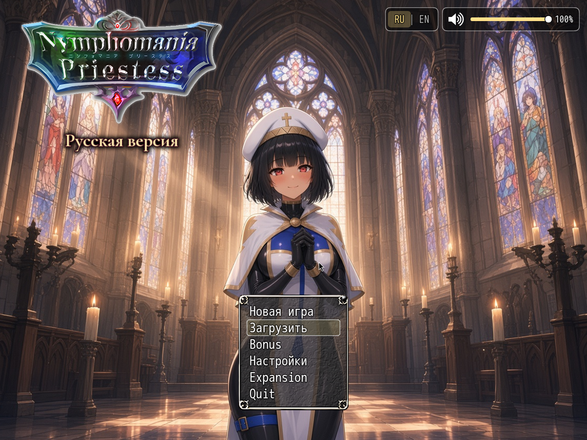

# Плагины мода NymPri (RU)


Личный набор плагинов русского мода **Nymphomania Priestess** (RPG Maker MV, 18+). Не связан с издателем оригинала.

Только перевод + переключатель языка: [nympri-ru](https://github.com/posolware1/nympri-ru)



Кнопка RU | EN — `NP_Language`. Динамик и ползунок — `NP_TitleVolume`.

## Требования

- Игра **Alpha 0.80j для Windows** с рабочей папкой `www` (английская сборка или RU-патч). На Linux этот набор не рассчитан: у самой игры часть путей в разном регистре (`TB_NPCstate` и `TB_NPCState.js`, `img/pictures/ui` и `UI`). Это не недостающие файлы NP, и установщик не добавляет алиасы регистра или чужой интерфейс.
- Скрипты цепляются к MEO / KNS / YEP Item Core / DreamX — остальной мод не убирайте.
- Python 3 нужен только чтобы запустить установщик.
- Полный английский текст CSV и базы — отдельная загрузка: [nympri-ru](https://github.com/posolware1/nympri-ru). Без `www/lang/en/build_info.json` и `data_overlay.json` `NP_Language` остаётся на русском и пишет об этом. Эти файлы отсюда не копируются.
- Два звука CC0 нужны скриптам и уже в комплекте: треск костра (`NP_AudioBalance` и `NP_CampSkills`) и разрыв ткани (`NP_AudioBalance`). `Rain.ogg` тоже в комплекте (CC0) — его имя просит событие игры, не скрипт. Авторство после установки: `audio/CREDITS_NP_CC0.txt`.

## Установка (Windows)

1. Скачайте ZIP репозитория (**Code → Download ZIP**) и распакуйте.
2. Запустите `install.bat` **или**:
   ```bat
   install.bat "C:\путь\к\игре\www"
   ```
   (Нужен Python 3. Скрипт копирует `.js`, при наличии `assets/`, и правит `plugins.js`.)
3. Запустите игру.

Установщик копирует скрипты и `assets/` (картинки, ролики, три звука CC0) и записывает `www/js/plugins.js`. `NP_Language` ставится сразу после `MEO_Util_Node`. Остальные NP — одним блоком в конце, `NP_OptionsCategories` последний. Повторный запуск не дублирует записи. Перед первым изменением сохраняется `plugins.js.bak`.

Предупреждения про отсутствующий nympri-ru и про необязательные имена звуков установку не отменяют. ffmpeg не нужен.

Без Python: скопируйте каждый `plugins/NP_*/NP_*.js` в `www/js/plugins/`, содержимое `plugins/*/assets/` — в `www/` (пути `img/`, `movies/`, `audio/`…), затем на машине с Python: `python install.py "www"`. Порядок в `plugins.js` — `install/plugins_order.txt`.

### Необязательные имена звуков

Часть событий игры просит имена файлов, которых в 0.80j не было. Пятьдесят таких имён можно собрать из **ваших** файлов игры:

```bat
python install.py "C:\путь\к\игре\www" --repair-audio
```

Восемь — точные копии. Сорок два нужно перекодировать через ffmpeg, чтобы поправить громкость. Совпадение байт со старой сборкой не обещается. Без ffmpeg эти сорок два пропускаются. `--degraded-copy` копирует их как есть и **не** повторяет старую громкость. Уже лежащие файлы не перезаписываются. Обычная установка это не делает, и эти файлы не CC0.

Девять пересведённых файлов со старыми именами, включая откровенные эффекты, сюда не входят. Полного совпадения со старой звуковой сборкой без этой отдельной работы нет, и этот набор её не делает.

## Плагины по категориям

Категории — только для навигации. **Порядок загрузки отдельный** — `install/plugins_order.txt`.

### Язык

- [NP_Language](plugins/NP_Language/) — Кнопка на титуле и пункт в настройках: RU ↔ EN, затем перезапуск.
- [NP_OptionsCategories](plugins/NP_OptionsCategories/) — Настройки по разделам: Звук, Бой, Механики, Интерфейс, Язык, Прочее.

### Интерфейс

- [NP_TitleVolume](plugins/NP_TitleVolume/) — Динамик и ползунок музыки 0–100 на титуле.
- [NP_TitleProgress](plugins/NP_TitleProgress/) — Фон и музыка титула сдвигаются по связи с Яризо.
- [NP_MenuLayout](plugins/NP_MenuLayout/) — Пауза: карточки отряда, задание, команды в «Ещё».
- [NP_LogToggle](plugins/NP_LogToggle/) — Журнал карты гаснет на сообщениях; L/D сворачивает.
- [NP_UIColors](plugins/NP_UIColors/) — Опция перекрашивает задания, вещи, лавку, журналы.
- [NP_SaveThumb](plugins/NP_SaveThumb/) — Слоты: снимок карты, глава, задание, стадия жрицы.
- [NP_ShopCompare](plugins/NP_ShopCompare/) — В лавке: «сейчас → станет» зелёным/красным.
- [NP_LevelAllocation](plugins/NP_LevelAllocation/) — После уровня — все новые очки на одном экране.
- [NP_BattleHUD](plugins/NP_BattleHUD/) — Карточки отряда: лицо, HP/MP, усталость, супер, напряжение.
- [NP_BattleCmd](plugins/NP_BattleCmd/) — Команды боя: две колонки «иконка + подпись».
- [NP_EnemyHUD](plugins/NP_EnemyHUD/) — Карточка врага: имя, HP, эффекты; F6 — подробности.
- [NP_PictureAnim](plugins/NP_PictureAnim/) — Картинка может дышать/качаться; лицо не искажается.
- [NP_VideoPortrait](plugins/NP_VideoPortrait/) — Зацикленное видео на месте портрета.

### Бой

- [NP_FastBattle](plugins/NP_FastBattle/) — Опция: короче паузы боя, без картинок кубиков.
- [NP_BattleQoL](plugins/NP_BattleQoL/) — Shift = ×2; автобой = обычная атака.
- [NP_PowerStrike](plugins/NP_PowerStrike/) — Команда боя: три мини-игры и множитель урона.
- [NP_SuperAttack](plugins/NP_SuperAttack/) — Суперы у жрицы, Яризо, Зельеварки и принцессы-вампира.
- [NP_BossBalance](plugins/NP_BossBalance/) — Фазы боссов, предел оглушения, масштаб сложности.
- [NP_RareMobs](plugins/NP_RareMobs/) — Редкие со звездой и бестиарий.
- [NP_EliteMobs](plugins/NP_EliteMobs/) — Шесть новых редких; шанс 25%, один на вход в карту.
- [NP_EliteRewards](plugins/NP_EliteRewards/) — Постоянные трофеи с шести новых редких.
- [NP_EliteSprites](plugins/NP_EliteSprites/) — Свои листы персонажей у новых редких.
- [NP_ClothDamage](plugins/NP_ClothDamage/) — Удары рвут базовое облачение на трёх уровнях картинки.
- [NP_Stress](plugins/NP_Stress/) — Напряжение 0–100, черты, храмовая служба.
- [NP_Voice](plugins/NP_Voice/) — Опция: короткие вздохи/стоны из штатного звука.

### Задания

- [NP_QuestMarker](plugins/NP_QuestMarker/) — Мигающий «!» на цели задания или на выходе к ней.
- [NP_QuestHints](plugins/NP_QuestHints/) — Строка «Куда идти: …» в подробностях задания.
- [NP_QuestTabs](plugins/NP_QuestTabs/) — Вкладки журнала: Сюжет / Побочные / Выполненные.
- [NP_YarizoQuest](plugins/NP_YarizoQuest/) — Задание следит, где Яризо, и ставит метку.
- [NP_SouthGateQuest](plugins/NP_SouthGateQuest/) — С ранга 2: доставка за 200 G на южной заставе.
- [NP_MorningHints](plugins/NP_MorningHints/) — После ночной отлучки герой замечает мелочь на следующей карте.
- [NP_BondHints](plugins/NP_BondHints/) — Журнал карты: какой порог связи и где ночевать дальше.
- [NP_RemovedQuestCompat](plugins/NP_RemovedQuestCompat/) — Чистит остатки трёх убранных заданий в старых сейвах.

### Контент

- [NP_PriestessDiary](plugins/NP_PriestessDiary/) — Страница «♥» и дневник открытых записей.
- [NP_Titles](plugins/NP_Titles/) — Меню «Титулы»: открыть, надеть, небольшой бонус жрице.
- [NP_Campfire](plugins/NP_Campfire/) — В некоторые ночи — короткий разговор перед сном.
- [NP_CampSkills](plugins/NP_CampSkills/) — Перед ночным разговором: умения отдыха за очки лагеря/гостиницы.
- [NP_OutfitReact](plugins/NP_OutfitReact/) — В откровенном наряде Яризо иногда говорит; ответ слайдом.
- [NP_Items](plugins/NP_Items/) — Оружие спутников, проклятые вещи, аффиксы, святая вода.
- [NP_ItemNameFix](plugins/NP_ItemNameFix/) — Переименовывает независимые копии оружия из текущей БД.
- [NP_AudioBalance](plugins/NP_AudioBalance/) — Опция ограничивает громкость; тихие карты получают звук.

### Прочее

- [NP_AutoSave](plugins/NP_AutoSave/) — Автосейв при переходах, после сна и перед боссами.

## Язык

`NP_Language` даёт кнопку **RU | EN** на титуле и в настройках. CSV-перевод: [nympri-ru](https://github.com/posolware1/nympri-ru).

## Для разработчиков

[docs/dev.md](docs/dev.md). English: [README.md](README.md).
