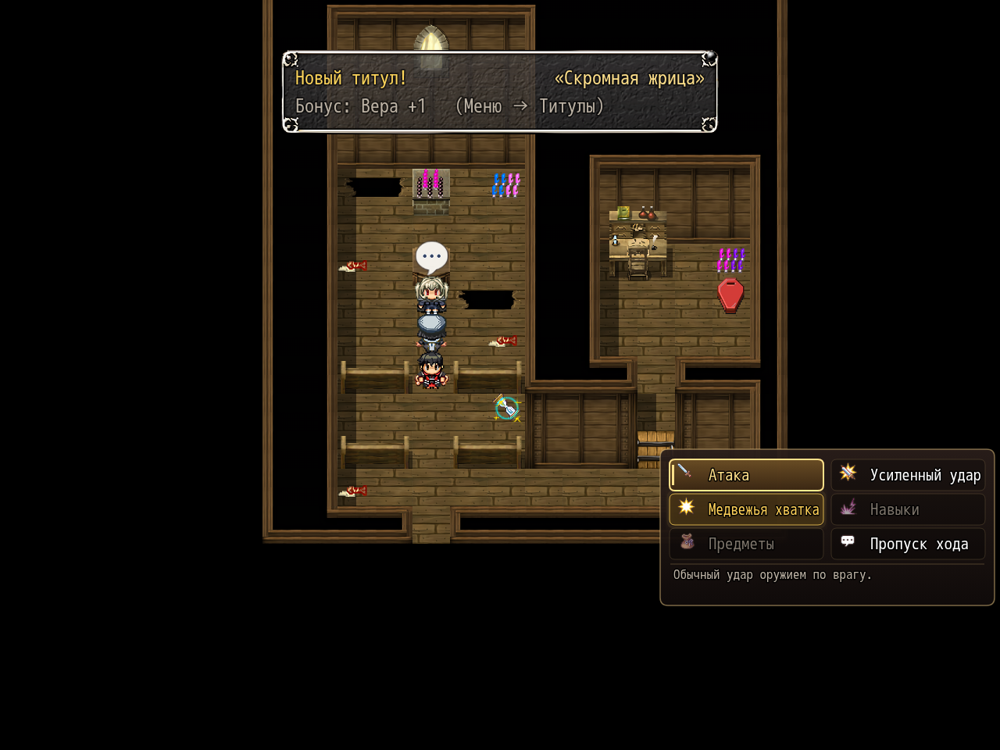

# NP_BattleCmd

## Title

Two-column battle command menu with a hint line.

## Version

0.1, marked as a prototype in `@plugindesc`.

## Purpose

When switch 14 is on and the choice list is a battle command list (it contains the attack icon), the window is redrawn as two columns. Each row is an icon and a label. A line under the list explains the highlighted command. Conditions, enabled state, and event branches are not changed.

Labels and hints the script knows:

- Attack, Power Strike (the QTE), Super (gold when the bar is full, otherwise why it is locked), Skills, Items, Guard (or a note that a shield is required), Wait, Auto battle, Escape, Struggle.
- A cut-in toggle when that choice is present.

A disabled row says it is unavailable, and for attack, power strike, skills, and items it keeps the original reason.

## Load order

After `MPP_ChoiceEX`, `MNKR_ChoiceCols`, `NP_PowerStrike`, `NP_BattleQoL`, `NP_SuperAttack`, and `NP_BattleHUD`. In the mod list it is immediately after `NP_BattleHUD` and before `NP_Items`. Before `NP_OptionsCategories`. It only restyles the battle command choice (common events 365 and 366). Other choices are left alone.

## Parameters

No Plugin Manager parameters. Options row **Новое меню команд / New command menu**.

## Requires

Windows **Alpha 0.80j**. From the downloaded ZIP, run `install.bat` and give it the game `www` folder. README categories are not the load order.

## Install

Copy `NP_BattleCmd.js` into the game's `www/js/plugins/` directory. The file name must stay `NP_BattleCmd.js`. In Plugin Manager, turn it ON in the order in [Load order](#load-order). RPG Maker MV loads plugins from `www/js/plugins/`, not from this repository's `plugins/NP_BattleCmd/` folder.

## Screenshots

Battle commands as icon plus label. Party cards and the enemy HP window are on the same frame. This does not show a super attack playing.

A super command is visible in the battle menu. The move itself is not shown.
