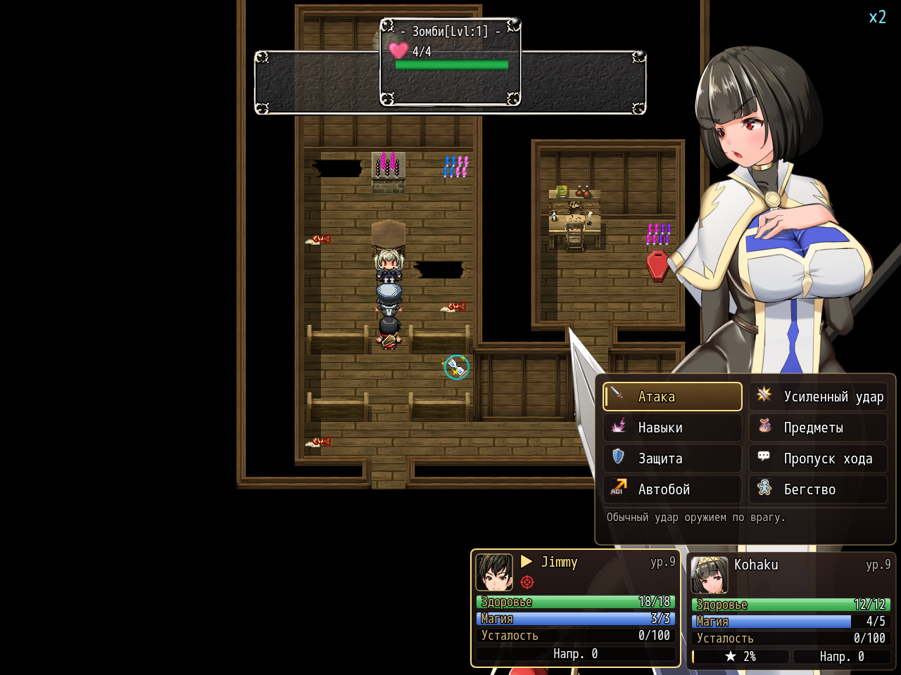
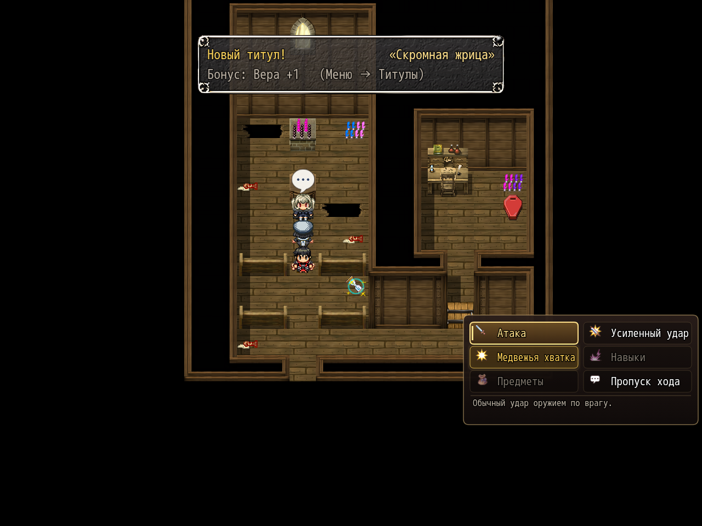

# NP_BattleCmd

## Название

Меню команд боя в две колонки и строка подсказки.

## Версия

0.1, в `@plugindesc` помечена как прототип.

## Назначение

Когда переключатель 14 включён и список выбора — это команды боя (в нём есть иконка атаки), окно перерисовывается в две колонки. Строка — иконка и подпись. Под списком пояснение к команде под курсором. Условия, доступность и ветки событий не меняются.

Подписи и подсказки, которые скрипт знает:

- Атака, Усиленный удар (QTE), Супер (золотом, когда шкала полна, иначе почему он закрыт), Навыки, Предметы, Защита (или пометка, что нужен щит), Пропуск хода, Автобой, Бегство, Вырваться.
- Смена кат-ина, если такой пункт есть.

Недоступная строка так и подписана, а у атаки, усиленного удара, навыков и предметов сохраняется исходная причина.

## Порядок загрузки

После `MPP_ChoiceEX`, `MNKR_ChoiceCols`, `NP_PowerStrike`, `NP_BattleQoL`, `NP_SuperAttack` и `NP_BattleHUD`. В списке мода сразу после `NP_BattleHUD` и перед `NP_Items`. До `NP_OptionsCategories`. Перерисовывает только выбор боевых команд (общие события 365 и 366). Остальные выборы не трогает.

## Параметры

Параметров в менеджере плагинов нет. Пункт **Новое меню команд**.

## Требования

Windows, **Alpha 0.80j**. Из скачанного ZIP запустите `install.bat` и укажите папку `www` игры. Категории в общем README — не порядок загрузки.

## Установка

Скопируйте `NP_BattleCmd.js` в `www/js/plugins/` игры. Имя файла должно остаться `NP_BattleCmd.js`. В менеджере плагинов включите его в порядке из раздела [Порядок загрузки](#порядок-загрузки). RPG Maker MV читает плагины из `www/js/plugins/`, а не из папки `plugins/NP_BattleCmd/` в этом репозитории.

## Скриншоты

Старый игровой кадр. Это не новый снимок этой ревизии, и для этой правки игру не запускали.

Команды боя: иконка и подпись. На том же кадре карточки отряда и окно HP врага. Это не воспроизведение суперудара.

В меню боя видна команда супера. Сам удар на кадре не показан.
