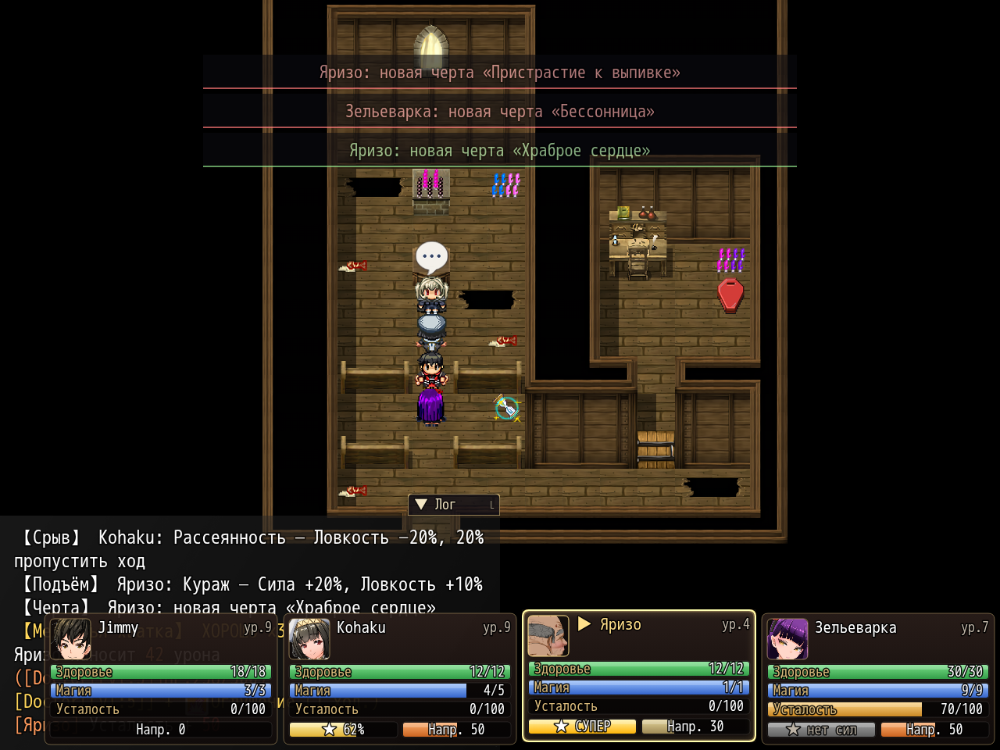

# NP_BattleHUD

## Title

Compact party cards in battle.

## Version

1.2 (`@plugindesc`).

## Purpose

While the option is on, switch 14 is on, the gallery is off, and a super QTE is not playing, the three MEO party windows (`WindowMC`, `WindowFeMC`, `WindowFollower`) are replaced by a row of cards along the bottom. The enemy window is not touched. Up to four actors are taken from the party, using the same visibility as the original windows, plus a fourth member when one exists.

Each card shows:

- A cropped face from `img/pictures/battle/c_window_actorN.png`.
- Bars for health, magic, and fatigue.
- The super-charge bar from `NP_SuperAttack` and the stress value from `NP_Stress`, including break cracks and rally glow, moved off the old floating bars.
- Effect chips for states, parameter buffs, camp buffs, and the current stress affliction. Overflow becomes a `+N` chip.
- A tooltip near the card when the pointer is on a chip: name, what it does, and how long it lasts.

The active actor is highlighted. Cards are about 300×204 and sit in the bottom-right of a 1280-wide screen, shrinking to fit.

## Load order

After `NP_Stress` and `NP_SuperAttack` (in the mod list, after `NP_ItemNameFix` and before `NP_BattleCmd`). Before `NP_OptionsCategories`. It replaces the MEO combat status windows and hides the separate stress and super bars so it can draw them on the card.

## Parameters

No Plugin Manager parameters. Options row **Компактная панель боя / Compact battle panel**, category Interface, default on.

## Requires

Windows **Alpha 0.80j**. From the downloaded ZIP, run `install.bat` and give it the game `www` folder. README categories are not the load order.

## Install

Copy `NP_BattleHUD.js` into the game's `www/js/plugins/` directory. The file name must stay `NP_BattleHUD.js`. In Plugin Manager, turn it ON in the order in [Load order](#load-order). RPG Maker MV loads plugins from `www/js/plugins/`, not from this repository's `plugins/NP_BattleHUD/` folder.

## Screenshots

Older in-game frame. It is not a new capture of this revision, and the game was not launched for this change.

Party cards are visible beside the command list and the enemy window. Older frame.

Four party cards are also visible on this stress-traits frame. Older frame.
