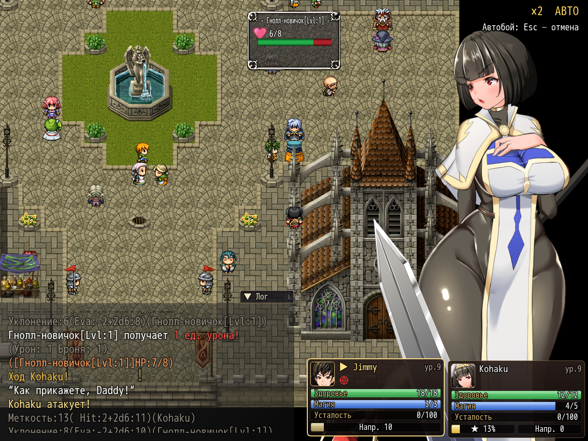

# NP_BattleQoL

## Title

Battle speed ×2 and an auto-attack command.

## Version

Not numbered in `@plugindesc`.

## Purpose

Options row **Скорость боя ×2 / Battle speed ×2**, also toggled with Shift during battle. While switch 14 is on, map logic (waits, pictures, screen effects), battle animations, and message text step twice per frame. A label in the top-right corner shows `×2`.

The hero's command list (common event 365) gains **Автобой / Auto battle** next to Wait. It is hidden in boss fights (switch 15) and in no-escape story fights (switch 85). While it is on, every party command menu picks the plain Attack, the first command: no skills, items, or lewd actions. Empty log pauses of the battle mechanics advance on their own. Other events, including grapples and dialogue, still wait for the player.

Cancel with Escape, X, right click, or Shift+Escape. Auto turns itself off when the battle ends, a boss or no-escape switch comes on, or Attack is not available. The corner label shows **АВТО / AUTO** and a short toast when the mode changes.

## Load order

After `NP_ShopCompare`, before `NP_SuperAttack`. Independent of `NP_FastBattle`. `NP_BattleCmd` should load after this script so the auto command gets an icon label. `NP_SuperAttack` refuses to offer supers while auto battle is on.

## Parameters

- **Speed Key** `16` — Shift.
- **Auto Icon** `38`.
- **Battle Switch** `14`.

## Requires

Windows **Alpha 0.80j**. From the downloaded ZIP, run `install.bat` and give it the game `www` folder. README categories are not the load order.

## Install

Copy `NP_BattleQoL.js` into the game's `www/js/plugins/` directory. The file name must stay `NP_BattleQoL.js`. In Plugin Manager, turn it ON in the order in [Load order](#load-order). RPG Maker MV loads plugins from `www/js/plugins/`, not from this repository's `plugins/NP_BattleQoL/` folder.

## Screenshots

Older in-game frame. It is not a new capture of this revision, and the game was not launched for this change.

The corner reads battle speed and autobattle. Older frame.
