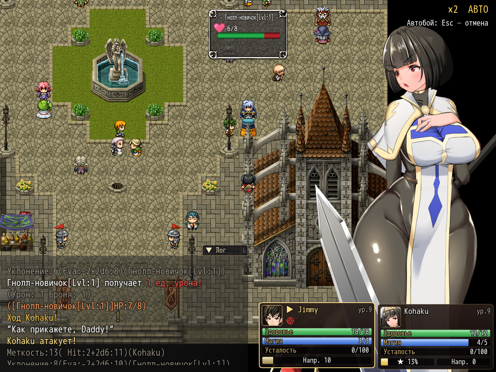

# NP_BattleQoL

## Название

Скорость боя ×2 и команда автобоя.

## Версия

В `@plugindesc` номера нет.

## Назначение

Пункт настроек **Скорость боя ×2**, его же переключает Shift в бою. Пока включён переключатель 14, логика карты (ожидания, картинки, эффекты экрана), боевые анимации и текст сообщений шагают дважды за кадр. В правом верхнем углу подпись `×2`.

В список команд героя (общее событие 365) рядом с ожиданием добавляется **Автобой**. В боях с боссом (переключатель 15) и в сюжетных боях без побега (переключатель 85) команды нет. Пока режим включён, меню каждого члена отряда выбирает обычную атаку, первую команду: без навыков, предметов и похабных действий. Пустые паузы журнала боевой механики листаются сами. Остальные события, включая захваты и диалоги, по-прежнему ждут игрока.

Отмена: Escape, X, правая кнопка или Shift+Escape. Автобой сам выключается в конце боя, когда включается босс или запрет побега, и если атака недоступна. Угловая подпись показывает **АВТО**, а смена режима — короткой всплывашкой.

## Порядок загрузки

После `NP_ShopCompare`, перед `NP_SuperAttack`. От `NP_FastBattle` не зависит. `NP_BattleCmd` ставьте после, чтобы команда автобоя получила подпись. `NP_SuperAttack` не предлагает суперы, пока автобой включён.

## Параметры

- **Speed Key** `16` — Shift.
- **Auto Icon** `38`.
- **Battle Switch** `14`.

## Требования

Windows, **Alpha 0.80j**. Из скачанного ZIP запустите `install.bat` и укажите папку `www` игры. Категории в общем README — не порядок загрузки.

## Установка

Скопируйте `NP_BattleQoL.js` в `www/js/plugins/` игры. Имя файла должно остаться `NP_BattleQoL.js`. В менеджере плагинов включите его в порядке из раздела [Порядок загрузки](#порядок-загрузки). RPG Maker MV читает плагины из `www/js/plugins/`, а не из папки `plugins/NP_BattleQoL/` в этом репозитории.

## Скриншоты

Старый игровой кадр. Это не новый снимок этой ревизии, и для этой правки игру не запускали.

В углу видны скорость боя и автобой. Старый кадр.
