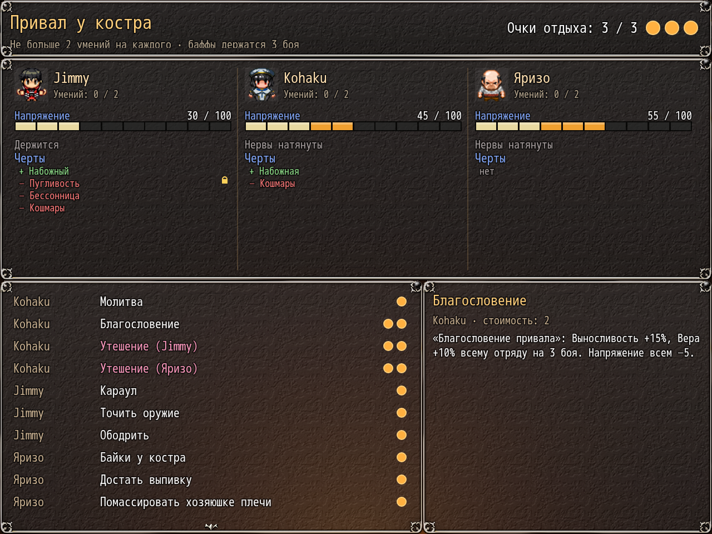

# NP_CampSkills

## Title

Camp and inn rest menu with limited points.

## Version

1.1 (`@plugindesc`).

## Purpose

The menu opens before the campfire talk. Camp (common event 474) gives 2 points. An inn (common event 325) gives 4 points and only the peaceful skills, the ones marked usable indoors. Each actor can be picked at most twice, and each skill once per rest. Buffs last 3 battles unless a skill says otherwise. It does not open when the option is off, in the gallery, in battle, on a story rest, solo, while the priestess is confined, or on the world map.

On a normal load outside an event it also clears a stuck patch-view flag (switch 192) that could block the rest menu forever.

Skills on the list, with the cost in points:

- Priestess: Prayer (1, heal 30% HP, cure poison, exhaustion, hangover, stress down, 25% to pray away one bad trait), Blessing (2, endurance and faith for 3 battles), Comfort with the hero (2, stage at least 2), Comfort with Yarizo (2, stage at least 2 and the NTR route).
- Hero: Night Watch (1, camp only, no ambush, fatigue recovery in the morning), Sharpen Weapon (1, strength for 3 battles), Encourage (1, stronger if love is at least 30).
- Yarizo: Campfire Tales (1, dexterity for 3 battles; war stories with the hero present, dirtier ones without), Break Out the Booze (1, fatigue, HP, stress, 25% hangover), shoulder rub (1).
- Potion Maker, when she is in the party: Brew a Potion (2, two small potions; bond 3 upgrades one), Gather Herbs (1, camp only), Invigorating Brew (1), Special Brew (2, bond at least 3).
- Vampire princess, when she is in the party: Night Vigil (1, camp only, no ambush), Bat Swarm (1, camp only, one-battle dexterity and a chance of gold), A Drop of Noble Blood (2, max HP and endurance for 2 battles).

The adult skills change lust, love, depravity, or a night-away counter and then return to the menu. They do not replace the game's own scenes.

## Load order

After `NP_Stress`, before `NP_YarizoQuest`. It opens before `NP_Campfire`'s talk, inside common events 474 and 325. Needs `NP_Stress` for the stress lines on each skill.

## Parameters

- **CampBgm** `Theme_-_Wayfarers_Path` — camp menu music. Empty leaves the current BGM.
- **CampBgs** `NP_Campfire_Crackle` — camp menu ambience. Empty means silence.
- **InnBgm** `PerituneMaterial_Taverne_loop` — inn rest music.

## Requires

Windows **Alpha 0.80j**. From the downloaded ZIP, run `install.bat` and give it the game `www` folder. README categories are not the load order.

The camp ambience file `audio/bgs/NP_Campfire_Crackle.ogg` is the CC0 sound shipped with NP_AudioBalance and copied by the same installer.

## Install

Copy `NP_CampSkills.js` into the game's `www/js/plugins/` directory. The file name must stay `NP_CampSkills.js`. In Plugin Manager, turn it ON in the order in [Load order](#load-order). RPG Maker MV loads plugins from `www/js/plugins/`, not from this repository's `plugins/NP_CampSkills/` folder.

## Screenshots

The camp-skill list is visible with the camp conversation.
