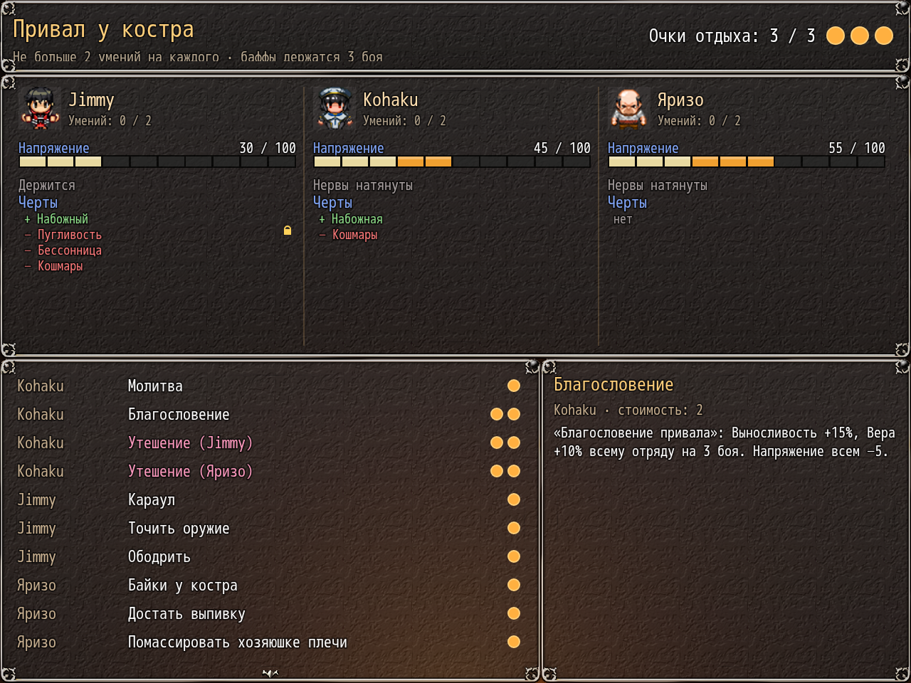

# NP_CampSkills

## Название

Меню умений на привале с очками отдыха.

## Версия

1.1 (`@plugindesc`).

## Назначение

Меню открывается перед разговором у костра. Лагерь (общее событие 474) даёт 2 очка. Гостиница (общее событие 325) даёт 4 очка и только мирные умения, помеченные как допустимые в помещении. Каждого можно выбрать не больше двух раз, каждое умение — один раз за отдых. Баффы длятся 3 боя, если у умения не сказано иначе. Меню не открывается, если опция выключена, в галерее, в бою, на сюжетном отдыхе, в соло, пока жрица в плену, и на карте мира.

При обычной загрузке вне события снимается застрявший флаг просмотра патчей (переключатель 192), который мог навсегда блокировать меню отдыха.

Умения в списке и цена в очках:

- Жрица: Молитва (1, +30% HP, снимает отравление, истощение и похмелье, напряжение вниз, 25% снять одну дурную черту), Благословение (2, выносливость и вера на 3 боя), Утешение героя (2, стадия не ниже 2), Утешение Яризо (2, стадия не ниже 2 и ветка NTR).
- Герой: Караул (1, только лагерь, без засады, утром меньше усталости), Точить оружие (1, сила на 3 боя), Ободрить (1, сильнее при любви от 30).
- Яризо: Байки у костра (1, ловкость на 3 боя; с героем военные, без него сальные), Достать выпивку (1, усталость, HP, напряжение, 25% похмелья), массаж плеч (1).
- Зельеварка, если она в отряде: Сварить зелье (2, два малых зелья; связь 3 улучшает одно), Сбор трав (1, только лагерь), Бодрящий отвар (1), Особый отвар (2, связь не ниже 3).
- Принцесса-вампир, если она в отряде: Ночное бдение (1, только лагерь, без засады), Стая летучих мышей (1, только лагерь, ловкость на один бой и шанс золота), Капля благородной крови (2, макс. HP и выносливость на 2 боя).

Взрослые умения меняют похоть, любовь, развращённость или счётчик ночных отлучек и возвращают в меню. Собственные сцены игры они не подменяют.

## Порядок загрузки

После `NP_Stress`, перед `NP_YarizoQuest`. Открывается до разговора `NP_Campfire`, внутри общих событий 474 и 325. Для строк про напряжение нужен `NP_Stress`.

## Параметры

- **CampBgm** `Theme_-_Wayfarers_Path` — музыка меню в лагере. Пусто — не менять текущую.
- **CampBgs** `NP_Campfire_Crackle` — эмбиент меню в лагере. Пусто — без звука.
- **InnBgm** `PerituneMaterial_Taverne_loop` — музыка отдыха в гостинице.

## Требования

Windows, **Alpha 0.80j**. Из скачанного ZIP запустите `install.bat` и укажите папку `www` игры. Категории в общем README — не порядок загрузки.

Эмбиент привала `audio/bgs/NP_Campfire_Crackle.ogg` — CC0-файл из NP_AudioBalance, его копирует тот же установщик.

## Установка

Скопируйте `NP_CampSkills.js` в `www/js/plugins/` игры. Имя файла должно остаться `NP_CampSkills.js`. В менеджере плагинов включите его в порядке из раздела [Порядок загрузки](#порядок-загрузки). RPG Maker MV читает плагины из `www/js/plugins/`, а не из папки `plugins/NP_CampSkills/` в этом репозитории.

## Скриншоты

Старый игровой кадр. Это не новый снимок этой ревизии, и для этой правки игру не запускали.

Список умений привала виден вместе с разговором у костра. Старый кадр.
