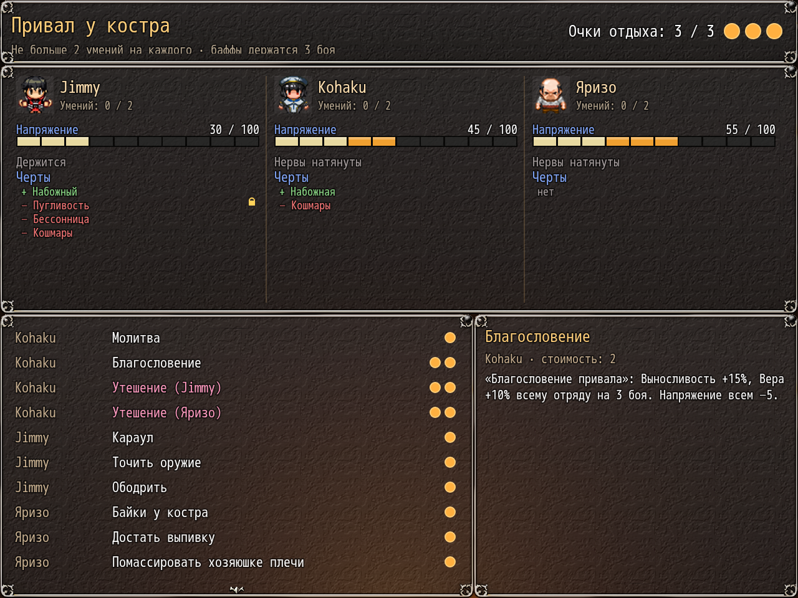

# NP_Campfire

## Название

Короткие разговоры в лагере и в гостинице.

## Версия

В `@plugindesc` номера нет. В шапке это скрипт разговоров на привале мода.

## Назначение

Перед выбором часового в лагере и перед обработкой сна в гостинице или кровати отряд может услышать короткий разговор. В лагере событие сна вызывается ещё раз позже; вторая вставка пропускается, поэтому игрок слышит один разговор.

Один и тот же разговор не играется дважды подряд, и четыре последних тоже обходятся. Реплики Яризо звучат только если он реально в отряде: договор включён, он не погиб и не уведён в порту, жив, и третий слот отряда — актёр 21. Иначе говорят герой и жрица, тон берётся из стадии дневника. С Яризо тон идёт за уровнем связи и переключателем 32.

Разговора нет в галерее, в бою, на сюжетной блокировке, в особом событии гостиницы, в соло, когда жрица в плену, и когда выключен переключатель 222.

## Порядок загрузки

После `NP_PictureAnim`, перед `NP_Titles`. Встраивается в общие события 474 (лагерь) и 325 (сон) в памяти. `NP_CampSkills` открывает своё меню до этого разговора.

## Параметры

- **Включено по умолчанию** `true` — подпись **Разговоры на привале**.
- **Шанс разговора** `40` процентов за ночь. Рост связи с прошлой ночи поднимает шанс до 85%.
- **Пауза** `2` ночёвки после разговора.

## Требования

Windows, **Alpha 0.80j**. Из скачанного ZIP запустите `install.bat` и укажите папку `www` игры. Категории в общем README — не порядок загрузки.

## Установка

Скопируйте `NP_Campfire.js` в `www/js/plugins/` игры. Имя файла должно остаться `NP_Campfire.js`. В менеджере плагинов включите его в порядке из раздела [Порядок загрузки](#порядок-загрузки). RPG Maker MV читает плагины из `www/js/plugins/`, а не из папки `plugins/NP_Campfire/` в этом репозитории.

## Скриншоты

На одном кадре разговор у костра и список умений привала. Также видны шкалы напряжения.
