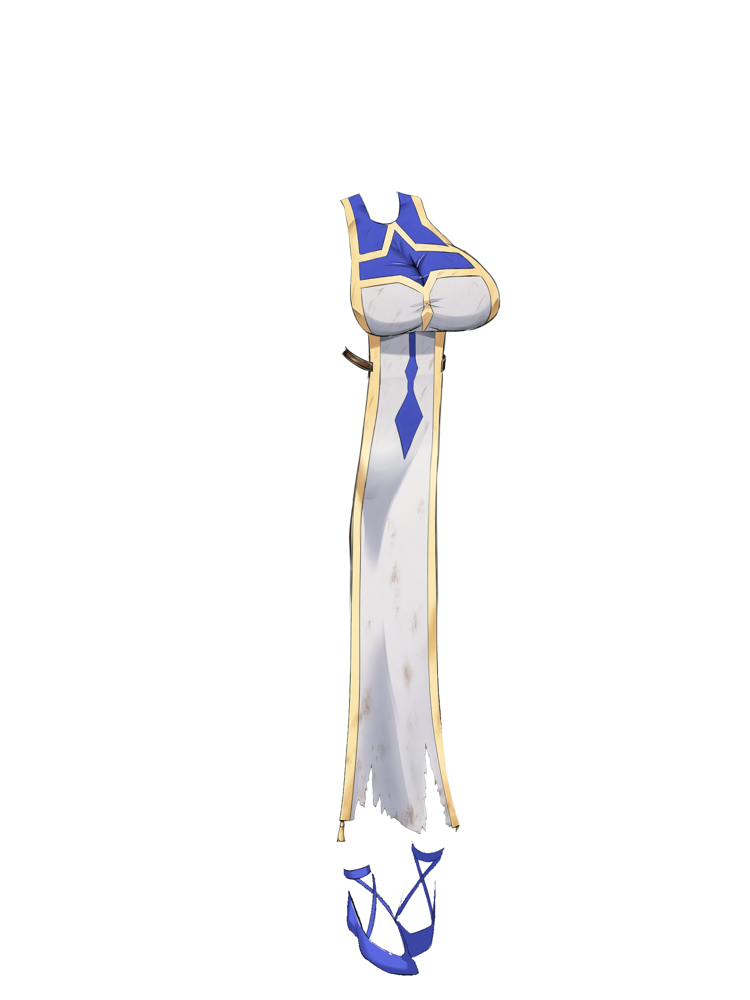
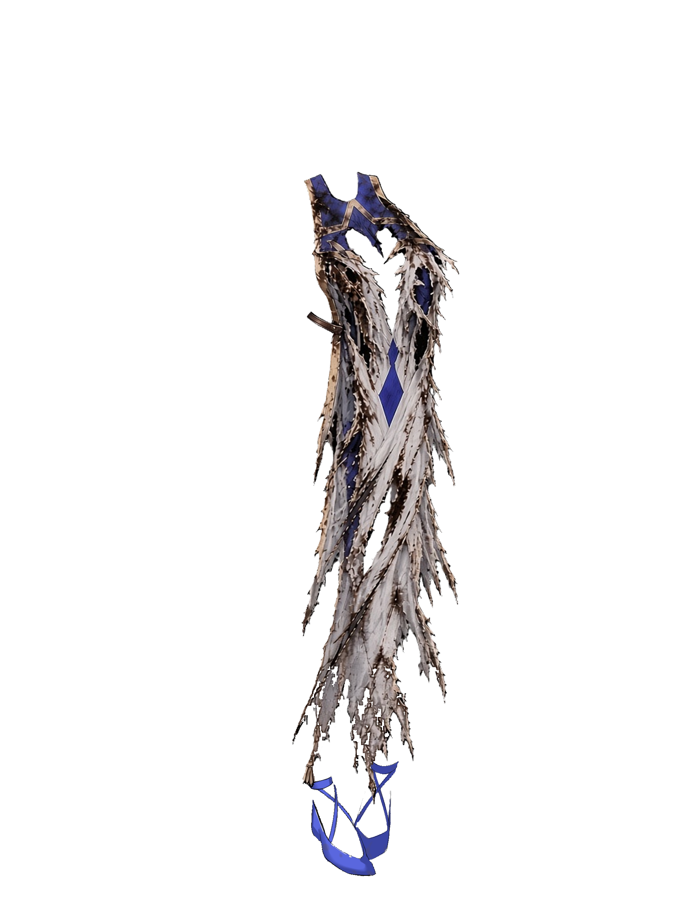
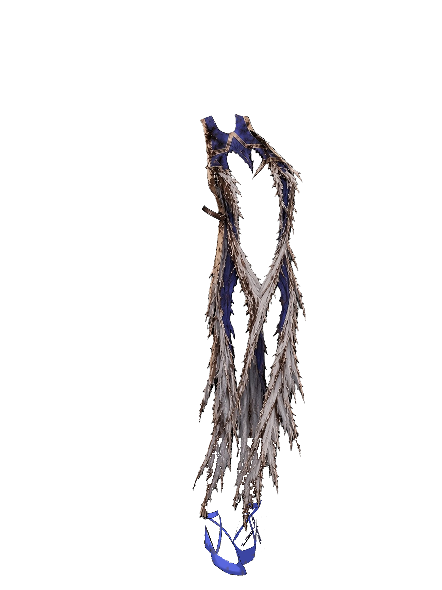

# NP_ClothDamage

## Title

Priestess vestments tear in battle and mend at rest.

## Version

Not numbered in `@plugindesc`.

## Purpose

While the priestess wears the basic vestment (armor 82, the outfit slot drawn as `stand-heroine-basic-cloth82-<variant>`), battle hits accumulate tear points. Crossing 4, 10, and 18 swaps the standing picture to a torn variant of the same pose. The picture already on screen changes immediately. `CommonEvents.json` is not edited.

Points reset to 0 on camp sleep (common event 474), inn or bed sleep (common event 325), and when the vestment is taken off and put back on outside battle. The gallery neither accumulates nor shows tears. State is `$gameSystem._npClothDmg`; old saves start at 0.

## Load order

After `NP_Titles`, before `NP_Stress`. `NP_Titles` reads the level for one title. `NP_AudioBalance` plays cues on tear and mend. Only armor 82 (the basic vestment, picture `stand-heroine-basic-cloth82`).

## Parameters

- **Enabled** `true` — Options label **Рваная одежда**.
- **Thresholds** `4,10,18` damage points for levels 1, 2, and 3.
- Points: a HP hit `1`, a crit `+2`, a hit of at least 25% max HP `+1`, an enemy skill tagged sexual or `<NP_ClothTear>` `+3` even with no HP loss.
- **LevelFiles** `t1,t2,t3` — picture suffix. Spare sets `ta` and `tb` exist in the art naming. A missing file keeps the intact picture.
- **BattleLog** `true` — a line in the battle log when the level changes.

## Requires

Windows **Alpha 0.80j**. From the downloaded ZIP, run `install.bat` and give it the game `www` folder. README categories are not the load order.

Torn-clothing pictures are in this plugin's `assets/` and are copied by the installer. The rip sound is the CC0 file `audio/se/NP_ClothRip.ogg` from NP_AudioBalance, played by that plugin.

## Install

Copy `NP_ClothDamage.js` into the game's `www/js/plugins/` directory. The file name must stay `NP_ClothDamage.js`. In Plugin Manager, turn it ON in the order in [Load order](#load-order). RPG Maker MV loads plugins from `www/js/plugins/`, not from this repository's `plugins/NP_ClothDamage/` folder.

## Assets

Copy the contents of this plugin's `assets/` folder into the game's `www/` directory and keep the relative paths. A file at `assets/img/pictures/example.png` must end up at `www/img/pictures/example.png` (and `assets/movies/clip.webm` at `www/movies/clip.webm`). The folder name `assets` is not part of the game path.

20 torn standing pictures for the basic vestment (armor 82), one set per face `0`–`3`. Each face has tear levels `t1`, `t2`, `t3` and fallback sets `ta`, `tb`. The intact `cloth82` pictures belong to the base game and are not in this folder.

- `img/pictures/stand-heroine-basic-cloth82-0-t1.png` through `stand-heroine-basic-cloth82-0-tb.png`
- the same five suffixes for faces `1`, `2`, and `3`

Full list and checksums: [INVENTORY.md](../../INVENTORY.md).

## Screenshots

These are the picture files the plugin uses.

Shipped tear levels for face 0 (the plugin swaps these onto the standing picture during battle):

