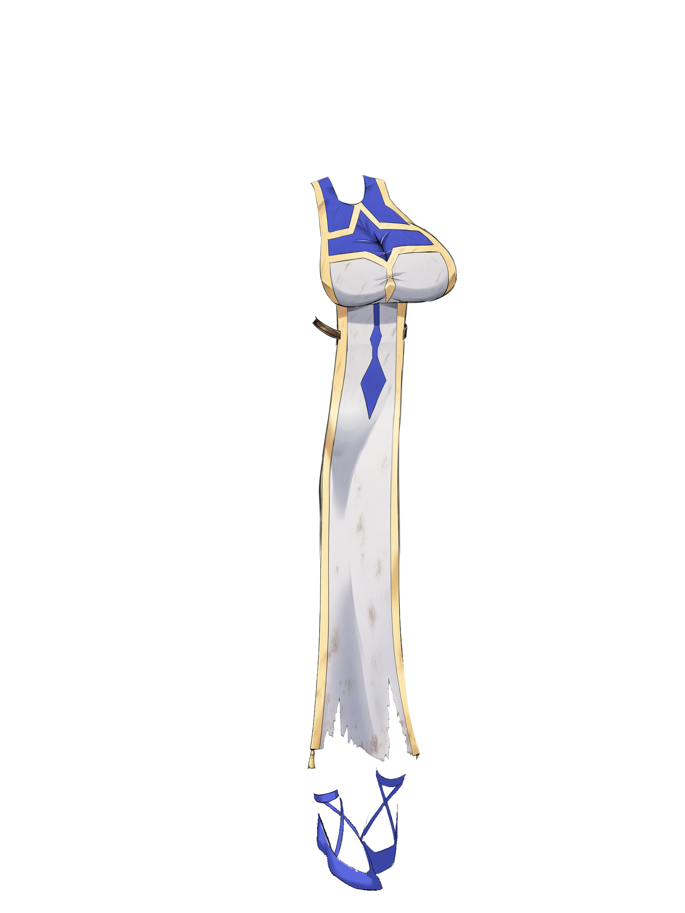
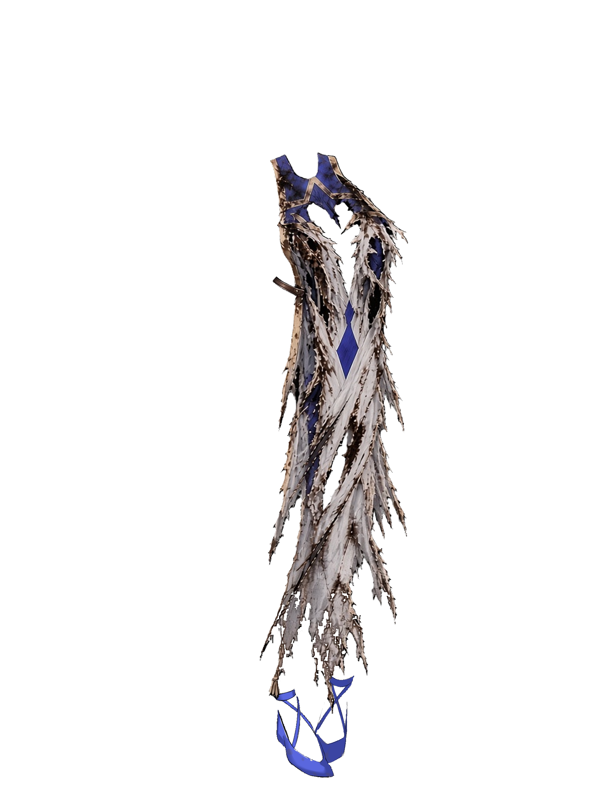
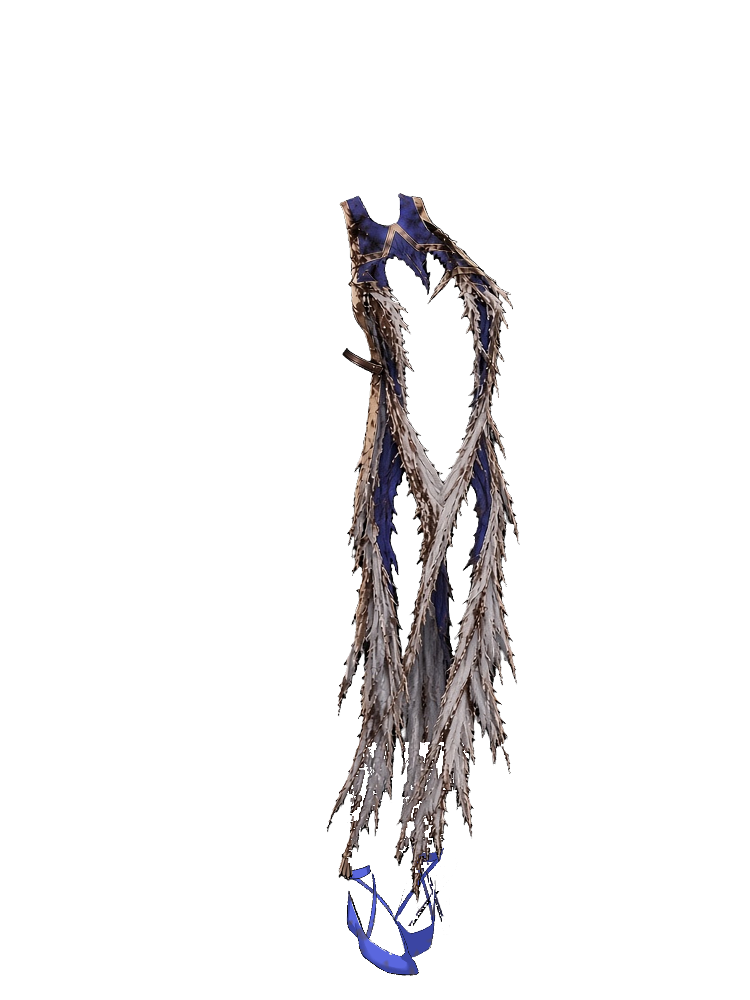

# NP_ClothDamage

## Название

Облачение жрицы рвётся в бою и чинится на отдыхе.

## Версия

В `@plugindesc` номера нет.

## Назначение

Пока на жрице базовое облачение (броня 82, слот наряда, картинка `stand-heroine-basic-cloth82-<вариант>`), удары в бою копят очки разрыва. Пороги 4, 10 и 18 подменяют стоячую картинку на рваный вариант той же позы. Уже показанная картинка меняется сразу. `CommonEvents.json` не правится.

Очки сбрасываются в 0 на сне в лагере (общее событие 474), на сне в гостинице или кровати (общее событие 325) и если облачение сняли и надели снова вне боя. В галерее очки не копятся и рваный вид не показывается. Состояние — `$gameSystem._npClothDmg`; старые сейвы начинают с 0.

## Порядок загрузки

После `NP_Titles`, перед `NP_Stress`. `NP_Titles` читает уровень для одного титула. `NP_AudioBalance` ставит звук на разрыв и починку. Только броня 82 (базовое облачение, картинка `stand-heroine-basic-cloth82`).

## Параметры

- **Включено** `true` — подпись **Рваная одежда**.
- **Пороги** `4,10,18` очков урона для уровней 1, 2 и 3.
- Очки: удар по HP `1`, крит `+2`, удар от 25% макс. HP `+1`, навык врага типа «性» или с заметкой `<NP_ClothTear>` `+3`, даже без потери HP.
- **Суффиксы** `t1,t2,t3`. Запасные наборы в именах файлов — `ta` и `tb`. Нет файла — остаётся целая картинка.
- **Строка в журнале боя** `true` — запись, когда уровень меняется.

## Установка

Скопируйте `NP_ClothDamage.js` в `www/js/plugins/` игры. Имя файла должно остаться `NP_ClothDamage.js`. В менеджере плагинов включите его в порядке из раздела [Порядок загрузки](#порядок-загрузки). RPG Maker MV читает плагины из `www/js/plugins/`, а не из папки `plugins/NP_ClothDamage/` в этом репозитории.

## Ресурсы

Скопируйте содержимое папки `assets/` этого плагина в `www/` игры и сохраните относительные пути. Файл `assets/img/pictures/example.png` должен оказаться в `www/img/pictures/example.png` (а `assets/movies/clip.webm` — в `www/movies/clip.webm`). Имя папки `assets` в путь игры не входит.

20 рваных стоячих картинок базового облачения (броня 82), по набору на лица `0`–`3`. У каждого лица уровни разрыва `t1`, `t2`, `t3` и запасные наборы `ta`, `tb`. Целые картинки `cloth82` входят в игру и здесь не лежат.

- `img/pictures/stand-heroine-basic-cloth82-0-t1.png` … `stand-heroine-basic-cloth82-0-tb.png`
- те же пять суффиксов для лиц `1`, `2` и `3`

Полный список и контрольные суммы: [INVENTORY.md](../../INVENTORY.md).

## Скриншоты

Уровни разрыва для лица 0 (плагин подменяет ими стоячую картинку в бою):

