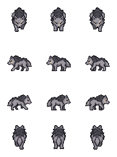
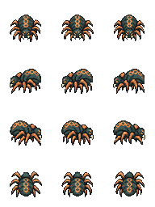
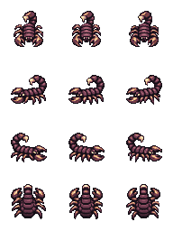
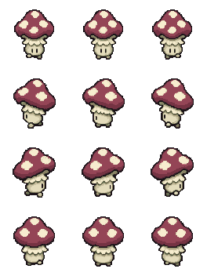
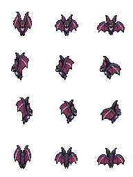
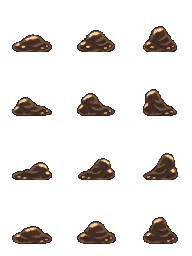

# NP_EliteSprites

## Title

Custom sprites for the six new rares.

## Version

0.1.0 (`@plugindesc`). Graphics only.

## Purpose

Each of the six species from `NP_EliteMobs` is drawn from a single-character sheet with eight extra transparent pixels on every edge. The body is drawn clean, above the additive aura. The character origin and the star are shifted so the padding does not move the sprite at the elite scale of 1.15.

The event remembers the original image in its saved state. Turning rare enemies off, or removing the rare mark, puts that image back.

## Load order

After `NP_EliteRewards`. The help text requires the elite expansion. It does not change spawn rolls, combat, loot, the thirteen older rares, or the normal enemy sheets.

## Parameters

No Plugin Manager parameters.

## Install

Copy `NP_EliteSprites.js` into the game's `www/js/plugins/` directory. The file name must stay `NP_EliteSprites.js`. In Plugin Manager, turn it ON in the order in [Load order](#load-order). RPG Maker MV loads plugins from `www/js/plugins/`, not from this repository's `plugins/NP_EliteSprites/` folder. The folder exists so the script and its notes can be browsed, and later split out as a git submodule.

## Assets

Copy the contents of this plugin's `assets/` folder into the game's `www/` directory and keep the relative paths. A file at `assets/img/pictures/example.png` must end up at `www/img/pictures/example.png` (and `assets/movies/clip.webm` at `www/movies/clip.webm`). The folder name `assets` is not part of the game path.

Six single-character sheets. The `$` prefix is the RPG Maker MV "one character" marker and is part of the file name. Aura and the star are still drawn by the rare-mob code.

- `img/characters/$NP_Elite_Wolf_v1.png` — Bloodtrail Wolf
- `img/characters/$NP_Elite_Spider_v1.png` — Retribution Spider
- `img/characters/$NP_Elite_Scorpion_v1.png` — Black Oath Scorpion
- `img/characters/$NP_Elite_Mushroom_v1.png` — Stillgrowth Mushroom
- `img/characters/$NP_Elite_Bat_v1.png` — Shifting Echo Bat
- `img/characters/$NP_Elite_Sludge_v1.png` — Gorging Sludge

Full list and checksums: [INVENTORY.md](../../INVENTORY.md).

## Screenshots

