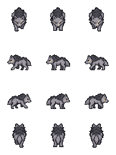
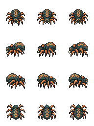
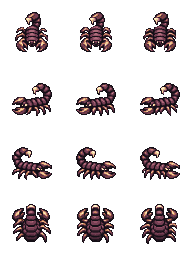
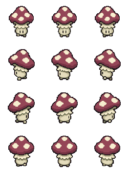
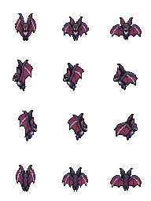
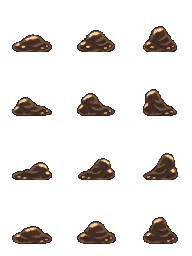

# NP_EliteSprites

## Название

Свои спрайты шести новых редких.

## Версия

0.1.0 (`@plugindesc`). Только графика.

## Назначение

Каждый из шести видов `NP_EliteMobs` рисуется с листа на одного персонажа, у которого по восемь прозрачных пикселей с каждого края. Тело рисуется чисто, поверх аддитивной ауры. Точка привязки и звезда сдвинуты, чтобы поля не уводили спрайт при элитном масштабе 1.15.

Событие помнит исходную картинку в своём сейве. Выключение редких врагов или снятие редкой метки возвращает эту картинку.

## Порядок загрузки

После `NP_EliteRewards`. Справка требует расширение элит. Броски появления, бой, добыча, тринадцать старых редких и листы обычных врагов не меняются.

## Параметры

Параметров в менеджере плагинов нет.

## Установка

Скопируйте `NP_EliteSprites.js` в `www/js/plugins/` игры. Имя файла должно остаться `NP_EliteSprites.js`. В менеджере плагинов включите его в порядке из раздела [Порядок загрузки](#порядок-загрузки). RPG Maker MV читает плагины из `www/js/plugins/`, а не из папки `plugins/NP_EliteSprites/` в этом репозитории. Папка нужна, чтобы скрипт и описание было удобно смотреть на GitHub и позже вынести в отдельный git submodule.

## Ресурсы

Скопируйте содержимое папки `assets/` этого плагина в `www/` игры и сохраните относительные пути. Файл `assets/img/pictures/example.png` должен оказаться в `www/img/pictures/example.png` (а `assets/movies/clip.webm` — в `www/movies/clip.webm`). Имя папки `assets` в путь игры не входит.

Шесть листов на одного персонажа. Префикс `$` — пометка RPG Maker MV «один персонаж», она входит в имя файла. Ауру и звезду по-прежнему рисует код редких врагов.

- `img/characters/$NP_Elite_Wolf_v1.png` — Кровавый следопыт
- `img/characters/$NP_Elite_Spider_v1.png` — Паук нити возмездия
- `img/characters/$NP_Elite_Scorpion_v1.png` — Скорпион чёрной клятвы
- `img/characters/$NP_Elite_Mushroom_v1.png` — Гриб тихого созревания
- `img/characters/$NP_Elite_Bat_v1.png` — Мышь переменчивого эха
- `img/characters/$NP_Elite_Sludge_v1.png` — Ил жадного поглощения

Полный список и контрольные суммы: [INVENTORY.md](../../INVENTORY.md).

## Скриншоты

