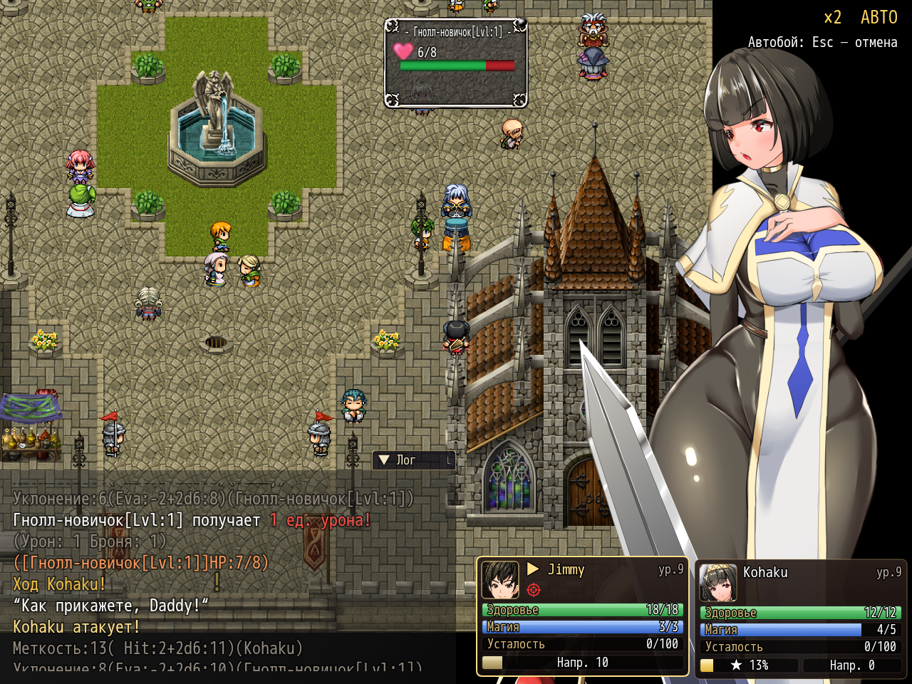

# NP_EnemyHUD

## Title

Enemy card with HP, effects, and a detail page.

## Version

1.0 (`@plugindesc`).

## Purpose

The card shows the current enemy name (variable 139), health as current / max, and a boss tag with the phase when `NP_BossBalance` says this is a boss. Effect chips cover states, with a short description (cannot act, blind, silenced, confused, asleep, paralyzed, stunned, skips a turn, trance) and the remaining enemy turns. A control-immunity chip appears while the boss balance script is counting immunity actions.

**Подробнее / Details**, or F6, opens a modal page. Page Up/Down or the ‹ › buttons change pages. Escape or the × closes it. While the page is open, clicks are not passed to the battle commands. The pages include armor, magic armor, and one block per effect: what it changes and how long it lasts. An empty list says there are no temporary effects.

## Load order

After `NP_BattleHUD` and `NP_BossBalance`, before `NP_BondHints` and `NP_OptionsCategories`. It keeps the enemy portrait, the party cards, and the command menu. It does not change battle numbers.

## Parameters

No Plugin Manager parameters. Options row **Карточка врага / Enemy card**, category Interface.

## Requires

Windows **Alpha 0.80j**. From the downloaded ZIP, run `install.bat` and give it the game `www` folder. README categories are not the load order.

## Install

Copy `NP_EnemyHUD.js` into the game's `www/js/plugins/` directory. The file name must stay `NP_EnemyHUD.js`. In Plugin Manager, turn it ON in the order in [Load order](#load-order). RPG Maker MV loads plugins from `www/js/plugins/`, not from this repository's `plugins/NP_EnemyHUD/` folder.

## Screenshots

Older in-game frame. It is not a new capture of this revision, and the game was not launched for this change.

The enemy HP window is visible. Older frame. Detail pages on F6 are not shown.

The enemy window is also visible while battle speed and autobattle are on. Older frame.
