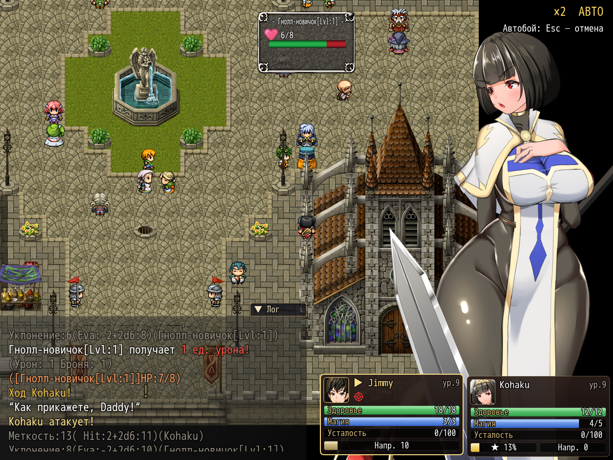

# NP_EnemyHUD

## Название

Карточка врага: HP, эффекты и подробности.

## Версия

1.0 (`@plugindesc`).

## Назначение

Карточка показывает имя текущего врага (переменная 139), здоровье как текущее / максимум и метку босса с фазой, если `NP_BossBalance` считает этого врага боссом. Значки эффектов покрывают состояния с короткой подписью (не может действовать, зрение, заклинания, смятение, сон, паралич, оглушение, пропуск хода, транс) и оставшимися ходами врага. Значок иммунитета к контролю появляется, пока скрипт баланса боссов считает ходы иммунитета.

**Подробнее** или F6 открывает модальную страницу. Page Up/Down или кнопки ‹ › листают страницы. Escape или × закрывают её. Пока страница открыта, нажатия не уходят в боевые команды. На страницах броня, магическая защита и по блоку на каждый эффект: что меняет и сколько длится. Пустой список говорит, что временных эффектов нет.

## Порядок загрузки

После `NP_BattleHUD` и `NP_BossBalance`, перед `NP_BondHints` и `NP_OptionsCategories`. Портрет врага, карточки отряда и меню команд остаются. Числа боя не меняет.

## Параметры

Параметров в менеджере плагинов нет. Пункт **Карточка врага**, раздел «Интерфейс».

## Требования

Windows, **Alpha 0.80j**. Из скачанного ZIP запустите `install.bat` и укажите папку `www` игры. Категории в общем README — не порядок загрузки.

## Установка

Скопируйте `NP_EnemyHUD.js` в `www/js/plugins/` игры. Имя файла должно остаться `NP_EnemyHUD.js`. В менеджере плагинов включите его в порядке из раздела [Порядок загрузки](#порядок-загрузки). RPG Maker MV читает плагины из `www/js/plugins/`, а не из папки `plugins/NP_EnemyHUD/` в этом репозитории.

## Скриншоты

Старый игровой кадр. Это не новый снимок этой ревизии, и для этой правки игру не запускали.

Окно HP врага видно. Старый кадр. Страницы подробностей по F6 не показаны.

Окно врага видно и при скорости боя и автобое. Старый кадр.
