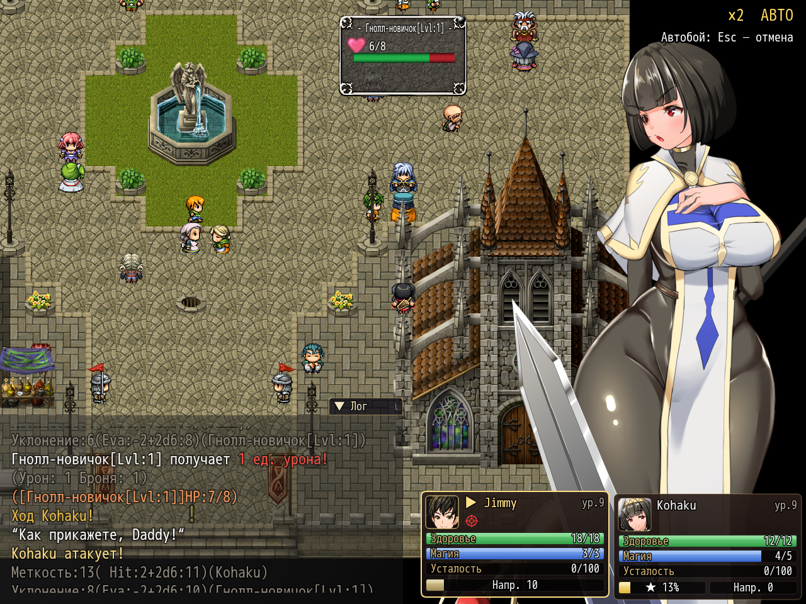

# NP_FastBattle

## Title

Optional faster battle pacing.

## Version

1.0 (`@plugindesc`). Default in Options is off.

## Purpose

With the option on and switch 14 set, battle-mechanic events only:

- Wait commands (and script `this.wait`) are multiplied by the wait rate.
- Show Animation no longer blocks until the animation finishes.
- Empty Show Text lines, the log's silent pauses, advance by themselves.
- Dice pictures are skipped.

Everything outside those event lists still waits for the player. That includes messages with a face or text, choices, battle erotic actions, harassment lines, the tutorial, ally knockdown, and defeat. Command: `NP_FastBattle on` or `off`.

## Load order

After `NP_QuestMarker`, before `NP_TitleProgress`. Separate from `NP_BattleQoL` (Shift ×2). Both may be on. `NP_Voice` shortens clips when this option is on during battle.

## Parameters

- **Enabled** `false` — Options label **Быстрый бой**.
- **Battle Switch** `14` — the in-battle switch.
- **Wait Rate** `0.25` — event waits in battle mechanics become a quarter, at least 1 frame.
- **Auto Advance Frames** `14` — empty log pauses last this many frames instead of waiting for a button.
- **Hide Dice** `true` — pictures `dice1`–`dice6` and `diceN_red` are not shown. The roll still prints in the log.
- **Battle Common Events** and **Battle Map Event Pages** — the only interpreters that get the speed-up. Defaults are the pure battle common events and map 53 pages `9:2` and `9:4`.

## Requires

Windows **Alpha 0.80j**. From the downloaded ZIP, run `install.bat` and give it the game `www` folder. README categories are not the load order.

## Install

Copy `NP_FastBattle.js` into the game's `www/js/plugins/` directory. The file name must stay `NP_FastBattle.js`. In Plugin Manager, turn it ON in the order in [Load order](#load-order). RPG Maker MV loads plugins from `www/js/plugins/`, not from this repository's `plugins/NP_FastBattle/` folder.

## Screenshots

The corner shows battle speed and autobattle. It does not by itself prove the shorter waits.

Battle speed is also visible on this command-list frame.
