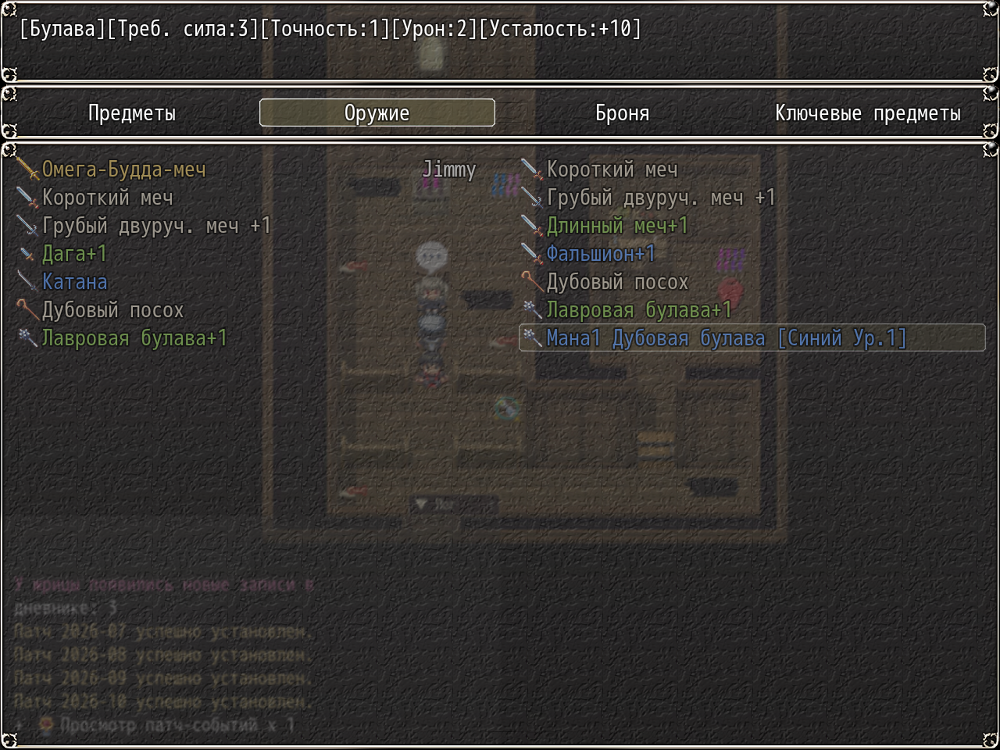

# NP_ItemNameFix

## Title

Saved weapon names rebuilt in the current language.

## Version

Not numbered in `@plugindesc`.

## Purpose

YEP Item Core and DreamX prefixes and suffixes store a copy of the weapon name and description inside the save, in whatever language was active when the weapon was obtained. An old save therefore shows English names in the Russian game, and the reverse.

On every load each instance is parsed as prefix, base, suffix, and a `+bonus`, matched against the Japanese, Russian, and English names of the base weapon and of the affix weapons, then rebuilt with the current database names and the same DreamX spacing. Names the parser does not recognize are left alone. Stats, traits, ids, price, and notes are not touched. Only `name`, `baseItemName`, and `description` change.

## Load order

After `NP_LogToggle`, before `NP_BattleHUD`. A language switch restarts the game, so the next load covers that switch too. Run after YEP Item Core and DreamX, which create the independent instances.

## Parameters

No Plugin Manager parameters. Call `NP_ItemNameFix.run()` if you need the counters `{checked, renamed, desc, skipped}`.

## Requires

Windows **Alpha 0.80j**. From the downloaded ZIP, run `install.bat` and give it the game `www` folder. README categories are not the load order.

With English mode on, names can be read from `www/lang/en/csv/` (nympri-ru). Without that pack, names come from the database that is already loaded.

## Install

Copy `NP_ItemNameFix.js` into the game's `www/js/plugins/` directory. The file name must stay `NP_ItemNameFix.js`. In Plugin Manager, turn it ON in the order in [Load order](#load-order). RPG Maker MV loads plugins from `www/js/plugins/`, not from this repository's `plugins/NP_ItemNameFix/` folder.

## Screenshots

Weapon names with a +1 suffix are visible. It does not show the name before the fix.
