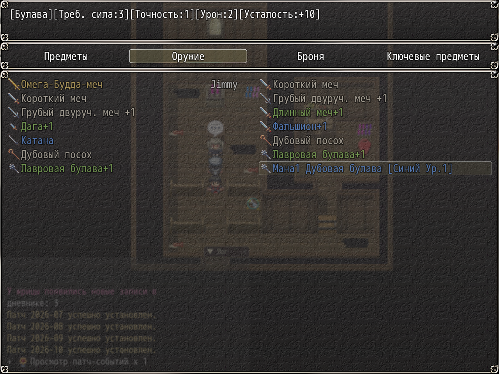

# NP_ItemNameFix

## Название

Имена сохранённого оружия собираются заново на текущем языке.

## Версия

В `@plugindesc` номера нет.

## Назначение

YEP Item Core и приставки/суффиксы DreamX хранят в сейве копию имени и описания оружия на том языке, который был включён в момент получения. Старый сейв поэтому показывает английские имена в русской игре и наоборот.

При каждой загрузке экземпляр разбирается как приставка, основа, суффикс и `+бонус`, сверяется с японским, русским и английским именами базового оружия и оружия-аффиксов, затем собирается заново из текущих имён базы и с теми же пробелами DreamX. Неузнанные имена не трогаются. Параметры, черты, id, цена и заметки не меняются. Меняются только `name`, `baseItemName` и `description`.

## Порядок загрузки

После `NP_LogToggle`, перед `NP_BattleHUD`. Смена языка перезапускает игру, поэтому следующая загрузка покрывает и её. Ставьте после YEP Item Core и DreamX, которые создают независимые экземпляры.

## Параметры

Параметров в менеджере плагинов нет. `NP_ItemNameFix.run()` возвращает счётчики `{checked, renamed, desc, skipped}`.

## Требования

Windows, **Alpha 0.80j**. Из скачанного ZIP запустите `install.bat` и укажите папку `www` игры. Категории в общем README — не порядок загрузки.

В английском режиме имена могут читаться из `www/lang/en/csv/` (nympri-ru). Без этого пакета берутся имена уже загруженной базы.

## Установка

Скопируйте `NP_ItemNameFix.js` в `www/js/plugins/` игры. Имя файла должно остаться `NP_ItemNameFix.js`. В менеджере плагинов включите его в порядке из раздела [Порядок загрузки](#порядок-загрузки). RPG Maker MV читает плагины из `www/js/plugins/`, а не из папки `plugins/NP_ItemNameFix/` в этом репозитории.

## Скриншоты

Видны имена оружия с суффиксом +1. Имя до исправления не показано.
