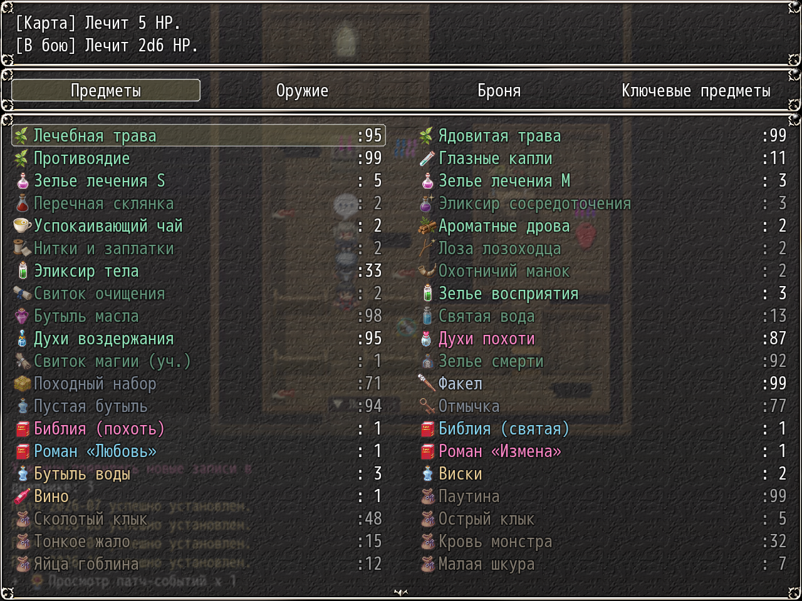
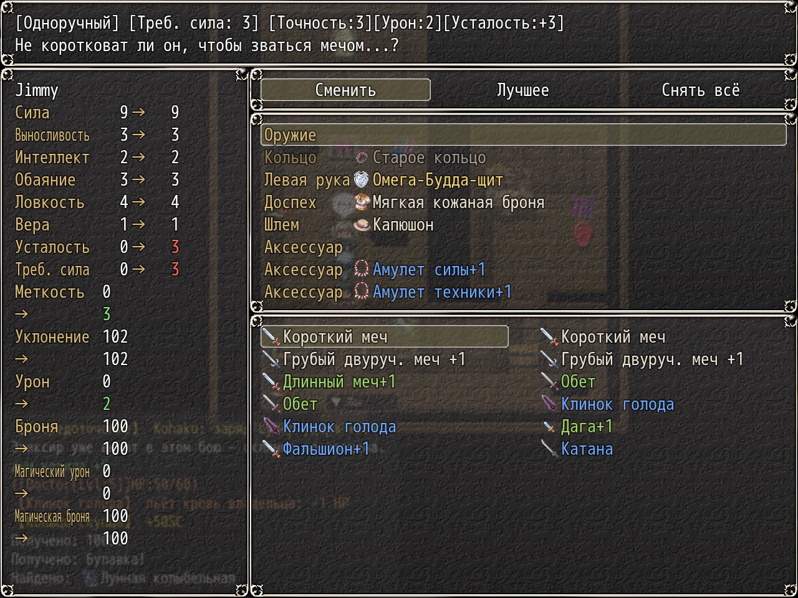

# NP_Items

## Title

Added items, affixes, curses, and Holy Water.

## Version

1.0 (script constant `NP_Items.VERSION`).

## Purpose

The script appends item, weapon, and armor records and then implements their effects. Boss and enemy rows are not edited. If an actor is missing (Yarizo is the usual case) that actor's items simply do nothing.

What the player runs into:

- **Holy Water** in battle (item id 40, also the `holy` tag). Against an unholy target it rolls 2d6, plus 2 if a flask belt is worn. Otherwise it splashes for 1. The line is printed in the battle log. Holy-tagged weapons add a small sanctified bonus on a normal hit against the same targets.
- **Cursed** gear cannot be unequipped, and a new item cannot replace a cursed one in that slot. A cleansing scroll in the menu lists the cursed slots and clears one when it is used.
- **Affixes.** Weapon records 401–405 are prefixes and 501–503 are suffixes. DreamX items made before the note was merged are still recognized by the affix name in the item's name. Affixes participate in price tier and in on-hit effects.
- **Rare-drop gear** that `NP_RareMobs` names (miser's ring, flask belt, bear claw, alchemist's sling, medallion, rage talisman, safety pin, gambler's ring, censer, hunger blade, rosary, campfire amulet, and the material items) is implemented here: on-hit flags, stress hooks, cloth thresholds for the safety pin, campfire amulet relief, and victory drops.
- Battle items are injected at the top of common event 350. Quest rewards and shop stock are added beside the original lists. A map-visit counter gates one rod so it does not repeat every step, and a lure item walks the event to the player.

State for one-time drops and quest grants is `$gameSystem._npItems`.

## Load order

After `NP_SuperAttack`, `NP_Stress`, `NP_ClothDamage`, and `NP_CampSkills`. In the mod list it sits after `NP_BattleCmd` and before `NP_EliteMobs`. Before `NP_OptionsCategories`. `NP_RareMobs` and the elite rewards look items up by the note tags this script writes, so those plugins stay after it.

## Parameters

No Plugin Manager parameters. Behaviour is selected by note tags `<NP_ITEM:key>`, `<NP_AFFIX:key>`, and `<NP_CURSED>`.

## Requires

Windows **Alpha 0.80j**. From the downloaded ZIP, run `install.bat` and give it the game `www` folder. README categories are not the load order.

## Install

Copy `NP_Items.js` into the game's `www/js/plugins/` directory. The file name must stay `NP_Items.js`. In Plugin Manager, turn it ON in the order in [Load order](#load-order). RPG Maker MV loads plugins from `www/js/plugins/`, not from this repository's `plugins/NP_Items/` folder.

## Screenshots

Older in-game frame. It is not a new capture of this revision, and the game was not launched for this change.

Item list with plugin item text. Older frame.

Equipment view of those items. Older frame.
