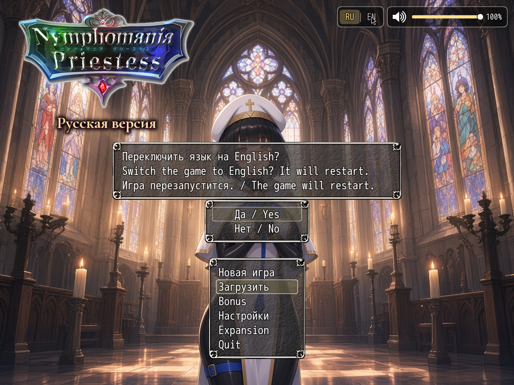

# NP_Language

## Title

Russian / English language switch.

## Version

1.1 (`@plugindesc`).

## Purpose

The player picks the language in two places: **Options → «Язык / Language»**, or the **RU | EN** button on the title screen, to the left of the volume widget. A confirm window appears. Accepting calls `location.reload()`, so the new language is applied from a clean boot.

English mode, for the player, means:

- CSV sheets (`./csv/*.csv`) are read from `www/lang/en/csv/` when that file exists. This covers MEO, KNS and TB windows.
- Database JSON still loads first. `www/lang/en/data_overlay.json` then replaces strings only. Event command structure stays as the mod patched it.
- Option and menu labels that come from plugin parameters are translated as the windows are built.
- Every other NP plugin asks `NP_L(russian, english)` (also `NP_Language.t`) and follows this switch.

Saves stay compatible both ways: the save holds switches and variables, not a second copy of the database. Default language on a fresh install is Russian. In English, the title logo drops the «Русская версия» caption.

## Load order

Enable immediately after `MEO_Util_Node`, before any plugin that reads CSV at boot (`MEO_VXACE_CSV_LogSheet` and the rest of the MEO stack). In the mod's `plugins.js` this is near the top, not next to the other NP scripts.

## Parameters

No Plugin Manager parameters. The language is stored on `ConfigManager.npLanguage` (`ru` or `en`, default `ru`) in `config.rpgsave`, not inside a save slot.

## Install

Copy `NP_Language.js` into the game's `www/js/plugins/` directory. The file name must stay `NP_Language.js`. In Plugin Manager, turn it ON in the order in [Load order](#load-order). RPG Maker MV loads plugins from `www/js/plugins/`, not from this repository's `plugins/NP_Language/` folder.

## Screenshots

The **RU | EN** button on the title screen opens this confirm window. Accepting reloads the game in the chosen language.
