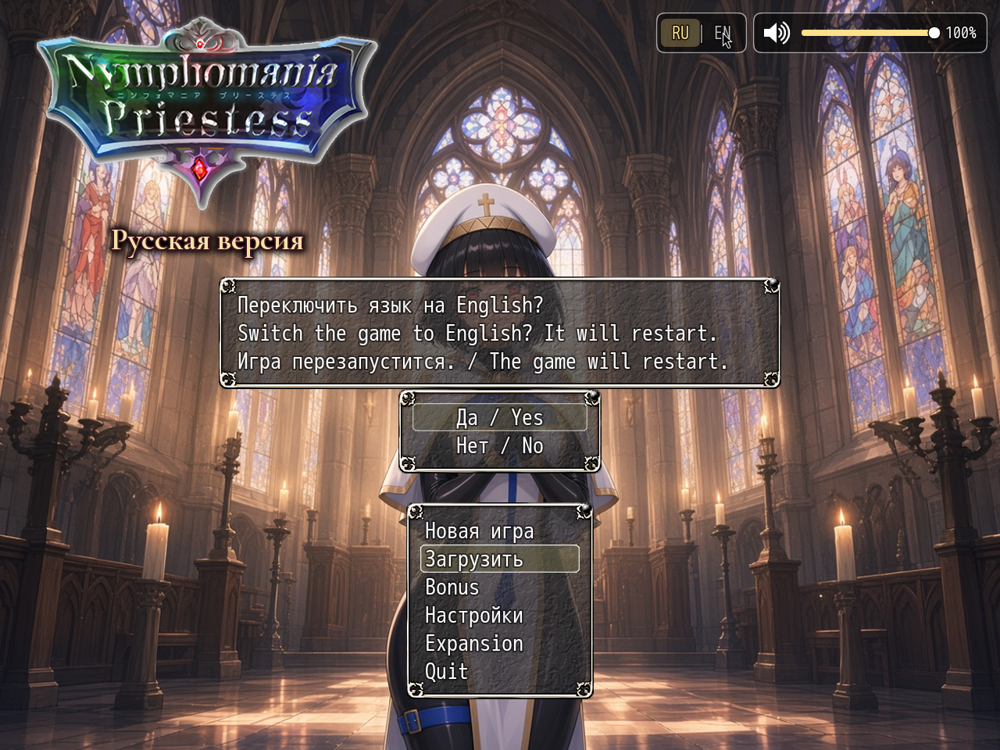

# NP_Language

## Название

Переключатель языка: русский / английский.

## Версия

1.1 (`@plugindesc`).

## Назначение

Игрок выбирает язык в двух местах: **Настройки → «Язык / Language»** или кнопка **RU | EN** на титульном экране, слева от регулятора громкости. Появляется окно подтверждения. Согласие вызывает `location.reload()`, и новый язык поднимается с чистого запуска.

В английском режиме игрок получает:

- CSV (`./csv/*.csv`) читаются из `www/lang/en/csv/`, если такой файл есть. Это окна MEO, KNS и TB.
- JSON базы сначала грузится как есть, затем `www/lang/en/data_overlay.json` подменяет только строки. Структура команд событий остаётся с правками мода.
- Подписи пунктов настроек и меню из параметров плагинов переводятся при построении окон.
- Остальные плагины NP спрашивают `NP_L(русский, английский)` (то же `NP_Language.t`) и идут за этим переключателем.

Сохранения совместимы в обе стороны: в сейве переключатели и переменные, а не вторая копия базы. На чистой установке язык по умолчанию русский. В английском режиме с логотипа титула убирается подпись «Русская версия».

## Порядок загрузки

Включайте сразу после `MEO_Util_Node`, до любого плагина, который читает CSV при запуске (`MEO_VXACE_CSV_LogSheet` и остальной стек MEO). В `plugins.js` мода он стоит в начале списка, а не рядом с остальными NP.

## Параметры

Параметров в менеджере плагинов нет. Язык лежит в `ConfigManager.npLanguage` (`ru` или `en`, по умолчанию `ru`) в `config.rpgsave`, а не в слоте сохранения.

## Установка

Скопируйте `NP_Language.js` в `www/js/plugins/` игры. Имя файла должно остаться `NP_Language.js`. В менеджере плагинов включите его в порядке из раздела [Порядок загрузки](#порядок-загрузки). RPG Maker MV читает плагины из `www/js/plugins/`, а не из папки `plugins/NP_Language/` в этом репозитории. Папка нужна, чтобы скрипт и описание было удобно смотреть на GitHub и позже вынести в отдельный git submodule.

## Скриншоты

Кнопка **RU | EN** на титуле открывает это окно. Согласие перезапускает игру на выбранном языке.
