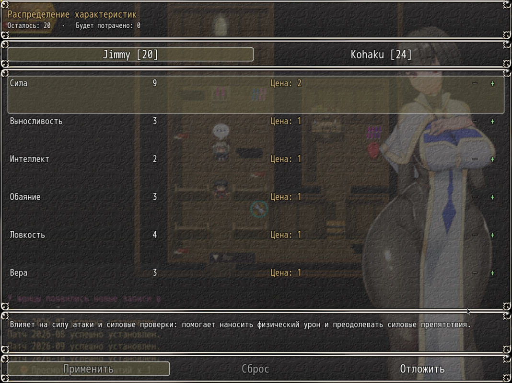

# NP_LevelAllocation

## Название

Один экран, чтобы потратить очки уровня.

## Версия

1.0 (`@plugindesc`).

## Назначение

Экран называется **Распределение характеристик**. На нём видно, сколько очков осталось и сколько черновик собирается потратить. Шесть строк: Сила, Выносливость, Интеллект, Обаяние, Ловкость, Вера. В строке текущее значение, изменение черновика, цена следующего очка и короткая фраза, на что параметр влияет (атака и силовые проверки, HP и защита, MP и магия, переговоры, замки и точность, чудеса и сопротивление).

Управление: вверх/вниз выбирает параметр, влево/вправо убавляет и прибавляет, OK прибавляет, Page Up/Down переключает героя и Кохаку, Escape переводит фокус на кнопки. Касание жмёт метки + и −.

Команды внизу: **Применить** (записывает черновик штатным добавлением параметра и списывает очки), **Сброс** (возвращает черновик), **Отложить** (закрывает без траты; очки остаются в переменных 172 и 173). Применить и Сброс неактивны, пока черновик совпадает с актёром.

## Порядок загрузки

После `NP_EliteSprites`, перед `NP_MenuLayout`. Заменяет общее событие 860 после патчей базы и открывается, когда общее событие 28 выдало очки. `NP_MenuLayout` может открыть эту сцену, если очки ждут.

## Параметры

Параметров в менеджере плагинов нет. Переменные очков 172 (герой) и 173 (Кохаку) и штатный вызов `addParam` сохраняются.

## Требования

Windows, **Alpha 0.80j**. Из скачанного ZIP запустите `install.bat` и укажите папку `www` игры. Категории в общем README — не порядок загрузки.

## Установка

Скопируйте `NP_LevelAllocation.js` в `www/js/plugins/` игры. Имя файла должно остаться `NP_LevelAllocation.js`. В менеджере плагинов включите его в порядке из раздела [Порядок загрузки](#порядок-загрузки). RPG Maker MV читает плагины из `www/js/plugins/`, а не из папки `plugins/NP_LevelAllocation/` в этом репозитории.

## Скриншоты

Сохранение, файл 15. Выбран Jimmy: осталось 20, «Будет потрачено: 0». Подсвечена сила, у неё цена 2. «Применить» и «Сброс» недоступны, потому что черновик пуст. Ни одно очко на этом экране не применено.
