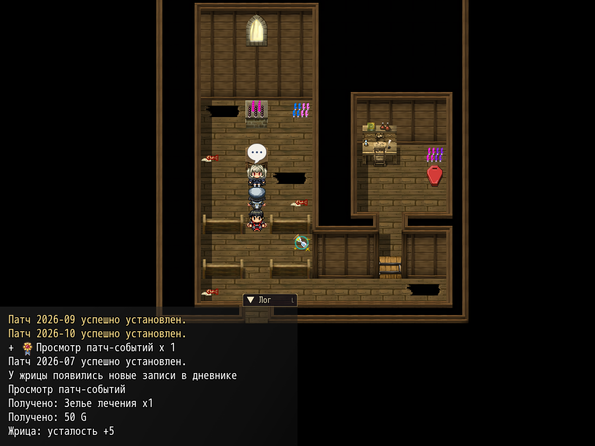

# NP_LogToggle

## Title

Map log hides in dialogue and can be collapsed.

## Version

Not numbered in `@plugindesc`.

## Purpose

The log is fully hidden while a message, choice, number input, or scrolling text is open, including scenes that use the message box, and it fades back afterwards.

A tab at the corner collapses and expands it by click or touch. Collapsed, only **▲ Лог** remains, with the number of new lines. The same action is on L and, by default, on D.

Two Options rows, category Interface: **Свернуть лог** (`npLogCollapsed`, default off) and **Прятать лог в диалогах** (`npLogAutoHide`, default on). The game's own show and hide functions still work: this script does not leave `window.visible` off. Hovering the log, the wheel or `[` / `]` scrolls, and Home/End jump to the ends. New lines keep the place you were reading.

## Load order

After `NP_UIColors`, before `NP_ItemNameFix`. It wraps `MEO_Logwindow`. `NP_BondHints` should load after this script. Battles that run on the map keep the log visible for command-only choices.

## Parameters

- **Hotkey** `76` — L. `0` disables it.
- **Take Over D** `true` — the original D key (common event 18) also collapses and expands the log, and the choice sticks.
- **Restore Delay** `24` frames with no message before the log fades back. This bridges the pause between lines.

## Requires

Windows **Alpha 0.80j**. From the downloaded ZIP, run `install.bat` and give it the game `www` folder. README categories are not the load order.

## Install

Copy `NP_LogToggle.js` into the game's `www/js/plugins/` directory. The file name must stay `NP_LogToggle.js`. In Plugin Manager, turn it ON in the order in [Load order](#load-order). RPG Maker MV loads plugins from `www/js/plugins/`, not from this repository's `plugins/NP_LogToggle/` folder.

## Screenshots

Older in-game frame. It is not a new capture of this revision, and the game was not launched for this change.

The map log is expanded. Older frame. The collapsed counter is not shown.
