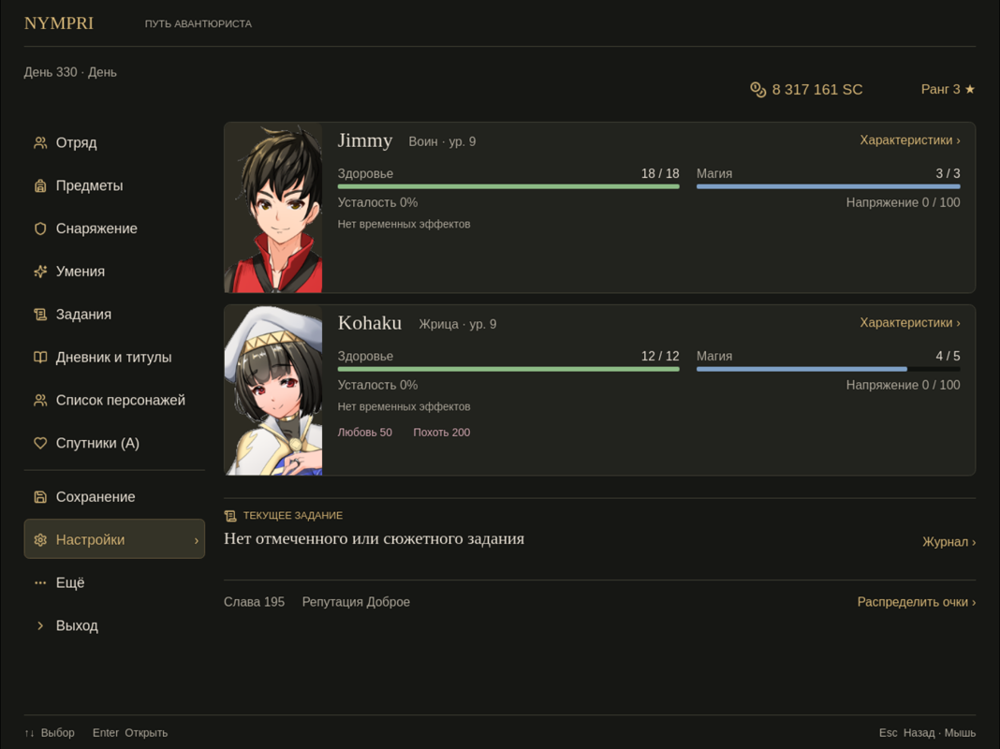

# NP_MenuLayout

## Title

Compact pause menu.

## Version

1.1 (`@plugindesc`).

## Purpose

With the option on, the pause screen is rebuilt but still calls the same commands.

The header is **ПУТЬ АВАНТЮРИСТА / THE ADVENTURER'S PATH**. It shows day number and day or night, map name (an inn floor is spelled out), silver, guild rank with stars, fame, and reputation.

A quest block shows the bookmarked or story quest, or a line that none is marked, and a **Journal** shortcut. If level-up points are waiting, a gold **Allocate points** link opens `NP_LevelAllocation`.

Party cards, scrolled with the usual menu controls, show class and level, health, magic, fatigue, stress when `NP_Stress` is active, and chips for temporary effects. The priestess card also shows love and lust. **Attributes** opens the status. An empty effect row says there are no temporary effects.

**Party effects** is its own page: Left/Right change actor, Up/Down and Page Up/Down move through the list, Escape goes back.

Commands that do not fit the main column go under **More**. When the diary and titles plugins are present they are grouped as **Diary and titles**. Companions keep their original command (the one that calls common event 5), relabelled. The footer reminds: arrows select, Enter opens, Escape goes back.

## Load order

After the original `Scene_Menu` extensions and after `NP_LevelAllocation`. Before `NP_EnemyHUD` and `NP_OptionsCategories`. Every original command, its `ext`, its enabled state, and its handler are kept.

## Parameters

No Plugin Manager parameters. Options row **Компактное меню паузы / Compact pause menu**, category Interface.

## Requires

Windows **Alpha 0.80j**. From the downloaded ZIP, run `install.bat` and give it the game `www` folder. README categories are not the load order.

## Install

Copy `NP_MenuLayout.js` into the game's `www/js/plugins/` directory. The file name must stay `NP_MenuLayout.js`. In Plugin Manager, turn it ON in the order in [Load order](#load-order). RPG Maker MV loads plugins from `www/js/plugins/`, not from this repository's `plugins/NP_MenuLayout/` folder.

## Assets

Copy the contents of this plugin's `assets/` folder into the game's `www/` directory and keep the relative paths. A file at `assets/img/pictures/example.png` must end up at `www/img/pictures/example.png` (and `assets/movies/clip.webm` at `www/movies/clip.webm`). The folder name `assets` is not part of the game path.

Menu icons loaded as `img/system/np-menu/<name>.svg`. They are Lucide static icons (ISC); `LICENSE.txt` and `NOTICE.txt` sit in the same folder. Stroke colour was set to `#dcbc7c` for this mod.

The script loads these by name: `users` (Party, character list), `backpack` (Items), `shield` (Equipment), `sparkles` (Skills), `scroll-text` (current quest), `book-open` (Diary and titles), `heart` (companions), `save`, `settings`, `coins` (silver), `ellipsis` (More), `chevron-right` (Exit), `moon` / `sun` / `sparkles` (effect chips). Also in the folder, unused by the current script: `sword.svg`, `chevron-down.svg`, `chevron-left.svg`, plus `LICENSE.txt` and `NOTICE.txt`.

Full list and checksums: [INVENTORY.md](../../INVENTORY.md).

## Screenshots

Older in-game frame. It is not a new capture of this revision, and the game was not launched for this change.

The command column sits on the left. Jimmy and Kohaku show class, level, and HP, MP, and FP. Under the list are alignment, fame, love, lust, and silver.
