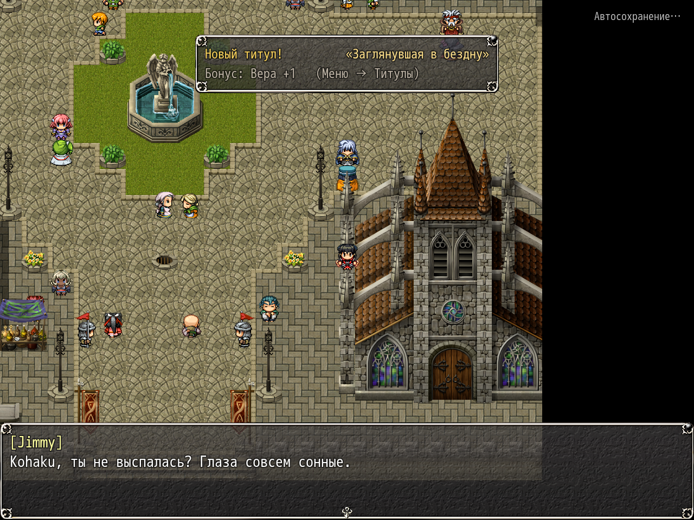

# NP_MorningHints

## Название

Несколько строк утром после ночной отлучки.

## Версия

В `@plugindesc` номера нет.

## Назначение

Когда утренняя отговорка сбрасывает переменную партнёра 4291 в 0, намёк ставится в очередь. Он играется в первый свободный момент на другой карте, когда отряд уже вышел из комнаты: одна–три короткие строки. Партнёр в 4291 — незнакомец (1) или Яризо (2). Формулировки зависят от этого и от стадии дневника. Яризо говорит, только если он реально с отрядом.

Подпись настройки **Утренние намёки**. Не играет в галерее, в бою, в катсценах, в плену и на карте мира, и не играет без героя и жрицы. В этих строках герой до верного вывода не доходит.

## Порядок загрузки

После `NP_RareMobs`, перед `NP_QuestHints`. Читает переменные ночных отлучек мода (4291 партнёр, 4292 счётчик) и стадию дневника. Сами числа не меняет.

## Параметры

- **Chance** `60` процентов после отлучки.
- **Cooldown** `1` — сколько отлучек пропускается после намёка, то есть не чаще чем через раз.
- **Delay** `45` свободных кадров на новой карте, прежде чем строки начнутся.

## Требования

Windows, **Alpha 0.80j**. Из скачанного ZIP запустите `install.bat` и укажите папку `www` игры. Категории в общем README — не порядок загрузки.

## Установка

Скопируйте `NP_MorningHints.js` в `www/js/plugins/` игры. Имя файла должно остаться `NP_MorningHints.js`. В менеджере плагинов включите его в порядке из раздела [Порядок загрузки](#порядок-загрузки). RPG Maker MV читает плагины из `www/js/plugins/`, а не из папки `plugins/NP_MorningHints/` в этом репозитории.

## Скриншоты

Старый игровой кадр. Это не новый снимок этой ревизии, и для этой правки игру не запускали.

На экране утренняя реплика. Также видны пометка автосохранения и тост титула. Старый кадр.
