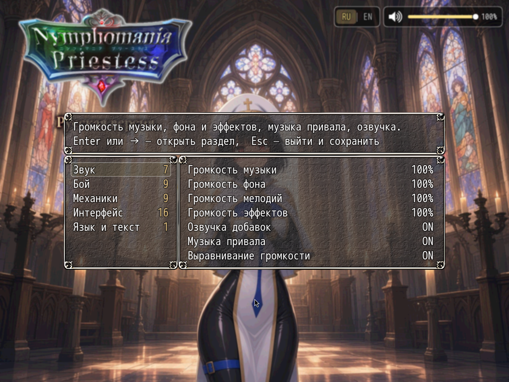

# NP_OptionsCategories

## Title

Options split into six categories.

## Version

Not numbered in `@plugindesc`. The header says to load it last.

## Purpose

No other plugin is edited. `Window_Options` still builds the full list, every hook included. This script then groups that list by symbol and opens a filtered sub-window that is still a `Window_Options`, so sliders and toggles behave as before.

Categories, in order:

- **Звук / Sound** — music, ambience, sound effects, camp music, voice extras. The core volume sliders stay first.
- **Бой / Battle** — battle speed and automation, supers, torn clothing, battle graphics.
- **Механики / Mechanics** — stress, camp, conversations, saving, morning hints, content toggles.
- **Интерфейс / Interface** — controls, notifications, hints, quest markers, the shop comparison, the screen.
- **Язык и текст / Language & Text** — the language switch and text settings.
- **Прочее / Other** — anything still unrecognized, so a plugin added later does not vanish.

Unknown symbols are guessed from the label. A plugin can call `NP_OptionsCategories.register(symbol, category)` with `sound`, `battle`, `mech`, `ui`, `lang`, or `misc`. Enter or Right opens a category. Escape returns to the category list and, from there, saves and leaves. Left/Right or Enter changes a value inside a category. The footer states those keys.

## Load order

Last. After every plugin that adds an options row, including the other NP scripts, CustomizeConfigItem, StartUpFullScreen, TB_OptionWindow, Mano_InputConfig, and TerraxLighting. The mod's `plugins.js` ends with this file.

## Parameters

- **Show option counts** `true` — the category row can show how many settings it holds.

## Requires

Windows **Alpha 0.80j**. From the downloaded ZIP, run `install.bat` and give it the game `www` folder. README categories are not the load order.

## Install

Copy `NP_OptionsCategories.js` into the game's `www/js/plugins/` directory. The file name must stay `NP_OptionsCategories.js`. In Plugin Manager, turn it ON in the order in [Load order](#load-order). RPG Maker MV loads plugins from `www/js/plugins/`, not from this repository's `plugins/NP_OptionsCategories/` folder.

## Screenshots

The left column is the category list with a count on each row. The right column is the open section. This shot is **Звук / Sound**: volume sliders, voice extras, camp music, and loudness balance. Enter or Right opens a section. Escape returns to the list and, from there, saves and leaves.
