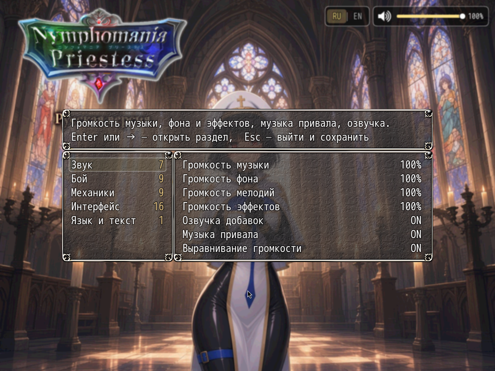

# NP_OptionsCategories

## Название

Настройки разложены по шести разделам.

## Версия

В `@plugindesc` номера нет. В шапке сказано грузить его последним.

## Назначение

Другие плагины не правятся. `Window_Options` по-прежнему собирает полный список, со всеми хуками. Этот скрипт группирует список по символу и открывает отфильтрованное подокно, которое всё ещё `Window_Options`, поэтому ползунки и переключатели работают как раньше.

Разделы по порядку:

- **Звук** — музыка, эмбиент, эффекты, музыка привала, озвучка добавок. Системные ползунки громкости остаются первыми.
- **Бой** — скорость и автоматизация боя, суперы, рваная одежда, боевая графика.
- **Механики** — напряжение, привал, разговоры, сохранения, утренние намёки, переключатели контента.
- **Интерфейс** — управление, уведомления, подсказки, метки заданий, сравнение в лавке, экран.
- **Язык и текст** — переключатель языка и текстовые настройки.
- **Прочее** — всё, что ещё не узнано, чтобы плагин, добавленный позже, не пропал.

Незнакомые символы угадываются по подписи. Плагин может вызвать `NP_OptionsCategories.register(symbol, category)` со значением `sound`, `battle`, `mech`, `ui`, `lang` или `misc`. Enter или вправо открывает раздел. Escape возвращает к списку разделов и оттуда сохраняет и выходит. Влево/вправо или Enter меняет значение внутри раздела. Эти клавиши написаны внизу окна.

## Порядок загрузки

Последним. После каждого плагина, который добавляет пункт настроек, включая остальные NP, CustomizeConfigItem, StartUpFullScreen, TB_OptionWindow, Mano_InputConfig и TerraxLighting. `plugins.js` мода заканчивается этим файлом.

## Параметры

- **Show option counts** `true` — в строке раздела может быть число настроек внутри.

## Установка

Скопируйте `NP_OptionsCategories.js` в `www/js/plugins/` игры. Имя файла должно остаться `NP_OptionsCategories.js`. В менеджере плагинов включите его в порядке из раздела [Порядок загрузки](#порядок-загрузки). RPG Maker MV читает плагины из `www/js/plugins/`, а не из папки `plugins/NP_OptionsCategories/` в этом репозитории. Папка нужна, чтобы скрипт и описание было удобно смотреть на GitHub и позже вынести в отдельный git submodule.

## Скриншоты

Слева список разделов, у каждого число пунктов. Справа открытый раздел. На снимке **Звук**: ползунки громкости, озвучка добавок, музыка привала и выравнивание громкости. Enter или вправо открывает раздел. Escape возвращает к списку и оттуда сохраняет выход.
