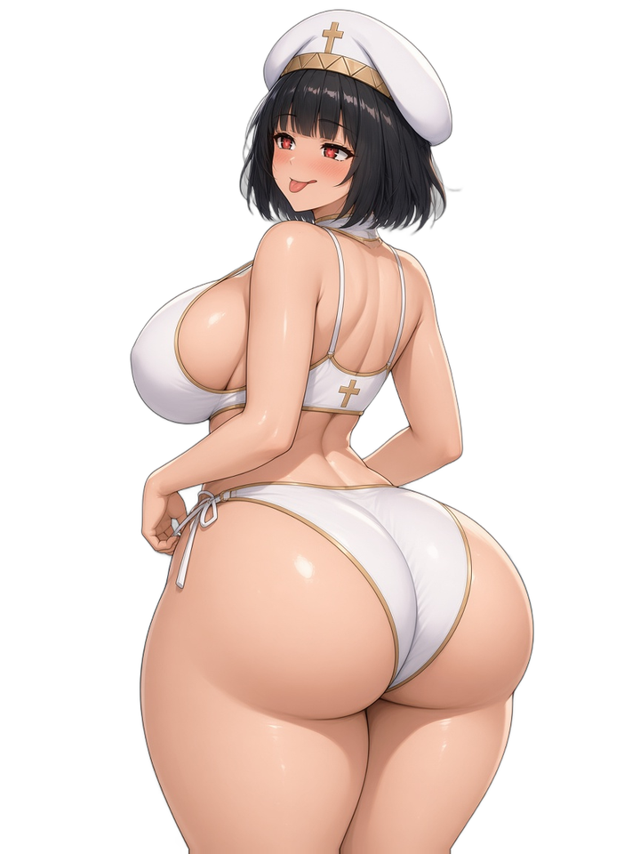

# NP_PictureAnim

## Title

Mesh animation for Show Picture.

## Version

1.0 (`@plugindesc`).

## Purpose

After Show Picture, `NP_PicAnim <id> <preset>` redraws that picture as a `PIXI.mesh.Plane`. Vertices move every frame. Time comes from the picture's own frame counter (60 fps), so the loop is saved with the picture.

Presets:

- `tease` — hip sway plus breathing, with a rigid head box.
- `laugh` — a seated laugh.
- `breathe` — breathing only.

Keys: `amp`, `speed`, `period`, `rect` (main region, 0–1), `head` (not deformed), `chest`, `seg` (grid, default 24×32). `NP_PicAnim <id> off` and Erase Picture or a new Show Picture on the same id clear it. `NP_PicAnim wait <frames>` waits that many frames or until click, OK, or cancel.

## Load order

After `NP_OutfitReact`, before `NP_Campfire`. Run the plugin command after Show Picture on that picture id.

## Parameters

No Plugin Manager parameters. Presets and keys are plugin-command arguments.

## Install

Copy `NP_PictureAnim.js` into the game's `www/js/plugins/` directory. The file name must stay `NP_PictureAnim.js`. In Plugin Manager, turn it ON in the order in [Load order](#load-order). RPG Maker MV loads plugins from `www/js/plugins/`, not from this repository's `plugins/NP_PictureAnim/` folder. The folder exists so the script and its notes can be browsed, and later split out as a git submodule.

## Assets

Copy the contents of this plugin's `assets/` folder into the game's `www/` directory and keep the relative paths. A file at `assets/img/pictures/example.png` must end up at `www/img/pictures/example.png` (and `assets/movies/clip.webm` at `www/movies/clip.webm`). The folder name `assets` is not part of the game path.

The beach pictures the mesh presets are aimed at:

- `img/pictures/np_beachanim_bg.png` — background
- `img/pictures/np_beachanim_pri.png` — priestess (the `tease` preset's regions are measured on this picture)
- `img/pictures/np_beachanim_yar.png` — Yarizo

Full list and checksums: [INVENTORY.md](../../INVENTORY.md).

## Screenshots

