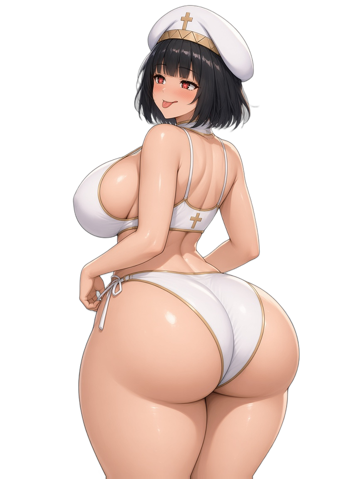

# NP_PictureAnim

## Название

Сеточная анимация картинок.

## Версия

1.0 (`@plugindesc`).

## Назначение

После Show Picture команда `NP_PicAnim <id> <пресет>` рисует картинку как `PIXI.mesh.Plane`. Вершины сдвигаются каждый кадр. Время берётся из счётчика кадров самой картинки (60 fps), поэтому цикл сохраняется вместе с ней.

Пресеты:

- `tease` — покачивание бёдер и дыхание, голова в жёсткой рамке.
- `laugh` — смех сидя.
- `breathe` — только дыхание.

Ключи: `amp`, `speed`, `period`, `rect` (главная область, 0–1), `head` (не деформируется), `chest`, `seg` (сетка, по умолчанию 24×32). `NP_PicAnim <id> off`, Erase Picture или новый Show Picture на том же номере снимают анимацию. `NP_PicAnim wait <кадры>` ждёт столько кадров или клик, OK либо отмену.

## Порядок загрузки

После `NP_OutfitReact`, перед `NP_Campfire`. Команду плагина вызывайте после Show Picture на том же номере картинки.

## Параметры

Параметров в менеджере плагинов нет. Пресеты и ключи задаются аргументами команды.

## Требования

Windows, **Alpha 0.80j**. Из скачанного ZIP запустите `install.bat` и укажите папку `www` игры. Категории в общем README — не порядок загрузки.

Пляжные картинки копирует установщик. Команды событий, которые их показывают, нет. Плагин может анимировать ту картинку, которую игра уже вывела.

## Установка

Скопируйте `NP_PictureAnim.js` в `www/js/plugins/` игры. Имя файла должно остаться `NP_PictureAnim.js`. В менеджере плагинов включите его в порядке из раздела [Порядок загрузки](#порядок-загрузки). RPG Maker MV читает плагины из `www/js/plugins/`, а не из папки `plugins/NP_PictureAnim/` в этом репозитории.

## Ресурсы

Скопируйте содержимое папки `assets/` этого плагина в `www/` игры и сохраните относительные пути. Файл `assets/img/pictures/example.png` должен оказаться в `www/img/pictures/example.png` (а `assets/movies/clip.webm` — в `www/movies/clip.webm`). Имя папки `assets` в путь игры не входит.

Пляжные картинки, под которые сняты области сетки:

- `img/pictures/np_beachanim_bg.png` — фон
- `img/pictures/np_beachanim_pri.png` — жрица (области пресета `tease` сняты с этой картинки)
- `img/pictures/np_beachanim_yar.png` — Яризо

Полный список и контрольные суммы: [INVENTORY.md](../../INVENTORY.md).

## Скриншоты

Это файлы картинок, которые использует плагин.

