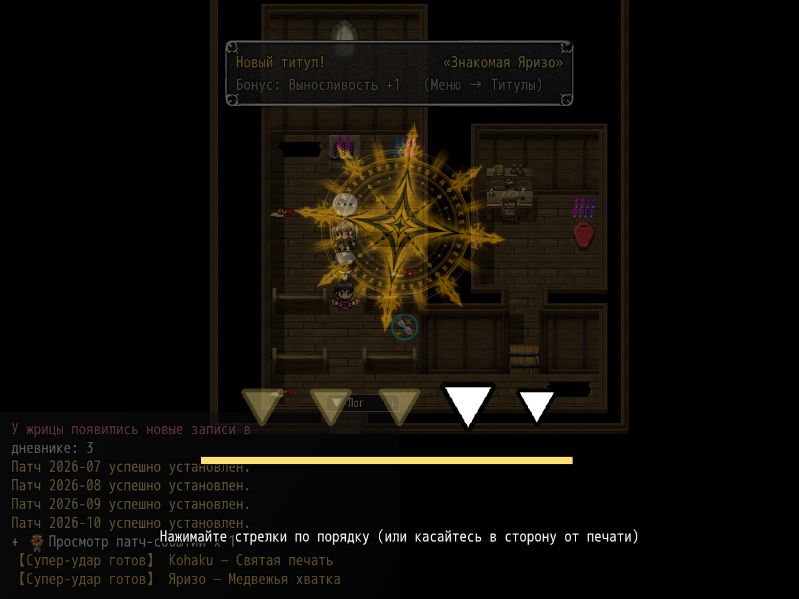

# NP_PowerStrike

## Название

Команда «Усиленный удар» с тремя QTE.

## Версия

1.1 (`@plugindesc`). В старой строке plugins.js стояло 1.0; в шапке скрипта — 1.1.

## Назначение

В меню боя героя и союзников сразу после «Атаки» появляется **Усиленный удар**. Выбор запускает одну из трёх нарисованных QTE. Таймеры зависят от сложности (переменная 3: Фап, Норма, Сложная, скрытая Лёгкая). Надписи на экране:

- Остановить маркер в золотой зоне (OK или касание).
- Зажать OK или кнопку мыши и отпустить в золотой зоне.
- Жать OK или кликать по кругам, пока они не погасли.

Оценка пишется в переменную результата. Следующая обычная атака (общее событие 36) один раз умножается уже после брони, и множитель сбрасывается. «Идеально» дополнительно играет анимацию 12. Удар добавляет усталость. `CommonEvents.json` не правится. Команды: `NP_PowerStrike run`, `NP_PowerStrike clear`.

## Порядок загрузки

После `NP_TitleProgress`, перед `NP_TitleVolume`. Команда встраивается в общие события 365 (герой) и 366 (союзники) в памяти, после `TB_CommonEventPatchLoader`. `NP_BattleCmd` ставьте после этого скрипта, чтобы он подписал иконку. `NP_SuperAttack` идёт позже и встаёт рядом с этой командой.

## Параметры

- **Result Variable** `3530` — оценка QTE: −1 пропуск, 0 слабо, 1 обычно, 2 хорошо, 3 идеально.
- **Multiplier Variable** `3531` — множитель урона ×100 (170 значит ×1.7). 0 — усиленного удара нет.
- Множители: идеально **1.7**, хорошо **1.25**, обычно **1.0**, слабо **0.6**.
- **Fatigue Rate** `0.5` — добавка усталости, удар стоит ×1.5 обычной атаки.
- **Command Icon** `131`, **Perfect Animation** `12`.
- **Fap Auto Success** `false` — если включено, сложность «Фап» пропускает QTE и ставит «Идеально».
- **Command Labels** `true` — подпись команды рядом с курсором иконки.

## Требования

Windows, **Alpha 0.80j**. Из скачанного ZIP запустите `install.bat` и укажите папку `www` игры. Категории в общем README — не порядок загрузки.

## Установка

Скопируйте `NP_PowerStrike.js` в `www/js/plugins/` игры. Имя файла должно остаться `NP_PowerStrike.js`. В менеджере плагинов включите его в порядке из раздела [Порядок загрузки](#порядок-загрузки). RPG Maker MV читает плагины из `www/js/plugins/`, а не из папки `plugins/NP_PowerStrike/` в этом репозитории.

## Скриншоты

На экране мини-игра на время. Число урона после неё не показано.
