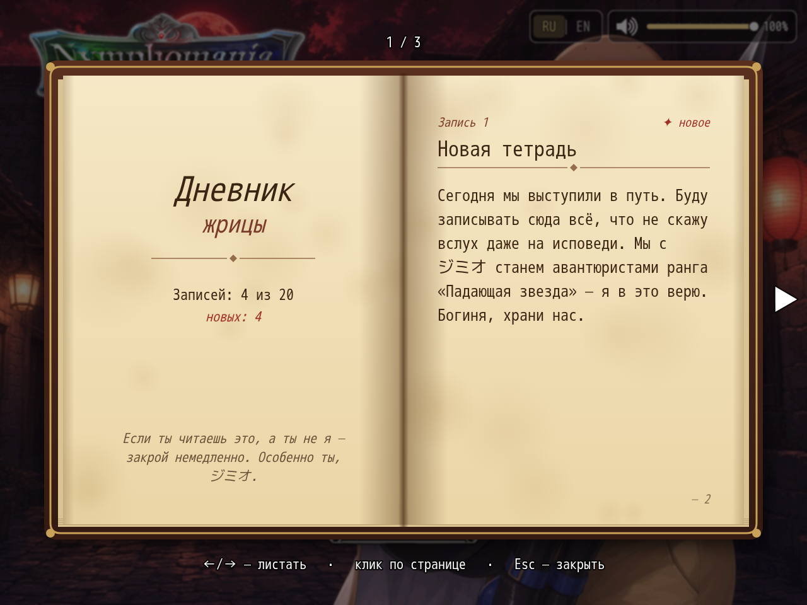

# NP_PriestessDiary

## Title

Priestess status page and diary book.

## Version

1.0 (`@plugindesc`).

## Purpose

Two places show the same priestess panel (actor 2):

- Character list, a new first page marked **♥**.
- The normal Status window, the same block along the bottom.

Meters, read from existing variables:

- Lust, variable 82 of 200, with the threshold marker from variable 98.
- Pure love, variable 83 of 200.
- Bond with Yarizo: level (variable 204, max 5) and points toward the next level.
- Depravity, variable 214 of 999.
- Nights away, variable 4292, a counter only.

Until Yarizo has actually been met, the bond meter is a neutral line and the thought line stays neutral. Stage names follow the diary's two branches (faithful, and the route gated by the mod's NTR flags). Thoughts and the stage label change with whichever branch the unlocked entries have reached.

The **Priestess's Diary** is a key item, given on a new game and added to old saves on load or on entering a map. Only the priestess, as party lead, can read it; anyone else gets a refusal window. The book uses left/right, Page Up/Down, the wheel, and clicks on each page. Escape or right click closes it. Entries unlock from switches and variables already in the game and are remembered in `$gameSystem._npDiary`. Commands: `NpDiary open`, `give`, `check`.

## Load order

After `NP_TitleVolume`, before `NP_Voice`. `NP_Titles` adds the active title into this status block, so load Titles later. `NP_MenuLayout` can open the diary from the pause menu.

## Parameters

- **Item Id** `1490` — key item created in an empty Items.json slot at boot.
- **Icon Index** `230` — open book.
- **Toast** `true` — the map log reports a new diary entry.

## Requires

Windows **Alpha 0.80j**. From the downloaded ZIP, run `install.bat` and give it the game `www` folder. README categories are not the load order.

## Install

Copy `NP_PriestessDiary.js` into the game's `www/js/plugins/` directory. The file name must stay `NP_PriestessDiary.js`. In Plugin Manager, turn it ON in the order in [Load order](#load-order). RPG Maker MV loads plugins from `www/js/plugins/`, not from this repository's `plugins/NP_PriestessDiary/` folder.

## Screenshots

The diary book is open. The corner also shows the volume widget and the RU | EN switch.
