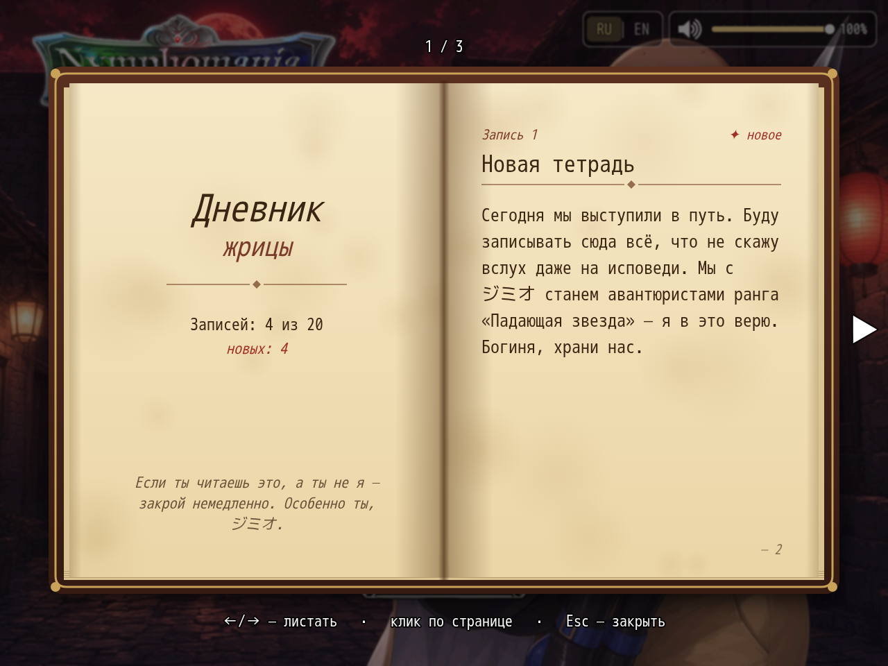

# NP_PriestessDiary

## Название

Страница состояния жрицы и дневник-книга.

## Версия

1.0 (`@plugindesc`).

## Назначение

Один и тот же блок жрицы (актёр 2) показывается в двух местах:

- Список персонажей, новая первая страница **♥**.
- Обычное окно «Статус», тот же блок внизу.

Шкалы читают уже существующие переменные:

- Похоть, переменная 82 из 200, метка порога — переменная 98.
- Чистая любовь, переменная 83 из 200.
- Связь с Яризо: уровень (переменная 204, максимум 5) и очки до следующего уровня.
- Развращённость, переменная 214 из 999.
- Ночные отлучки, переменная 4292, только счётчик.

Пока Яризо реально не встречен, шкала связи — нейтральная строка, и мысли тоже нейтральные. Названия стадий идут по двум веткам дневника (верная и ветка, которую открывают флаги NTR мода). Мысли и подпись стадии зависят от того, какие записи уже открыты.

**Дневник жрицы** — ключевой предмет. Он выдаётся в новой игре и дописывается в старые сейвы при загрузке или входе на карту. Читать может только жрица, пока она ведёт отряд; остальные получают окно отказа. Книга листается влево/вправо, Page Up/Down, колесом и кликом по странице. Esc или правая кнопка закрывают её. Записи открываются по уже существующим переключателям и переменным и запоминаются в `$gameSystem._npDiary`. Команды: `NpDiary open`, `give`, `check`.

## Порядок загрузки

После `NP_TitleVolume`, перед `NP_Voice`. `NP_Titles` дописывает активный титул в этот блок, поэтому титулы ставьте позже. `NP_MenuLayout` открывает дневник из меню паузы.

## Параметры

- **Item Id** `1490` — ключевой предмет, создаётся в пустом слоте Items.json при запуске.
- **Icon Index** `230` — открытая книга.
- **Toast** `true` — журнал карты сообщает о новой записи.

## Требования

Windows, **Alpha 0.80j**. Из скачанного ZIP запустите `install.bat` и укажите папку `www` игры. Категории в общем README — не порядок загрузки.

## Установка

Скопируйте `NP_PriestessDiary.js` в `www/js/plugins/` игры. Имя файла должно остаться `NP_PriestessDiary.js`. В менеджере плагинов включите его в порядке из раздела [Порядок загрузки](#порядок-загрузки). RPG Maker MV читает плагины из `www/js/plugins/`, а не из папки `plugins/NP_PriestessDiary/` в этом репозитории.

## Скриншоты

Старый игровой кадр. Это не новый снимок этой ревизии, и для этой правки игру не запускали.

Открыта книга дневника. В углу также видны ползунок громкости и переключатель RU | EN. Старый кадр.
