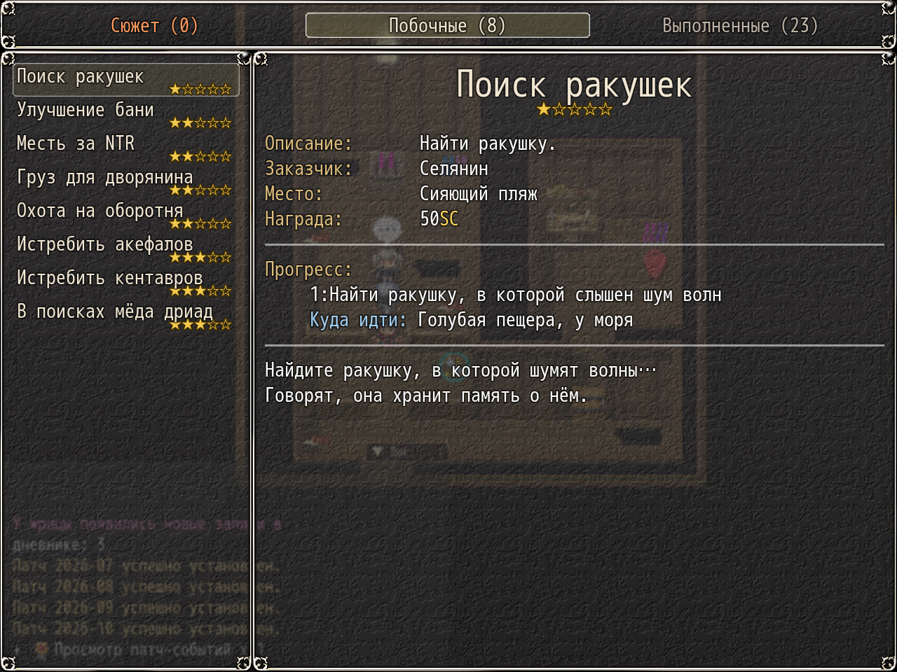

# NP_QuestHints

## Title

«Where to go» on the current quest step, plus tab counts.

## Version

Not numbered in `@plugindesc`.

## Purpose

Under the progress list of an active quest, one line reads **Куда идти: <place> / Where to go: <place>**. Only quests and steps listed in the script's table get a line, and only when the current variable range matches that step. Steps the author did not verify have no hint.

The existing KNS tabs «В процессе» and «Выполнено» also receive counts. `NP_QuestTabs`, loaded next, replaces those two tabs with three of its own and keeps the idea of a count in the tab name.

## Load order

After `NP_MorningHints`, before `NP_QuestTabs`. It writes into the KNS quest detail window. `NP_QuestTabs` replaces the two KNS tabs afterwards, and `NP_UIColors` colors this hint line, so both should load later.

## Parameters

No Plugin Manager parameters. Options row **Подсказки в журнале / Journal hints**. Off removes the added lines. QuestList.csv is not edited, so the places are not baked into the progress text.

## Requires

Windows **Alpha 0.80j**. From the downloaded ZIP, run `install.bat` and give it the game `www` folder. README categories are not the load order.

## Install

Copy `NP_QuestHints.js` into the game's `www/js/plugins/` directory. The file name must stay `NP_QuestHints.js`. In Plugin Manager, turn it ON in the order in [Load order](#load-order). RPG Maker MV loads plugins from `www/js/plugins/`, not from this repository's `plugins/NP_QuestHints/` folder.

## Screenshots

The quest window shows a where-to-go line. Journal tabs are on the same frame.
