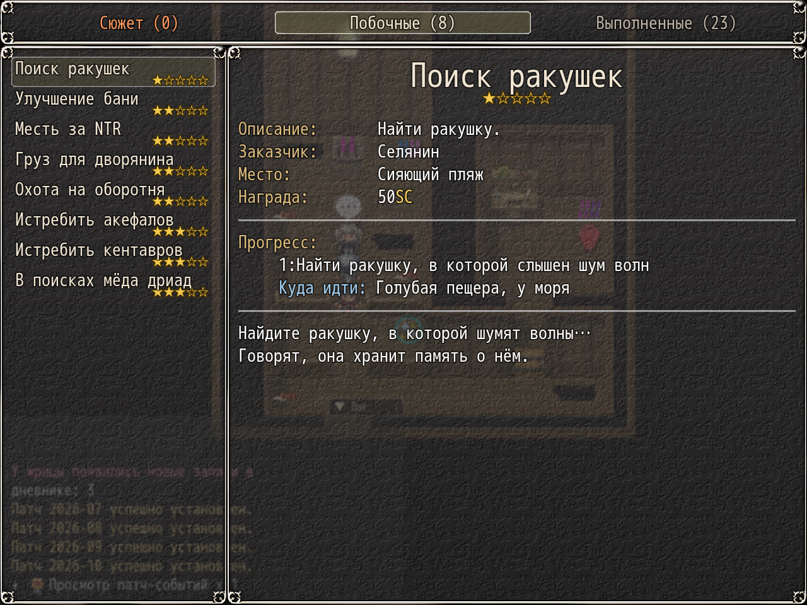

# NP_QuestHints

## Название

«Куда идти» на текущем этапе задания и счётчики вкладок.

## Версия

В `@plugindesc` номера нет.

## Назначение

Под списком прогресса активного задания появляется одна строка **Куда идти: <место>**. Строка есть только у заданий и этапов из таблицы скрипта и только когда текущий диапазон переменной совпадает с этим этапом. Этапы, которые автор не проверил, без подсказки.

Уже существующие вкладки KNS «В процессе» и «Выполнено» получают счётчики. Следующий плагин, `NP_QuestTabs`, заменяет эти две вкладки тремя своими и оставляет счётчик в имени вкладки.

## Порядок загрузки

После `NP_MorningHints`, перед `NP_QuestTabs`. Пишет в окно подробностей задания KNS. `NP_QuestTabs` потом заменяет две вкладки KNS, а `NP_UIColors` красит эту строку, поэтому оба должны грузиться позже.

## Параметры

Параметров в менеджере плагинов нет. Пункт **Подсказки в журнале**. Выключено — добавленные строки пропадают. QuestList.csv не правится, поэтому места не зашиты в текст прогресса.

## Требования

Windows, **Alpha 0.80j**. Из скачанного ZIP запустите `install.bat` и укажите папку `www` игры. Категории в общем README — не порядок загрузки.

## Установка

Скопируйте `NP_QuestHints.js` в `www/js/plugins/` игры. Имя файла должно остаться `NP_QuestHints.js`. В менеджере плагинов включите его в порядке из раздела [Порядок загрузки](#порядок-загрузки). RPG Maker MV читает плагины из `www/js/plugins/`, а не из папки `plugins/NP_QuestHints/` в этом репозитории.

## Скриншоты

Старый игровой кадр. Это не новый снимок этой ревизии, и для этой правки игру не запускали.

В окне задания видна строка, куда идти. На том же кадре вкладки журнала. Старый кадр.
