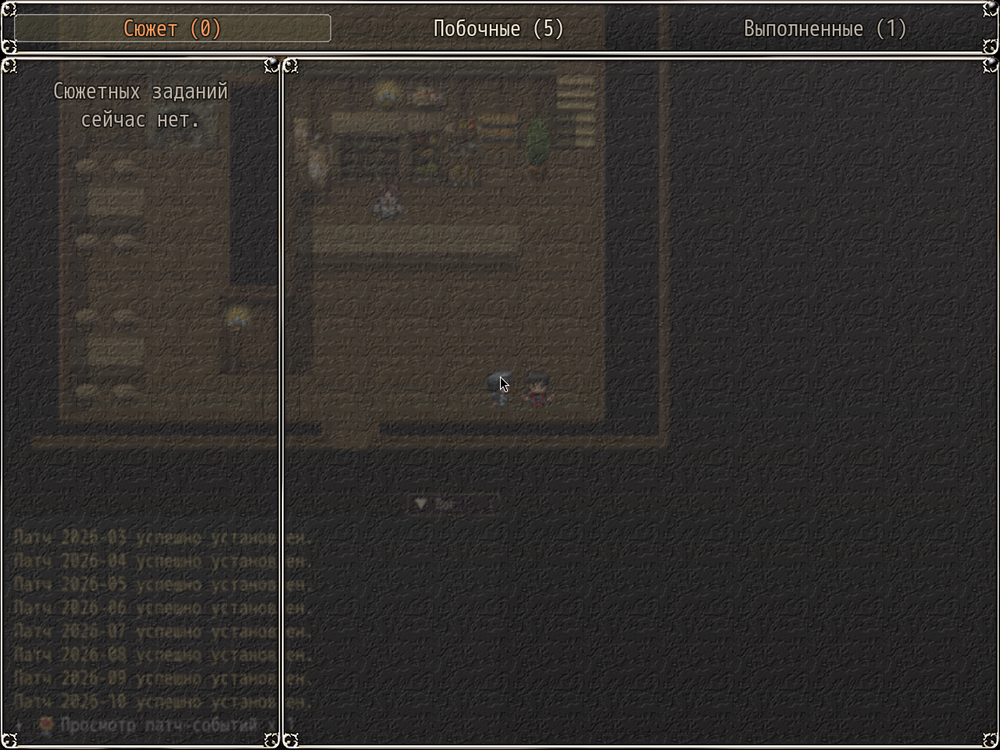
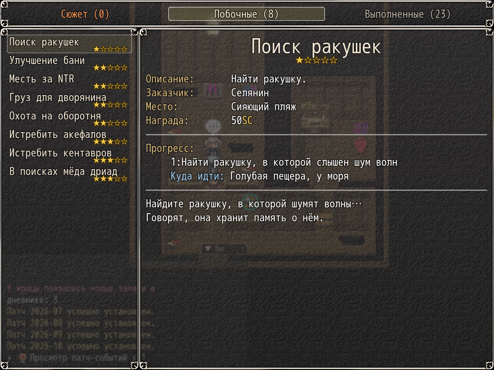

# NP_QuestTabs

## Title

Quest journal tabs: Story, Side, Completed.

## Version

Not numbered in `@plugindesc`.

## Purpose

The journal scene replaces the two KNS tabs:

- **Сюжет / Story** — active main-story quests.
- **Побочные / Side** — active side quests, tutorials included.
- **Выполненные / Completed** — everything finished, story first, then side. Story quests keep a small «Сюжет» tag, tutorials an «Обучение / Tutorial» tag.

Each tab name includes a count. An empty tab shows a short line instead of a blank list. KNS files and QuestList.csv are not modified.

## Load order

After `NP_QuestHints`, `NP_QuestMarker`, `NP_YarizoQuest`, and the KNS quest plugins. Before `NP_AudioBalance` in the mod list, and before `NP_UIColors` and `NP_OptionsCategories`. Only `Scene_KNSQuest` uses the new windows. The quest board, the HUD, and map markers are unchanged.

## Parameters

No Plugin Manager parameters. Classification is `NP_QuestTabs.TABLE` (id ranges) and `NP_QuestTabs.IDS` (single ids). Anything not listed is a side quest.

## Requires

Windows **Alpha 0.80j**. From the downloaded ZIP, run `install.bat` and give it the game `www` folder. README categories are not the load order.

## Install

Copy `NP_QuestTabs.js` into the game's `www/js/plugins/` directory. The file name must stay `NP_QuestTabs.js`. In Plugin Manager, turn it ON in the order in [Load order](#load-order). RPG Maker MV loads plugins from `www/js/plugins/`, not from this repository's `plugins/NP_QuestTabs/` folder.

## Screenshots

Older in-game frame. It is not a new capture of this revision, and the game was not launched for this change.

Three tabs sit in the header, each with a count: **Сюжет / Story (0)**, **Побочные / Side (5)**, **Выполненные / Completed (1)**. Story is selected and empty, so the list shows a short line instead of a blank page.

Journal tabs are visible above a where-to-go line. Older frame. The other capture in this folder is the tab row with counts.
