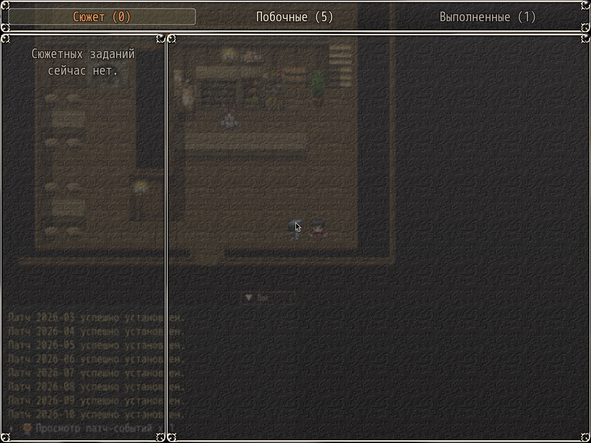

# NP_QuestTabs

## Название

Вкладки журнала: Сюжет, Побочные, Выполненные.

## Версия

В `@plugindesc` номера нет.

## Назначение

Сцена журнала заменяет две вкладки KNS:

- **Сюжет** — активные сюжетные задания.
- **Побочные** — активные побочные, включая обучение.
- **Выполненные** — всё законченное: сначала сюжет, потом побочные. У сюжетных остаётся маленькая метка «Сюжет», у обучения — «Обучение».

В имени вкладки есть счётчик. Пустая вкладка показывает короткую строку вместо пустого списка. Файлы KNS и QuestList.csv не меняются.

## Порядок загрузки

После `NP_QuestHints`, `NP_QuestMarker`, `NP_YarizoQuest` и плагинов заданий KNS. В списке мода перед `NP_AudioBalance`, а также перед `NP_UIColors` и `NP_OptionsCategories`. Новые окна только у `Scene_KNSQuest`. Доска заданий, HUD и метки на карте не меняются.

## Параметры

Параметров в менеджере плагинов нет. Классификация — `NP_QuestTabs.TABLE` (диапазоны id) и `NP_QuestTabs.IDS` (одиночные id). Всё, чего нет в списках, считается побочным.

## Установка

Скопируйте `NP_QuestTabs.js` в `www/js/plugins/` игры. Имя файла должно остаться `NP_QuestTabs.js`. В менеджере плагинов включите его в порядке из раздела [Порядок загрузки](#порядок-загрузки). RPG Maker MV читает плагины из `www/js/plugins/`, а не из папки `plugins/NP_QuestTabs/` в этом репозитории. Папка нужна, чтобы скрипт и описание было удобно смотреть на GitHub и позже вынести в отдельный git submodule.

## Скриншоты

В шапке три вкладки со счётчиками: **Сюжет (0)**, **Побочные (5)**, **Выполненные (1)**. Выбран пустой сюжет, поэтому вместо пустого списка стоит короткая строка.
