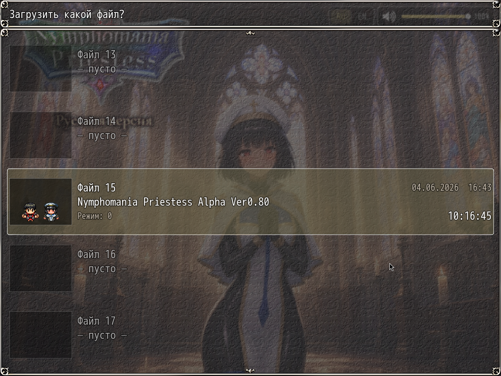

# NP_SaveThumb

## Title

Save-anywhere option and richer save slots.

## Version

1.0 (`@plugindesc`).

## Purpose

**Save anywhere.** The base game already allows the menu save almost everywhere, and common event 27 turns it off on maps whose note says `セーブ禁止` (ruins, Map255). With the option on, that map-note lock is lifted once no event or message is running. Locks set by event commands stay. Saving from the menu is still refused during battle (switch 14) and in the gallery (switch 5). Off restores the original rules.

**Save slots.** Each save's global info gains:

- A JPEG thumbnail of the map, about 4–6 KB at the default size.
- Chapter number from the main quests (`900Cxx`).
- The current main quest, or the quest in the navigator.
- Priestess stage 0–3, from the diary plugin when it is loaded.

The file window draws the thumbnail and those three lines. Old saves without the fields still open. Shared helpers for other plugins: `NP_Stage.compute()`, `label`, `color`, `drawHeart`.

## Load order

After `NP_Voice`, before `NP_OutfitReact`. Does not change `NP_AutoSave` files. Stage labels prefer `NP_PriestessDiary` when that plugin is present.

## Parameters

- **Save Anywhere** `true` — Options label **Сохранение везде**.
- **Thumb Width** `160`, **Thumb Height** `120`, **Jpeg Quality** `0.6`.
- **Stage Labels** `Верная жрица,Смятение,Двойная жизнь,Падение` — used only when the diary plugin is absent.

## Requires

Windows **Alpha 0.80j**. From the downloaded ZIP, run `install.bat` and give it the game `www` folder. README categories are not the load order.

## Install

Copy `NP_SaveThumb.js` into the game's `www/js/plugins/` directory. The file name must stay `NP_SaveThumb.js`. In Plugin Manager, turn it ON in the order in [Load order](#load-order). RPG Maker MV loads plugins from `www/js/plugins/`, not from this repository's `plugins/NP_SaveThumb/` folder.

## Screenshots

Older in-game frame. It is not a new capture of this revision, and the game was not launched for this change.

The file window is the load list. Empty rows stay blank. An occupied row shows a small preview, the file title, the date, and the play time.
