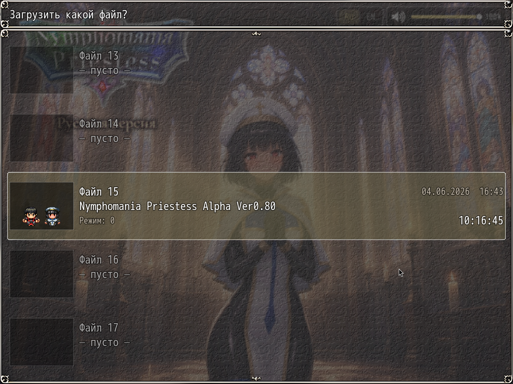

# NP_SaveThumb

## Название

Сохранение везде и подробные слоты.

## Версия

1.0 (`@plugindesc`).

## Назначение

**Сохранение везде.** Базовая игра и так пускает в меню сохранения почти отовсюду, а общее событие 27 выключает его на картах с заметкой `セーブ禁止` (руины, Map255). С включённой опцией этот запрет карты снимается, как только не идёт событие или сообщение. Запрет, поставленный командой события, остаётся. Из меню по-прежнему нельзя сохраняться в бою (переключатель 14) и в галерее (переключатель 5). Выключенная опция возвращает оригинальные правила.

**Слоты.** В общие сведения сейва дописываются:

- JPEG-снимок карты, при размере по умолчанию около 4–6 КБ.
- Номер главы по главным заданиям (`900Cxx`).
- Текущее главное задание или задание из навигатора.
- Стадия жрицы 0–3, из плагина дневника, если он загружен.

Окно файлов рисует снимок и эти три строки. Старые сейвы без полей открываются как раньше. Общие функции для других плагинов: `NP_Stage.compute()`, `label`, `color`, `drawHeart`.

## Порядок загрузки

После `NP_Voice`, перед `NP_OutfitReact`. Файлы `NP_AutoSave` не меняет. Подписи стадий берутся из `NP_PriestessDiary`, если тот плагин есть.

## Параметры

- **Save Anywhere** `true` — подпись **Сохранение везде**.
- **Thumb Width** `160`, **Thumb Height** `120`, **Jpeg Quality** `0.6`.
- **Stage Labels** `Верная жрица,Смятение,Двойная жизнь,Падение` — только если плагина дневника нет.

## Требования

Windows, **Alpha 0.80j**. Из скачанного ZIP запустите `install.bat` и укажите папку `www` игры. Категории в общем README — не порядок загрузки.

## Установка

Скопируйте `NP_SaveThumb.js` в `www/js/plugins/` игры. Имя файла должно остаться `NP_SaveThumb.js`. В менеджере плагинов включите его в порядке из раздела [Порядок загрузки](#порядок-загрузки). RPG Maker MV читает плагины из `www/js/plugins/`, а не из папки `plugins/NP_SaveThumb/` в этом репозитории.

## Скриншоты

Старый игровой кадр. Это не новый снимок этой ревизии, и для этой правки игру не запускали.

Окно файлов — список загрузки. Пустые строки остаются пустыми. У занятой строки маленькое превью, название файла, дата и время в игре.
