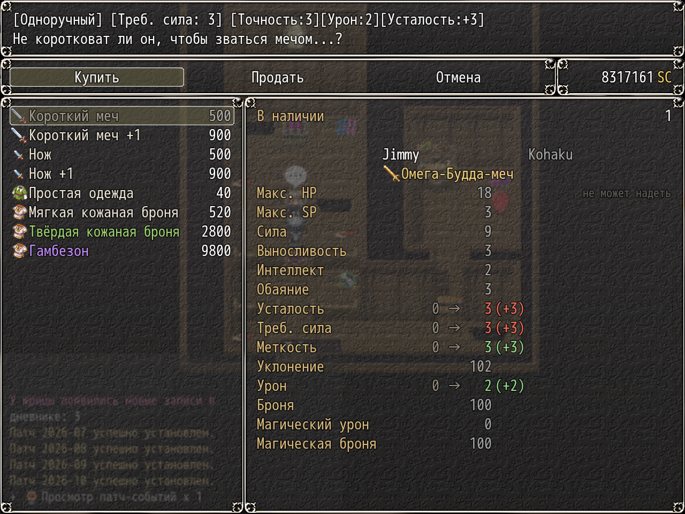
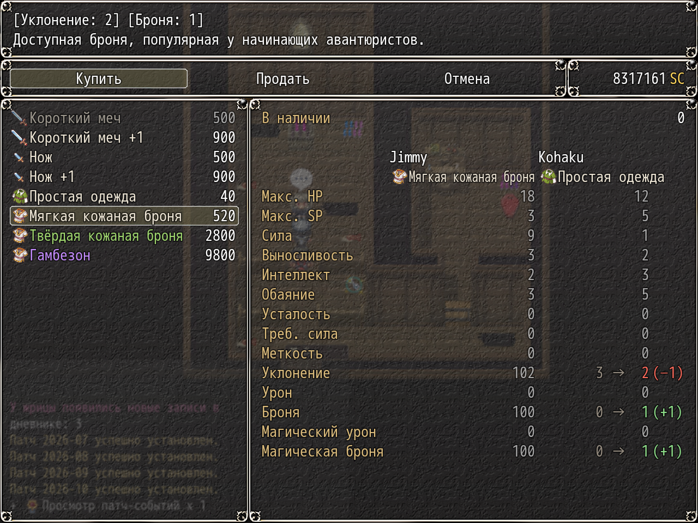

# NP_ShopCompare

## Title

Shop rows compare gear with what is worn.

## Version

Not numbered in `@plugindesc`.

## Purpose

On the equipment buy screen, every party member who can wear the highlighted item gets a comparison row: current value, arrow, new value, and the difference. Better is green, worse is red, unchanged rows are dimmed. If the column is narrow, the row shows the new value and the difference only.

Dice stats such as 1d3 are compared by their average. Fatigue and requirement rows treat a lower number as better, matching KNS. Only drawing changes. Equipment is restored after the measurement, so buying and selling are untouched.

## Load order

After `NP_YarizoQuest`, before `NP_BattleQoL`. Extends KNS `Window_ShopStatus`. Load before `NP_UIColors`, which recolors the up/down arrows, and before `NP_OptionsCategories`.

## Parameters

- **Enabled** `true` — Options label **Сравнение в лавке**. Off restores the original KNS shop status.

## Requires

Windows **Alpha 0.80j**. From the downloaded ZIP, run `install.bat` and give it the game `www` folder. README categories are not the load order.

## Install

Copy `NP_ShopCompare.js` into the game's `www/js/plugins/` directory. The file name must stay `NP_ShopCompare.js`. In Plugin Manager, turn it ON in the order in [Load order](#load-order). RPG Maker MV loads plugins from `www/js/plugins/`, not from this repository's `plugins/NP_ShopCompare/` folder.

## Screenshots

Older in-game frame. It is not a new capture of this revision, and the game was not launched for this change.

Buy list: current and new weapon stats. Older frame, not a new capture.

The same comparison for armor, two characters. Older frame.
