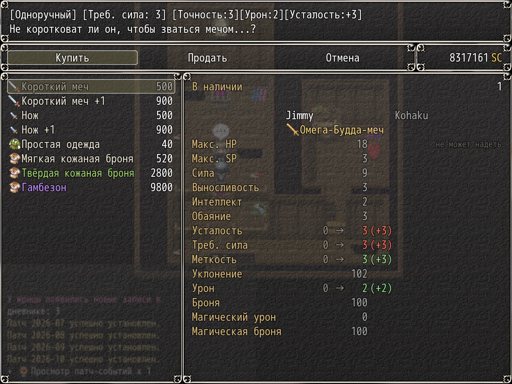
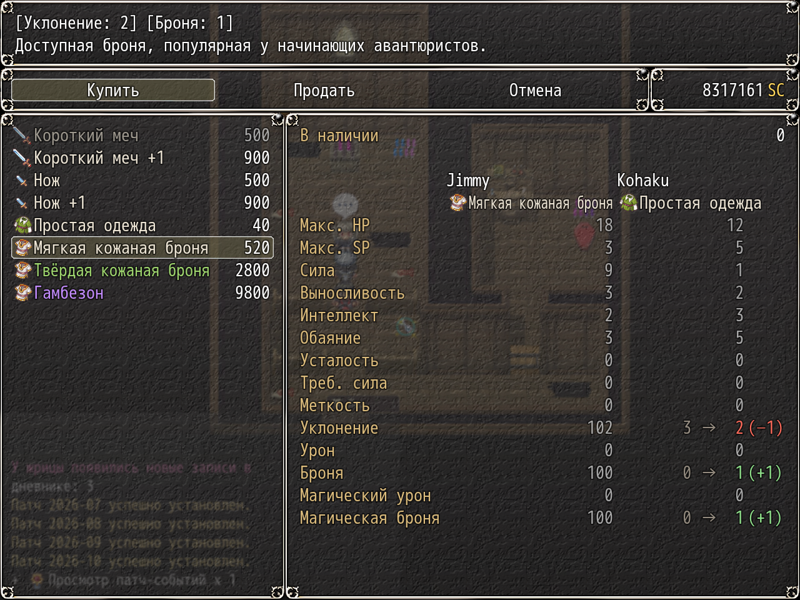

# NP_ShopCompare

## Название

В лавке строки сравнивают вещь с надетой.

## Версия

В `@plugindesc` номера нет.

## Назначение

На экране покупки экипировки у каждого члена отряда, который может надеть выбранную вещь, есть строка сравнения: текущее значение, стрелка, новое и разница. Лучше — зелёным, хуже — красным, без изменений — приглушённо. Если колонка узкая, остаётся новое значение и разница.

Кости вроде 1d3 сравниваются по среднему. Усталость и требования считают меньшее число лучшим, как в KNS. Меняется только отрисовка. После замера экипировка возвращается на место, покупка и продажа не затрагиваются.

## Порядок загрузки

После `NP_YarizoQuest`, перед `NP_BattleQoL`. Расширяет окно KNS `Window_ShopStatus`. Ставьте до `NP_UIColors`, который перекрашивает стрелки, и до `NP_OptionsCategories`.

## Параметры

- **Enabled** `true` — подпись **Сравнение в лавке**. Выключено — исходный вид KNS.

## Требования

Windows, **Alpha 0.80j**. Из скачанного ZIP запустите `install.bat` и укажите папку `www` игры. Категории в общем README — не порядок загрузки.

## Установка

Скопируйте `NP_ShopCompare.js` в `www/js/plugins/` игры. Имя файла должно остаться `NP_ShopCompare.js`. В менеджере плагинов включите его в порядке из раздела [Порядок загрузки](#порядок-загрузки). RPG Maker MV читает плагины из `www/js/plugins/`, а не из папки `plugins/NP_ShopCompare/` в этом репозитории.

## Скриншоты

Старый игровой кадр. Это не новый снимок этой ревизии, и для этой правки игру не запускали.

Список покупки: текущие и новые параметры оружия. Старый кадр, не новый снимок.

То же сравнение для брони, два персонажа. Старый кадр.
