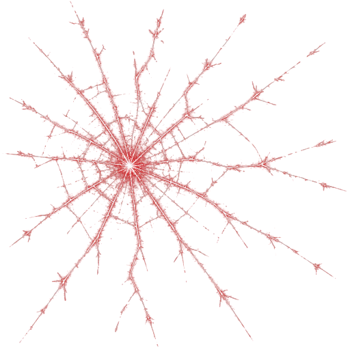
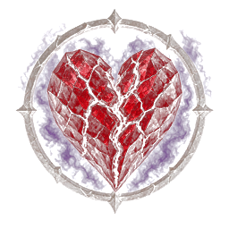

# NP_Stress

## Title

Party stress, breaks, virtues, and a temple.

## Version

1.1 (`@plugindesc`).

## Purpose

Every actor in the party has a stress value from 0 to 100, stored in `$gameSystem._npStress`. The gallery ignores it. With `NP_BattleHUD` off, bars are drawn over the battle status windows, with cracks or a glow when someone breaks or rallies. With the battle HUD on, those bars move onto the party cards.

At 100 the actor resolves a break or, less often, a rally. Examples of breaks: Distraction (dexterity down, chance to skip), Yearning (lust rises faster), Vulnerable (enemies prefer her), Jealousy, Paranoia, Wandering Hands, Panic, Rage, Apathy. Rallies: Resolve (stress rises at half speed), Holy Fire, Swagger. The result is logged and can leave a lasting trait.

Traits are virtual states. They are not rows in States.json. Positive examples: Devout, Steadfast, Tireless, Keen Eye, Battle Thrill, Cool-Headed, Brave Heart. Negative examples: Skittish, Insomnia, Nightmares, Cowardice, Fond of the Bottle, Broken Faith (priestess only), Jealous Type (hero only). Some pairs replace each other.

Sleep relieves stress unless the actor has Insomnia; Nightmares add stress in the morning. Battle itself adds a little at the start unless the actor is Tireless. Crits, heavy hits, allies falling, groping, and lewd lines all move the number, and traits scale those moves.

In town, the temple choice list gains **Temple Service (traits)**. The window lists each person's traits. The player can lock a trait for gold, unlock for free, or pay to remove one.

## Load order

After `NP_ClothDamage` and `NP_Titles`, before `NP_CampSkills`. `NP_BattleHUD` later draws the bar and the break cracks on the party card and hides this plugin's standalone bars. `NP_CampSkills` spends and relieves this stress.

## Parameters

No Plugin Manager parameters. Options row **Напряжение** turns both stress and traits off. The numbers stay in the save.

## Install

Copy `NP_Stress.js` into the game's `www/js/plugins/` directory. The file name must stay `NP_Stress.js`. In Plugin Manager, turn it ON in the order in [Load order](#load-order). RPG Maker MV loads plugins from `www/js/plugins/`, not from this repository's `plugins/NP_Stress/` folder.

## Assets

Copy the contents of this plugin's `assets/` folder into the game's `www/` directory and keep the relative paths. A file at `assets/img/pictures/example.png` must end up at `www/img/pictures/example.png` (and `assets/movies/clip.webm` at `www/movies/clip.webm`). The folder name `assets` is not part of the game path.

Overlay pictures drawn on the battle bars and, when `NP_BattleHUD` is on, on the party card:

- `img/pictures/np_stress_crack.png` — break cracks
- `img/pictures/np_stress_afflict.png` — affliction mark
- `img/pictures/np_stress_virtue.png` — rally glow

Full list and checksums: [INVENTORY.md](../../INVENTORY.md).

## Screenshots

