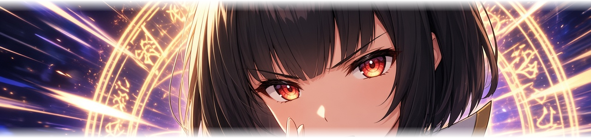
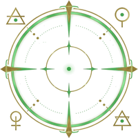
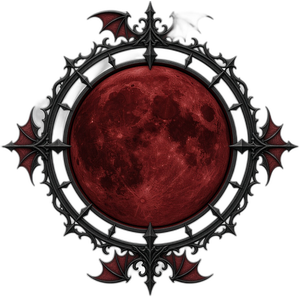
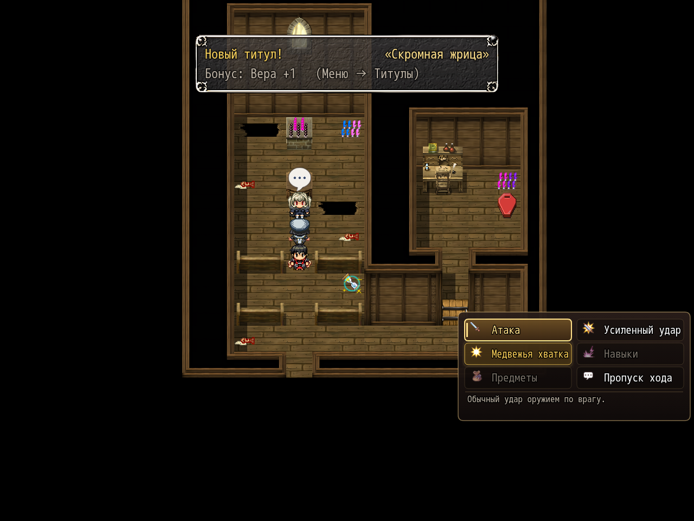
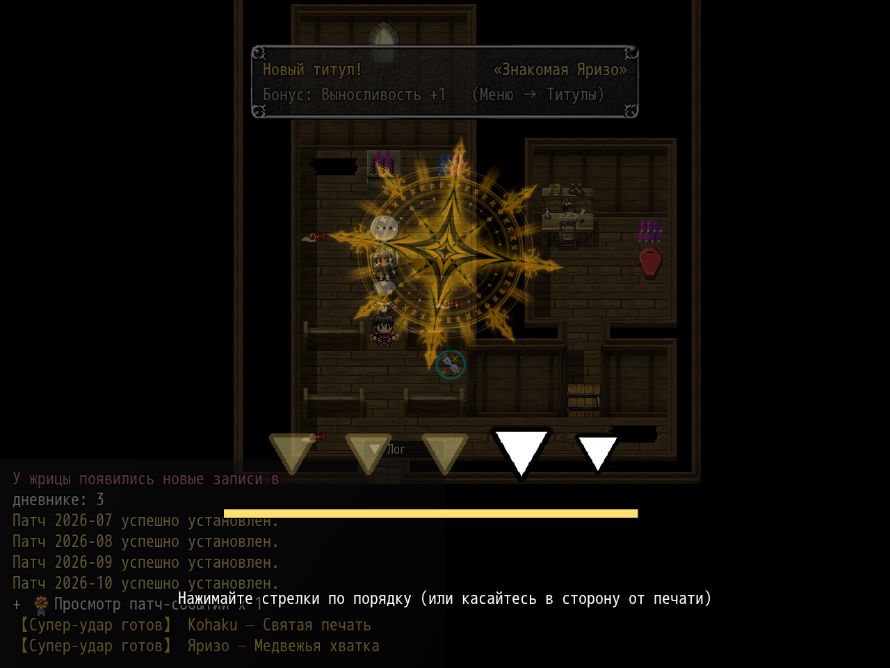

# NP_SuperAttack

## Title

Companion super attacks with a charge bar and a QTE.

## Version

1.2 (script constant `NP_SuperAttack.VERSION`). `@plugindesc` does not repeat the number.

## Purpose

Companion command lists (common event 366) gain a sixth command after Power Strike. It stays grey until that actor's charge is 100% and fatigue can pay the cost (+50, or +40 on Fap and Easy).

- Priestess (2), **Святая печать / Holy Seal** — an arrow sequence. Holy damage and a party heal.
- Yarizo (21), **Медвежья хватка / Bear Grip** — mash into a zone. Stun. Overfilling the mash makes him skip his next turn.
- Potion Maker (10), **Бросок склянки / Flask Throw** — a sweeping reticle. Fire, poison, or sleep. A miss breaks the flask.
- Vampire princess (19), **Кровавая луна / Blood Moon** — a rotating needle stopped three times. The party gains lifesteal for the rest of the battle.

Charge comes from damage dealt, damage taken, an ally falling, and each of the actor's own turns, all times the fill rate. A full bar is kept after the battle. Options row **Автовыполнение QTE / Auto QTE** always takes an average result. The command is not offered in the gallery, during auto battle, or while Ctrl-skip is held. Old saves create the bars lazily. `NP_BattleHUD` draws the bar on the party card.

## Load order

After `NP_PowerStrike`, `NP_Stress`, `NP_FastBattle`, and `NP_BattleQoL`. In the mod list it sits after `NP_BattleQoL` and before `NP_BossBalance`. `NP_BattleHUD` and `NP_BattleCmd` come later and should stay after this script. The hero has no super.

## Parameters

- **Icon** `143`.
- **Charge fill rate** `0.44` — about a full bar in 6–7 ordinary rounds. `1` is the old, faster rate.
- **Min damage: base** `5`, **per level** `0.25`, **stat divisor** `4`. The super's base hit is at least this, before the QTE multiplier and armor. The stat is attack for Yarizo and the higher of attack and magic attack for the others. Divisor `0` turns the stat term off.

## Requires

Windows **Alpha 0.80j**. From the downloaded ZIP, run `install.bat` and give it the game `www` folder. README categories are not the load order.

## Install

Copy `NP_SuperAttack.js` into the game's `www/js/plugins/` directory. The file name must stay `NP_SuperAttack.js`. In Plugin Manager, turn it ON in the order in [Load order](#load-order). RPG Maker MV loads plugins from `www/js/plugins/`, not from this repository's `plugins/NP_SuperAttack/` folder.

## Assets

Copy the contents of this plugin's `assets/` folder into the game's `www/` directory and keep the relative paths. A file at `assets/img/pictures/example.png` must end up at `www/img/pictures/example.png` (and `assets/movies/clip.webm` at `www/movies/clip.webm`). The folder name `assets` is not part of the game path.

Cut-ins and the QTE pictures, all under `img/pictures/`:

- `np_super_cutin_pri.png` — priestess (Holy Seal)
- `np_super_cutin_yar.png` — Yarizo (Bear Grip)
- `np_super_cutin_pm.png` — Potion Maker (Flask Throw)
- `np_super_cutin_vp.png` — vampire princess (Blood Moon)
- `np_super_sign.png` — Holy Seal marker
- `np_super_flask.png` and `np_super_reticle.png` — Flask Throw
- `np_super_moon.png` — Blood Moon needle

Full list and checksums: [INVENTORY.md](../../INVENTORY.md).

## Screenshots

These are the picture files the plugin uses.

The super command is in the battle menu. The attack animation is not shown.

A seal minigame is visible. This frame is not proof the super attack connected.
