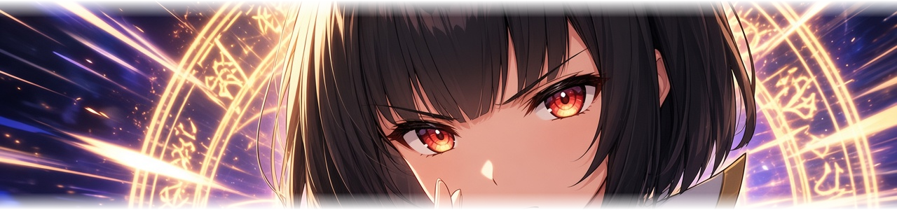
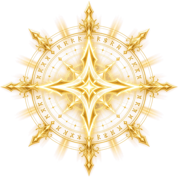
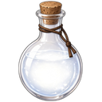
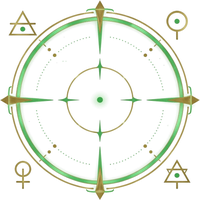
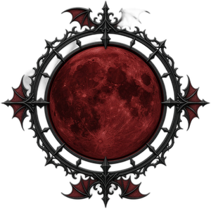
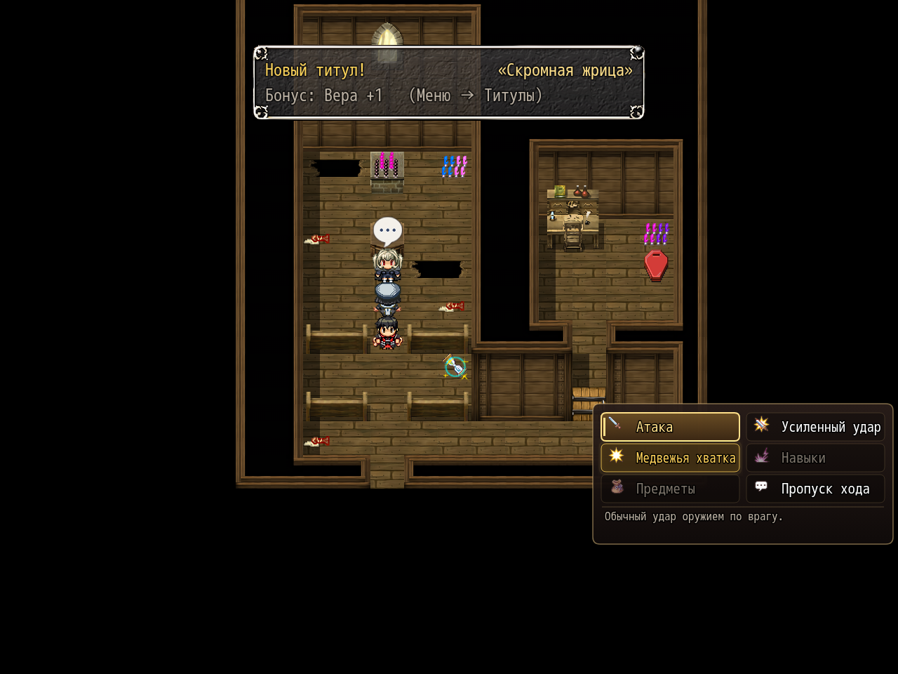
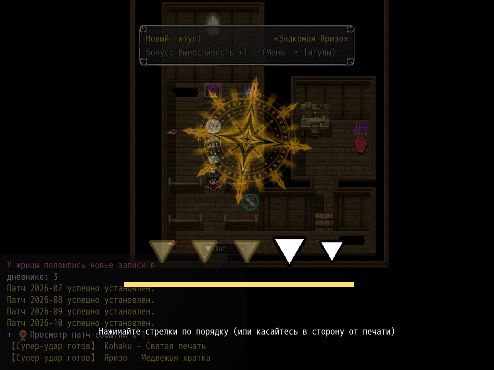

# NP_SuperAttack

## Название

Супер-удары спутников: шкала заряда и QTE.

## Версия

1.2 (константа `NP_SuperAttack.VERSION`). В `@plugindesc` номер не повторён.

## Назначение

В меню спутников (общее событие 366) после усиленного удара появляется шестая команда. Она серая, пока заряд этого актёра не 100% и пока усталости хватает на цену (+50, на Фапе и Лёгкой +40).

- Жрица (2), **Святая печать** — последовательность стрелок. Святой урон и лечение отряда.
- Яризо (21), **Медвежья хватка** — набивание в зону. Оглушение. Если набить слишком много, он пропускает следующий ход.
- Зельеварка (10), **Бросок склянки** — бегущий прицел. Огонь, яд или сон. Промах разбивает склянку.
- Принцесса-вампир (19), **Кровавая луна** — вращающаяся стрелка, три остановки. До конца боя у отряда вампиризм.

Заряд копится от нанесённого и полученного урона, падения союзника и каждого своего хода, всё это умножается на скорость заполнения. Полная шкала сохраняется после боя. Пункт **Автовыполнение QTE** всегда берёт средний результат. Команды нет в галерее, в автобое и при зажатом пропуске на Ctrl. Старые сейвы создают шкалы при первом обращении. `NP_BattleHUD` рисует шкалу на карточке отряда.

## Порядок загрузки

После `NP_PowerStrike`, `NP_Stress`, `NP_FastBattle` и `NP_BattleQoL`. В списке мода он стоит после `NP_BattleQoL` и перед `NP_BossBalance`. `NP_BattleHUD` и `NP_BattleCmd` идут позже и должны остаться после этого скрипта. У героя супера нет.

## Параметры

- **Icon** `143`.
- **Скорость заряда** `0.44` — полная шкала примерно за 6–7 обычных раундов. `1` — старая, быстрая скорость.
- **Минимальный урон: база** `5`, **за уровень** `0.25`, **делитель параметра** `4`. Базовый удар супера не ниже этого ещё до множителя QTE и брони. Параметр — атака у Яризо и большее из атаки и маг. атаки у остальных. Делитель `0` выключает добавку от параметра.

## Требования

Windows, **Alpha 0.80j**. Из скачанного ZIP запустите `install.bat` и укажите папку `www` игры. Категории в общем README — не порядок загрузки.

## Установка

Скопируйте `NP_SuperAttack.js` в `www/js/plugins/` игры. Имя файла должно остаться `NP_SuperAttack.js`. В менеджере плагинов включите его в порядке из раздела [Порядок загрузки](#порядок-загрузки). RPG Maker MV читает плагины из `www/js/plugins/`, а не из папки `plugins/NP_SuperAttack/` в этом репозитории.

## Ресурсы

Скопируйте содержимое папки `assets/` этого плагина в `www/` игры и сохраните относительные пути. Файл `assets/img/pictures/example.png` должен оказаться в `www/img/pictures/example.png` (а `assets/movies/clip.webm` — в `www/movies/clip.webm`). Имя папки `assets` в путь игры не входит.

Кат-ины и картинки QTE, все в `img/pictures/`:

- `np_super_cutin_pri.png` — жрица (Святая печать)
- `np_super_cutin_yar.png` — Яризо (Медвежья хватка)
- `np_super_cutin_pm.png` — Зельеварка (Бросок склянки)
- `np_super_cutin_vp.png` — принцесса-вампир (Кровавая луна)
- `np_super_sign.png` — маркер Святой печати
- `np_super_flask.png` и `np_super_reticle.png` — Бросок склянки
- `np_super_moon.png` — стрелка Кровавой луны

Полный список и контрольные суммы: [INVENTORY.md](../../INVENTORY.md).

## Скриншоты

Это файлы картинок, которые использует плагин.

Команда супера в меню боя. Анимация удара не показана.

Видна мини-игра с печатью. Кадр не доказывает, что суперудар попал.
