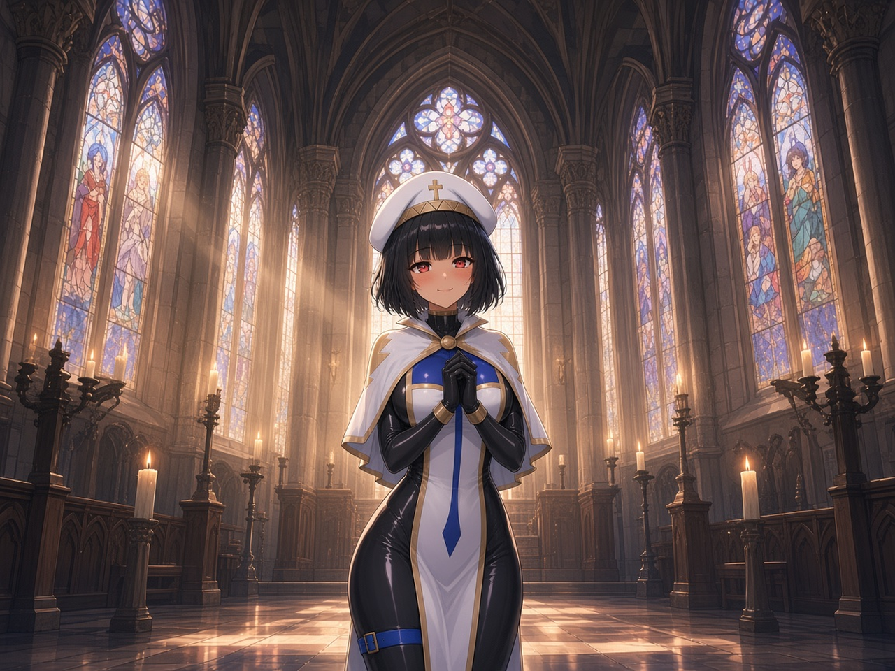
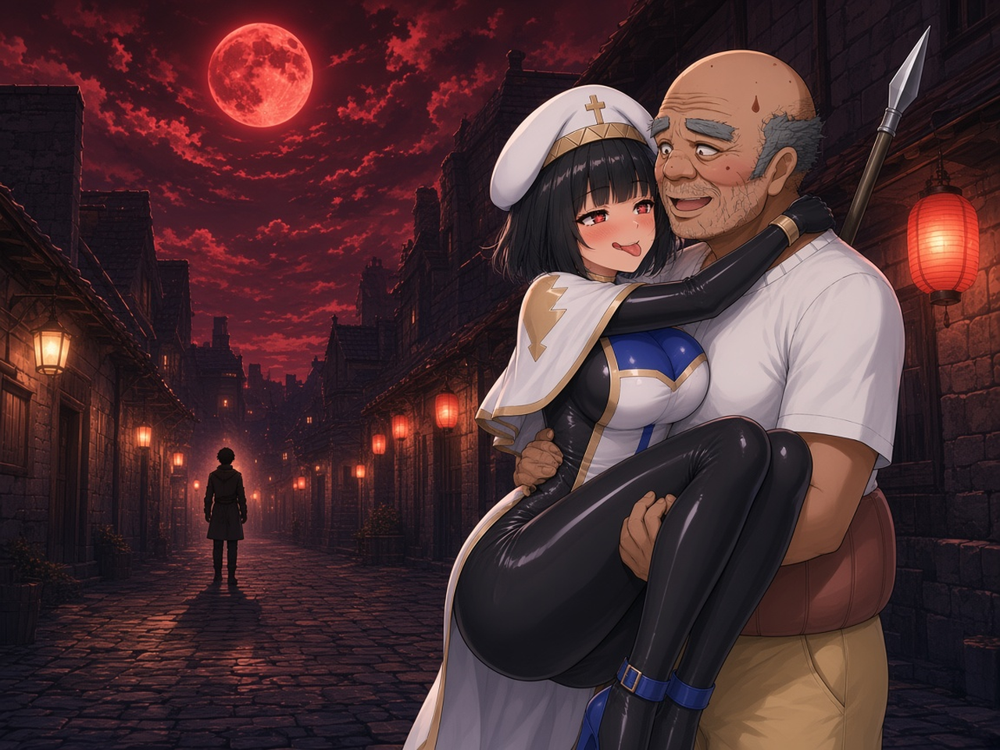
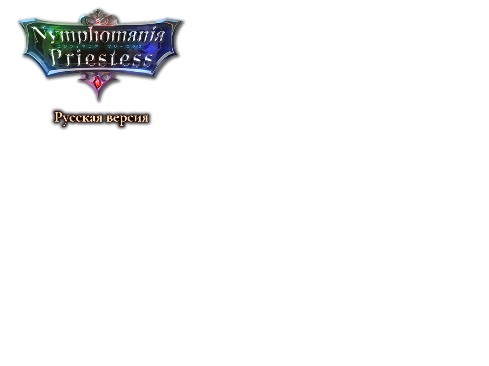

# NP_TitleProgress

## Title

Title screen that follows the Yarizo route.

## Version

1.0 (`@plugindesc`).

## Purpose

The title the player sees is the furthest stage ever reached on this install, not the stage of the save they happen to highlight. Gallery mode (switch 5) is not counted. The stage only increases.

- Stage 0 — fresh install.
- Stage 1 — Yarizo contract (switch 643) or bond variable 204 at least 2.
- Stage 2 — bond at least 3.
- Stage 3 — bond at least 4.

Each stage has its own background and BGM. The picture slowly zooms and pans when Ken Burns is on. Turning the option off always shows stage 0.

## Load order

After `NP_FastBattle`, before `NP_PowerStrike`. Does not depend on `NP_TitleVolume`. The furthest stage is stored in `config.rpgsave`, so the title knows it without loading a save.

## Parameters

- **Enabled** `true` — Options label **Заставка по прогрессу**. Off forces stage 0.
- **Backgrounds** `np_title_s0,np_title_s1,np_title_s2,np_title_s3` in `img/titles1`.
- **Logo** `np_title_logo` in `img/titles2`.
- **Bgm** four tracks, volumes **90,90,90,100**. An empty name falls back to the system title BGM.
- **Ken Burns** `true` — slow zoom and pan of the background.

## Requires

Windows **Alpha 0.80j**. From the downloaded ZIP, run `install.bat` and give it the game `www` folder. README categories are not the load order.

Title pictures are copied by the installer. The music names are files that already belong to the game.

## Install

Copy `NP_TitleProgress.js` into the game's `www/js/plugins/` directory. The file name must stay `NP_TitleProgress.js`. In Plugin Manager, turn it ON in the order in [Load order](#load-order). RPG Maker MV loads plugins from `www/js/plugins/`, not from this repository's `plugins/NP_TitleProgress/` folder.

## Assets

Copy the contents of this plugin's `assets/` folder into the game's `www/` directory and keep the relative paths. A file at `assets/img/pictures/example.png` must end up at `www/img/pictures/example.png` (and `assets/movies/clip.webm` at `www/movies/clip.webm`). The folder name `assets` is not part of the game path.

Stage backgrounds and logos. Title BGM stays the stock tracks already in the game; those audio files are not here.

- `img/titles1/np_title_s0.png` — stage 0
- `img/titles1/np_title_s1.png` — stage 1
- `img/titles1/np_title_s2.png` — stage 2
- `img/titles1/np_title_s3.png` — stage 3
- `img/titles2/np_title_logo.png` — logo
- `img/titles2/np_title_logo_en.png` — logo used with the English title art

Full list and checksums: [INVENTORY.md](../../INVENTORY.md).

## Screenshots

These are the picture files the plugin uses.

