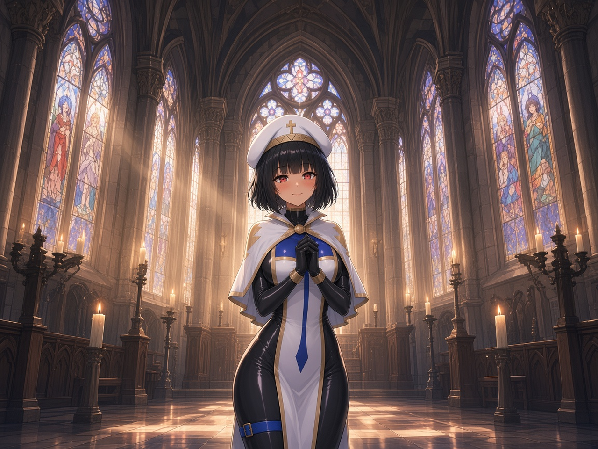
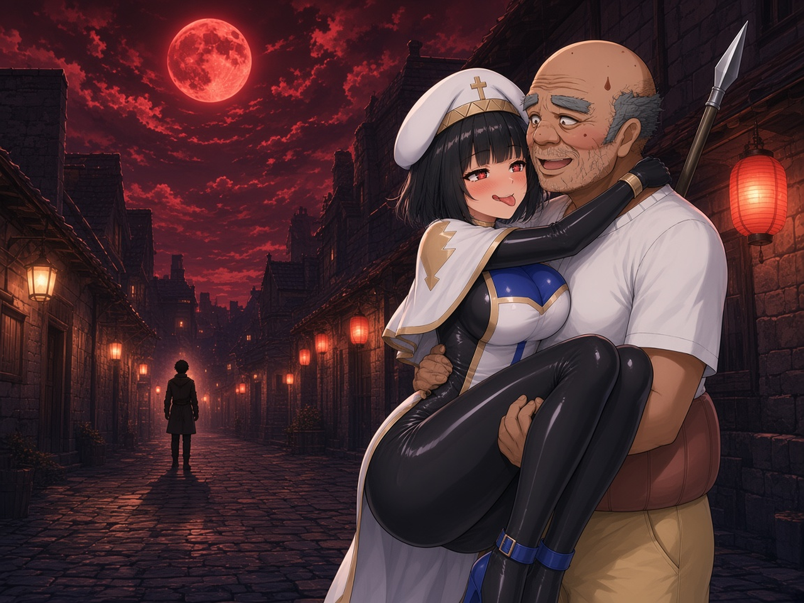
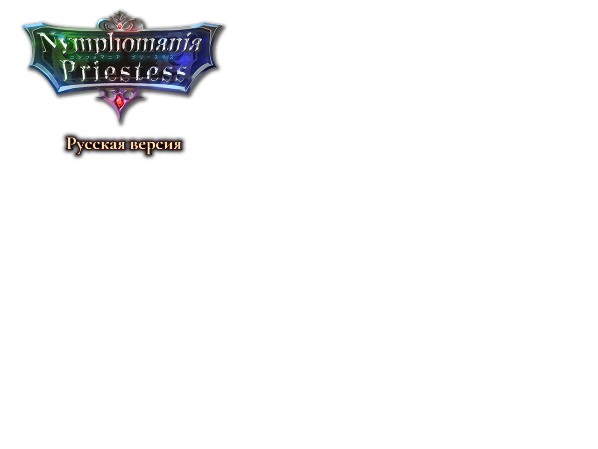

# NP_TitleProgress

## Название

Титульный экран по линии Яризо.

## Версия

1.0 (`@plugindesc`).

## Назначение

Титул показывает самый дальний этап, которого эта установка когда-либо достигала, а не этап того сейва, на котором стоит курсор. Режим галереи (переключатель 5) не считается. Этап только растёт.

- Этап 0 — новая установка.
- Этап 1 — договор с Яризо (переключатель 643) или связь (переменная 204) не ниже 2.
- Этап 2 — связь не ниже 3.
- Этап 3 — связь не ниже 4.

У каждого этапа свой фон и своя музыка. При включённом Ken Burns картинка медленно зумится и едет. Выключенная опция всегда показывает этап 0.

## Порядок загрузки

После `NP_FastBattle`, перед `NP_PowerStrike`. От `NP_TitleVolume` не зависит. Дальний этап пишется в `config.rpgsave`, поэтому титул знает его без загрузки сейва.

## Параметры

- **Enabled** `true` — подпись **Заставка по прогрессу**. Выключено — всегда этап 0.
- **Backgrounds** `np_title_s0,np_title_s1,np_title_s2,np_title_s3` в `img/titles1`.
- **Logo** `np_title_logo` в `img/titles2`.
- **Bgm** четыре трека, громкости **90,90,90,100**. Пустое имя — музыка титула из системы.
- **Ken Burns** `true` — медленный зум и панорама фона.

## Требования

Windows, **Alpha 0.80j**. Из скачанного ZIP запустите `install.bat` и укажите папку `www` игры. Категории в общем README — не порядок загрузки.

Картинки титула копирует установщик. Имена музыки — файлы, которые уже есть в игре.

## Установка

Скопируйте `NP_TitleProgress.js` в `www/js/plugins/` игры. Имя файла должно остаться `NP_TitleProgress.js`. В менеджере плагинов включите его в порядке из раздела [Порядок загрузки](#порядок-загрузки). RPG Maker MV читает плагины из `www/js/plugins/`, а не из папки `plugins/NP_TitleProgress/` в этом репозитории.

## Ресурсы

Скопируйте содержимое папки `assets/` этого плагина в `www/` игры и сохраните относительные пути. Файл `assets/img/pictures/example.png` должен оказаться в `www/img/pictures/example.png` (а `assets/movies/clip.webm` — в `www/movies/clip.webm`). Имя папки `assets` в путь игры не входит.

Фоны этапов и логотипы. Музыка титула — штатные треки игры; звуковых файлов здесь нет.

- `img/titles1/np_title_s0.png` — этап 0
- `img/titles1/np_title_s1.png` — этап 1
- `img/titles1/np_title_s2.png` — этап 2
- `img/titles1/np_title_s3.png` — этап 3
- `img/titles2/np_title_logo.png` — логотип
- `img/titles2/np_title_logo_en.png` — логотип для английского титула

Полный список и контрольные суммы: [INVENTORY.md](../../INVENTORY.md).

## Скриншоты

Картинки ниже — файлы из состава плагина, а не новый снимок игры.

