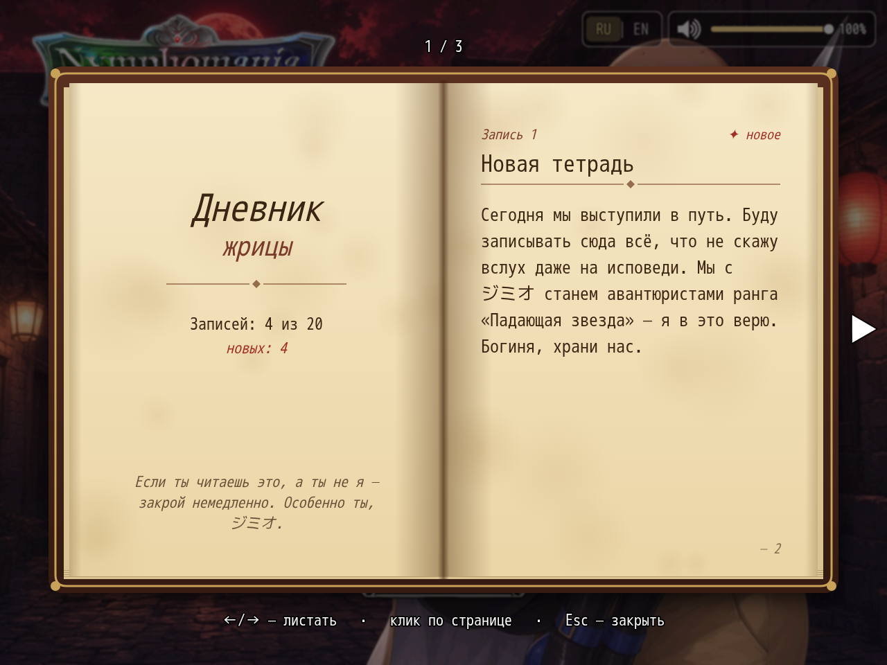

# NP_TitleVolume

## Title

Title-screen speaker and volume slider.

## Version

1.0 (`@plugindesc`).

## Purpose

The title screen gets a 300×52 widget: a speaker and a slider.

- Click or tap the speaker to mute BGM. The previous volume is remembered and restored on the next click.
- Click or drag the bar to set 0–100 in steps of 10.
- Mouse wheel over the widget changes volume by 10.
- M does the same as the speaker, and only on the title.

The value is `ConfigManager.bgmVolume`, the same Options row as BGM volume. It applies at once and is saved with `ConfigManager.save()`.

## Load order

After `NP_PowerStrike`, before `NP_PriestessDiary`. Independent of `NP_TitleProgress`. `NP_Language` draws its RU|EN button to the left of this widget.

## Parameters

- **Corner** `topright` (`topright` or `bottomright`).
- **Hotkey** `77` — key code M. `0` disables the key.

## Requires

Windows **Alpha 0.80j**. From the downloaded ZIP, run `install.bat` and give it the game `www` folder. README categories are not the load order.

## Install

Copy `NP_TitleVolume.js` into the game's `www/js/plugins/` directory. The file name must stay `NP_TitleVolume.js`. In Plugin Manager, turn it ON in the order in [Load order](#load-order). RPG Maker MV loads plugins from `www/js/plugins/`, not from this repository's `plugins/NP_TitleVolume/` folder.

## Screenshots

Older in-game frame. It is not a new capture of this revision, and the game was not launched for this change.

The volume widget is in the corner of this diary frame. This is not a title-screen capture.
