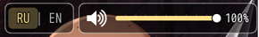

# NP_TitleVolume

## Название

Динамик и ползунок громкости на титуле.

## Версия

1.0 (`@plugindesc`).

## Назначение

На титульном экране появляется виджет 300×52: динамик и ползунок.

- Клик или касание динамика выключает BGM. Прежняя громкость запоминается и возвращается следующим кликом.
- Клик или перетаскивание ставят 0–100 с шагом 10.
- Колесо мыши над виджетом меняет громкость на 10.
- Клавиша M делает то же, что динамик, и только на титуле.

Значение — `ConfigManager.bgmVolume`, тот же пункт, что «Громкость BGM». Оно применяется сразу и пишется через `ConfigManager.save()`.

## Порядок загрузки

После `NP_PowerStrike`, перед `NP_PriestessDiary`. От `NP_TitleProgress` не зависит. `NP_Language` рисует кнопку RU|EN слева от этого виджета.

## Параметры

- **Corner** `topright` (`topright` или `bottomright`).
- **Hotkey** `77` — код клавиши M. `0` отключает клавишу.

## Требования

Windows, **Alpha 0.80j**. Из скачанного ZIP запустите `install.bat` и укажите папку `www` игры. Категории в общем README — не порядок загрузки.

## Установка

Скопируйте `NP_TitleVolume.js` в `www/js/plugins/` игры. Имя файла должно остаться `NP_TitleVolume.js`. В менеджере плагинов включите его в порядке из раздела [Порядок загрузки](#порядок-загрузки). RPG Maker MV читает плагины из `www/js/plugins/`, а не из папки `plugins/NP_TitleVolume/` в этом репозитории.

## Скриншоты

Это вырезка полосы титула, не весь титульный экран. Снята до загрузки файла 15. Отмечен RU, ползунок показывает 100%. Кнопка RU | EN рядом — `NP_Language`; её не нажимали. Смены фона титула на кадре нет, поэтому это не снимок `NP_TitleProgress`.
