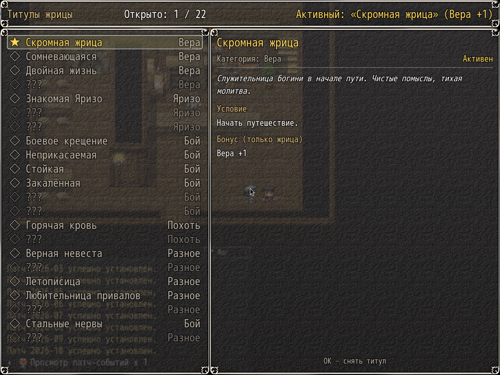
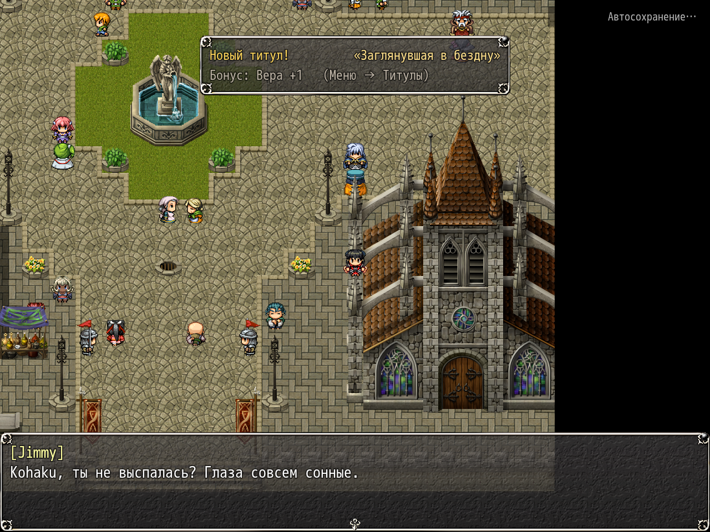

# NP_Titles

## Title

Priestess titles, one equipped bonus.

## Version

1.0 (`@plugindesc`).

## Purpose

The priestess (actor 2) collects titles. The menu command opens a list of unlocked titles and locked ones shown as `???` when a hint exists. The detail pane shows the description, the condition, progress, and the bonus. OK equips or removes the title. Only one title is active, and its bonus applies only to her.

A new unlock shows a short window at the top of the screen. It does not block input. Checks run after a battle (switch 14 falling), after a map change, and about every two seconds on the map. Nothing unlocks during the fight itself, and nothing unlocks or applies in the gallery.

The twenty titles, by category:

- Faith: Humble Priestess (start), Doubting, Double Life, Fallen Saint (Yarizo stages 1–3).
- Yarizo: Acquaintance (contract), Favorite (bond 5), Night Visitor (5 nights away).
- Combat: Baptism by Fire (first win), Untouchable (10 wins in a row without harassment), Steadfast (20 wins while harassed), Battle-Hardened (100 wins), Monster Slayer (four uniques), Torn but Alive (win at maximum clothing damage).
- Lust: Hot-Blooded (threshold crossed 10 times), Insatiable (lust 200).
- Misc: Faithful Bride (love 150), Beach Beauty, Chronicler (every diary entry), Campfire Lover (20 camp talks), Gazed into the Abyss (a grim ending seen).

Yarizo titles require `NP_PriestessDiary.yarizoMet()`. Bonuses are small flat parameter adds (and one faith penalty on Fallen Saint and Insatiable). State is `$gameSystem._npTitles`. Commands: `NpTitles open`, `check`, `unlock <id>`.

## Load order

After `NP_Campfire`, before `NP_ClothDamage`. Place it before `NP_Stress`. It writes the active title into the diary status panel, so `NP_PriestessDiary` should already be loaded. The «Torn but Alive» title stays hidden unless `NP_ClothDamage` is present.

## Parameters

- **Popup** `true` — Options label **Уведомления о титулах**.
- **Menu Label** `Титулы` — empty hides the main-menu command.

## Requires

Windows **Alpha 0.80j**. From the downloaded ZIP, run `install.bat` and give it the game `www` folder. README categories are not the load order.

## Install

Copy `NP_Titles.js` into the game's `www/js/plugins/` directory. The file name must stay `NP_Titles.js`. In Plugin Manager, turn it ON in the order in [Load order](#load-order). RPG Maker MV loads plugins from `www/js/plugins/`, not from this repository's `plugins/NP_Titles/` folder.

## Screenshots

Older in-game frame. It is not a new capture of this revision, and the game was not launched for this change.

The header shows how many titles are unlocked and which one is active. Locked rows read `???`. The detail pane for **Скромная жрица / Humble Priestess** shows the description, the condition, the faith bonus, and that it is equipped. OK removes it.

A title toast is visible on this morning frame. The titles menu itself is the other capture already in this folder. Older frames.
