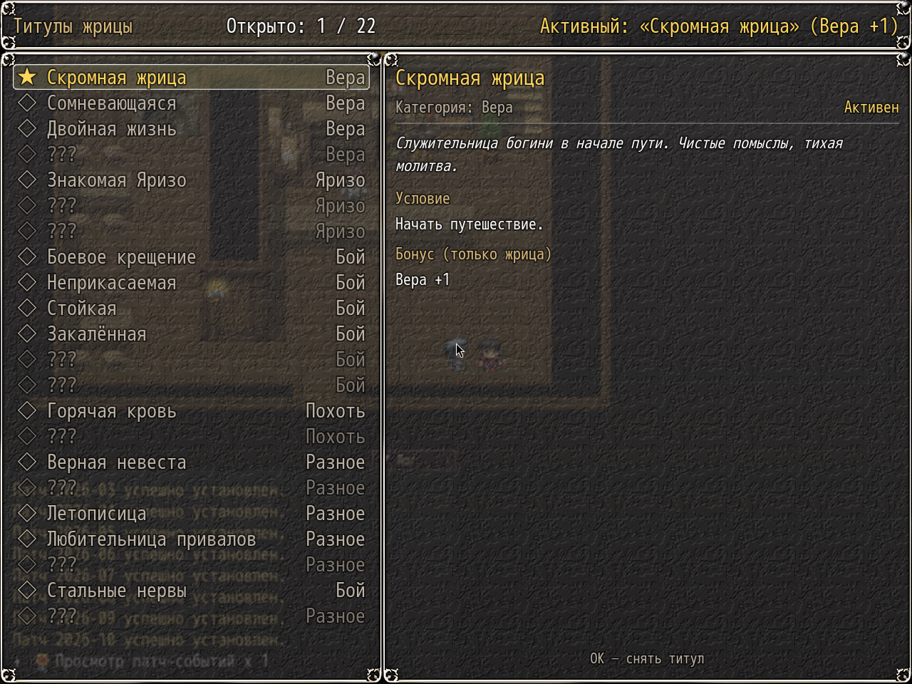
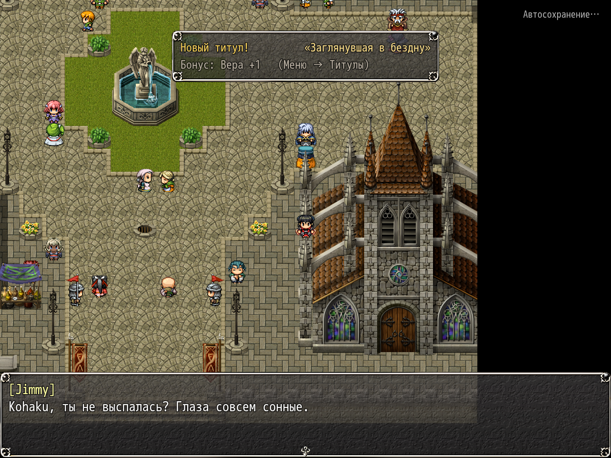

# NP_Titles

## Название

Титулы жрицы, один надетый бонус.

## Версия

1.0 (`@plugindesc`).

## Назначение

Жрица (актёр 2) собирает титулы. Команда меню открывает список открытых и закрытых: закрытые с подсказкой показаны как `???`. Справа описание, условие, прогресс и бонус. OK надевает или снимает титул. Активен только один, и бонус действует только на неё.

Новый титул показывает короткое окно сверху. Оно не блокирует ввод. Проверка идёт после боя (переключатель 14 гаснет), после смены карты и примерно раз в две секунды на карте. Во время самого боя ничего не открывается. В галерее ничего не считается и бонус не действует.

Двадцать титулов по разделам:

- Вера: Скромная жрица (старт), Сомневающаяся, Двойная жизнь, Падшая святая (стадии Яризо 1–3).
- Яризо: Знакомая (договор), Любимица (связь 5), Ночная гостья (5 ночных отлучек).
- Бой: Боевое крещение (первая победа), Неприкасаемая (10 побед подряд без приставаний), Стойкая (20 побед, в которых приставали), Закалённая (100 побед), Гроза чудовищ (четыре уникальных), Рваная, но живая (победа при максимальном порванном облачении).
- Похоть: Горячая кровь (порог 10 раз), Неутолимая (похоть 200).
- Разное: Верная невеста (любовь 150), Пляжная красотка, Летописица (все записи дневника), Любительница привалов (20 разговоров), Заглянувшая в бездну (увиден мрачный финал).

Титулы Яризо требуют `NP_PriestessDiary.yarizoMet()`. Бонусы — небольшие плоские прибавки к параметрам (и штраф веры у Падшей святой и Неутолимой). Состояние — `$gameSystem._npTitles`. Команды: `NpTitles open`, `check`, `unlock <id>`.

## Порядок загрузки

После `NP_Campfire`, перед `NP_ClothDamage`. Ставьте до `NP_Stress`. Активный титул дописывается в блок дневника, поэтому `NP_PriestessDiary` уже должен быть загружен. Титул «Рваная, но живая» скрыт, пока нет `NP_ClothDamage`.

## Параметры

- **Popup** `true` — подпись **Уведомления о титулах**.
- **Menu Label** `Титулы` — пустое значение прячет команду главного меню.

## Требования

Windows, **Alpha 0.80j**. Из скачанного ZIP запустите `install.bat` и укажите папку `www` игры. Категории в общем README — не порядок загрузки.

## Установка

Скопируйте `NP_Titles.js` в `www/js/plugins/` игры. Имя файла должно остаться `NP_Titles.js`. В менеджере плагинов включите его в порядке из раздела [Порядок загрузки](#порядок-загрузки). RPG Maker MV читает плагины из `www/js/plugins/`, а не из папки `plugins/NP_Titles/` в этом репозитории.

## Скриншоты

В шапке — сколько титулов открыто и какой сейчас активен. Закрытые строки подписаны `???`. Справа у **Скромной жрицы** описание, условие, бонус веры и пометка, что титул надет. OK снимает его.

Тост титула виден на утреннем кадре. Само меню титулов — другой, уже лежащий здесь снимок.
